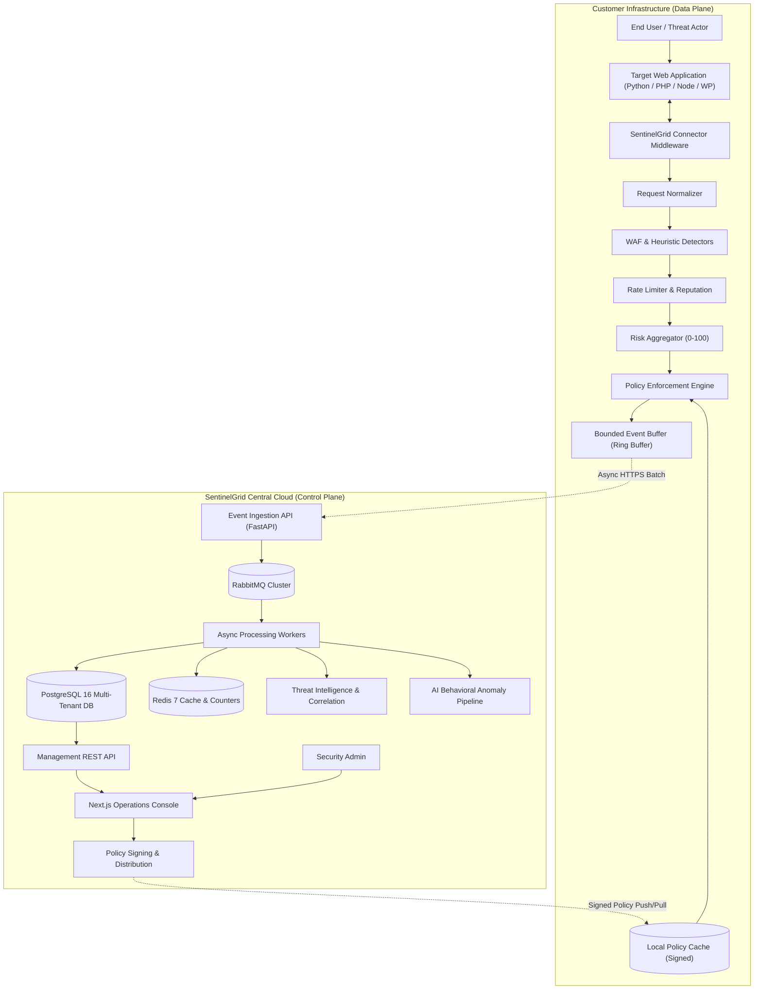

# SentinelGrid — System Architecture Specification (v1.0)

## 1. Executive Summary & Product Scope
SentinelGrid is a multi-tenant, cloud-managed Web Application Security Platform designed to protect web applications locally while leveraging a centralized cloud control plane for threat intelligence, analytics, policy management, and explainable AI-assisted anomaly detection.

Rather than acting as a simple inline firewall or proxy, SentinelGrid decouples:
1. **Customer-Side Data Plane**: Embedded framework middleware or local agents inspecting traffic locally in milliseconds without passing user payload bodies to external servers.
2. **Central Cloud Control Plane**: High-throughput asynchronous ingestion cluster providing threat aggregation, digital policy signing, incident correlation, and operational dashboards.

## 2. Architecture Principles
- **Sub-10ms Local Execution**: The connector must evaluate rules, local rate limits, and calculate risk in under 10ms (p95 target <= 5ms).
- **Privacy by Design**: Sensitive parameters (`password`, `token`, `secret`, `authorization`, `cookie`, `card`, `cvv`) are strictly stripped or masked before security events leave the client's perimeter.
- **Fail-Open Resilience**: If the cloud control plane, Redis, or local event buffers experience outages, the local connector maintains web application availability using the last-known-good digitally signed policy.
- **Explainable Scoring**: All decisions are backed by deterministic, explainable mathematical formulas rather than black-box AI scores.
- **Modular Monolith First**: The central backend is architected as a modular Python/FastAPI monolith with clear bounded contexts, asynchronous workers, and event queues, avoiding premature microservice complexity.
