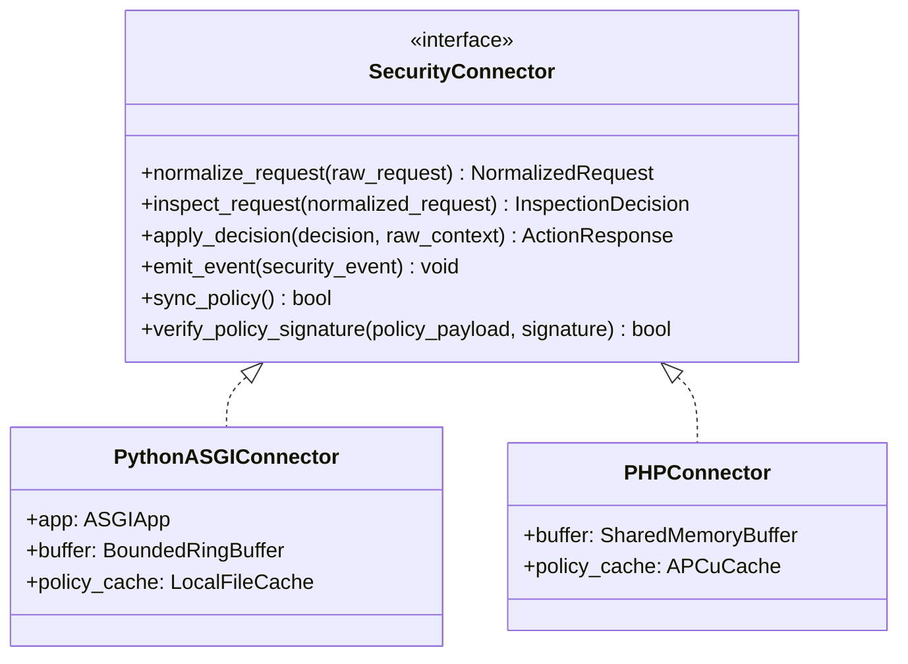

# SentinelGrid Connector Architecture & Interface Specification

## 1. Connector Responsibilities
A SentinelGrid Connector is an integration module running directly inside the customer's application or web server environment. It acts as the local **data plane**.



## 2. Standard Connector Interface Contract

```python
from abc import ABC, abstractmethod
from typing import Optional, Dict, Any

class NormalizedRequest:
    method: str
    path: str
    client_ip: str
    headers: Dict[str, str]
    query_params: Dict[str, str]
    body_peek: bytes
    body_size: int

class InspectionDecision:
    action: str  # "allow", "monitor", "challenge", "block"
    risk_score: float
    matched_rule_ids: list[str]
    challenge_payload: Optional[str]
    block_message: Optional[str]

class SecurityConnector(ABC):
    @abstractmethod
    def normalize_request(self, raw_request: Any) -> NormalizedRequest:
        """Extracts and sanitizes request data into standard normalized format."""
        pass

    @abstractmethod
    def inspect_request(self, normalized_request: NormalizedRequest) -> InspectionDecision:
        """Executes WAF rules, rate limiting, and risk scoring."""
        pass

    @abstractmethod
    def apply_decision(self, decision: InspectionDecision, raw_context: Any) -> Optional[Any]:
        """Halts execution and returns HTTP 403/429 if blocked/challenged; otherwise passes through."""
        pass

    @abstractmethod
    def emit_event(self, event: Dict[str, Any]) -> None:
        """Pushes sanitized event into the thread-safe local ring buffer."""
        pass

    @abstractmethod
    def sync_policy(self) -> bool:
        """Polls cloud control plane for updated signed policy; verifies cryptographic signature."""
        pass
```

## 3. Cryptographic Policy Verification
Policies distributed from the control plane are signed using HMAC-SHA256 (or Ed25519) with the shared secret provisioned during connector onboarding:

$$\text{Signature} = \text{HMAC-SHA256}(K_{\text{secret}}, \text{CanonicalJSON}(\text{policy}))$$

When receiving a policy update:
1. Re-serialize the policy payload to canonical JSON (sorted keys, no extraneous whitespace).
2. Compute the expected HMAC using the local connector secret.
3. Compare in constant-time (`hmac.compare_digest`).
4. If invalid, **reject update**, retain last-known-good policy from local cache, and fire a tamper alert event.

## 4. Fault Tolerance & Memory Protection
- **Bounded In-Memory Ring Buffer**: Default capacity of 5,000 events. If the buffer is full (e.g. cloud ingestion outage), the connector drops oldest non-critical events, increments an internal `dropped_events_counter`, and ensures host application memory never leaks.
- **Fail-Open by Default**: An uncaught exception within connector inspection MUST NEVER crash the customer website. The request is allowed through, and a fallback error metric is logged.
