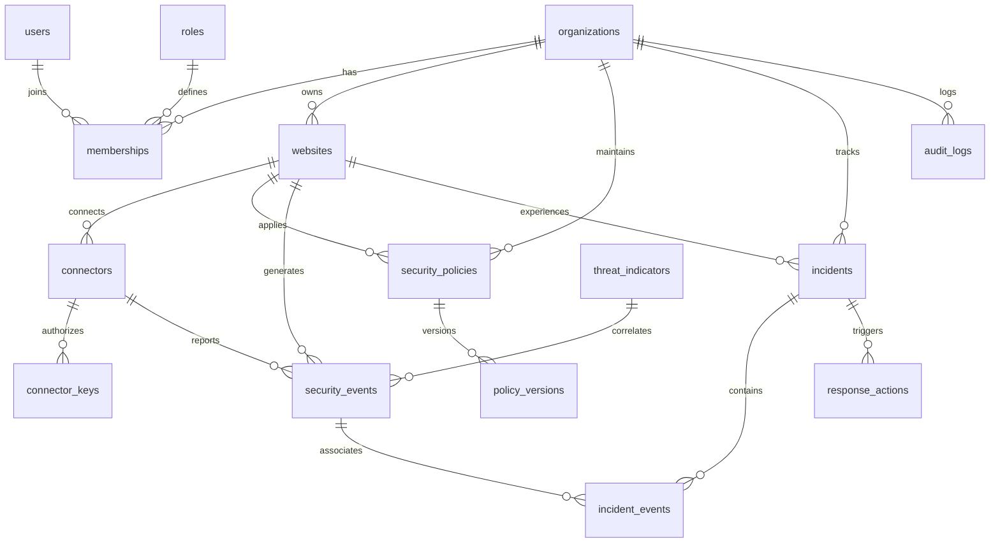

# SentinelGrid Database Architecture Specification

## 1. Relational Database Design
SentinelGrid utilizes **PostgreSQL 16** as the primary system of record. High-volume entity tables (`security_events`) utilize native PostgreSQL declarative table partitioning by range (`timestamp`).

## 2. Table Specifications

### `organizations`
Primary tenant container.
- `id` (UUID, PK)
- `name` (VARCHAR 255, NOT NULL)
- `slug` (VARCHAR 100, UNIQUE, NOT NULL)
- `status` (VARCHAR 50, DEFAULT 'active')
- `plan_tier` (VARCHAR 50, DEFAULT 'starter')
- `created_at` (TIMESTAMPTZ, DEFAULT NOW())
- `updated_at` (TIMESTAMPTZ, DEFAULT NOW())

### `websites`
Web applications enrolled for protection.
- `id` (UUID, PK)
- `organization_id` (UUID, FK -> organizations.id, NOT NULL)
- `name` (VARCHAR 255, NOT NULL)
- `domain` (VARCHAR 255, NOT NULL)
- `environment` (VARCHAR 50, DEFAULT 'production')
- `status` (VARCHAR 50, DEFAULT 'active')
- `created_at` (TIMESTAMPTZ, DEFAULT NOW())
- `updated_at` (TIMESTAMPTZ, DEFAULT NOW())

### `connectors`
Registered connector instances running on customer infrastructure.
- `id` (UUID, PK)
- `website_id` (UUID, FK -> websites.id, NOT NULL)
- `connector_type` (VARCHAR 50, NOT NULL: `python`, `php`, `wordpress`, `nodejs`, `agent`)
- `version` (VARCHAR 50, NOT NULL)
- `hostname` (VARCHAR 255)
- `ip_address` (INET)
- `last_heartbeat_at` (TIMESTAMPTZ)
- `status` (VARCHAR 50, DEFAULT 'active')
- `created_at` (TIMESTAMPTZ, DEFAULT NOW())

### `connector_keys`
API credentials for connector authentication and HMAC verification.
- `id` (UUID, PK)
- `connector_id` (UUID, FK -> connectors.id, NOT NULL)
- `key_id` (VARCHAR 64, UNIQUE, NOT NULL)
- `secret_hash` (VARCHAR 255, NOT NULL)
- `revoked` (BOOLEAN, DEFAULT FALSE)
- `expires_at` (TIMESTAMPTZ)
- `created_at` (TIMESTAMPTZ, DEFAULT NOW())

### `security_policies`
Policy configuration profiles.
- `id` (UUID, PK)
- `organization_id` (UUID, FK -> organizations.id, NOT NULL)
- `website_id` (UUID, FK -> websites.id, NOT NULL)
- `name` (VARCHAR 255, NOT NULL)
- `current_version` (INT, DEFAULT 1)
- `mode` (VARCHAR 50, DEFAULT 'active_protection')
- `created_at` (TIMESTAMPTZ, DEFAULT NOW())
- `updated_at` (TIMESTAMPTZ, DEFAULT NOW())

### `policy_versions`
Immutable, cryptographically signed policy payloads.
- `id` (UUID, PK)
- `policy_id` (UUID, FK -> security_policies.id, NOT NULL)
- `version` (INT, NOT NULL)
- `payload` (JSONB, NOT NULL)
- `signature` (VARCHAR 512, NOT NULL)
- `signature_algorithm` (VARCHAR 50, DEFAULT 'HMAC-SHA256')
- `created_by` (UUID, FK -> users.id)
- `created_at` (TIMESTAMPTZ, DEFAULT NOW())

### `security_events` (Partitioned by Range on `timestamp`)
High-volume sanitized security telemetry.
- `id` (UUID, NOT NULL)
- `timestamp` (TIMESTAMPTZ, NOT NULL)
- `organization_id` (UUID, NOT NULL)
- `website_id` (UUID, NOT NULL)
- `connector_id` (UUID, NOT NULL)
- `client_ip` (INET, NOT NULL)
- `client_ip_hash` (VARCHAR 64)
- `country_code` (CHAR 2)
- `user_agent` (VARCHAR 512)
- `method` (VARCHAR 10, NOT NULL)
- `path` (VARCHAR 2048, NOT NULL)
- `risk_score` (NUMERIC(5,2), NOT NULL)
- `action_taken` (VARCHAR 20, NOT NULL)
- `http_status` (INT)
- `execution_duration_ms` (NUMERIC(8,3))
- `detection_data` (JSONB)
- `request_metadata` (JSONB)
- PRIMARY KEY (`id`, `timestamp`)

### `threat_indicators`
Global and tenant threat intelligence feed.
- `id` (UUID, PK)
- `indicator_type` (VARCHAR 50, NOT NULL: `ip`, `cidr`, `asn`, `user_agent_pattern`)
- `indicator_value` (VARCHAR 255, NOT NULL)
- `reputation_score` (INT, DEFAULT 0)
- `source` (VARCHAR 100, NOT NULL)
- `confidence` (NUMERIC(3,2), DEFAULT 1.0)
- `expires_at` (TIMESTAMPTZ)
- `created_at` (TIMESTAMPTZ, DEFAULT NOW())

### `incidents`
Aggregated security incidents grouping related events.
- `id` (UUID, PK)
- `organization_id` (UUID, NOT NULL)
- `website_id` (UUID, NOT NULL)
- `title` (VARCHAR 255, NOT NULL)
- `severity` (VARCHAR 20, NOT NULL: `low`, `medium`, `high`, `critical`)
- `status` (VARCHAR 30, DEFAULT 'open': `open`, `investigating`, `mitigated`, `resolved`, `false_positive`)
- `category` (VARCHAR 50, NOT NULL)
- `event_count` (INT, DEFAULT 1)
- `first_seen_at` (TIMESTAMPTZ, NOT NULL)
- `last_seen_at` (TIMESTAMPTZ, NOT NULL)
- `summary` (TEXT)
- `created_at` (TIMESTAMPTZ, DEFAULT NOW())
- `updated_at` (TIMESTAMPTZ, DEFAULT NOW())

### `incident_events`
Junction table linking events to incidents.
- `incident_id` (UUID, NOT NULL)
- `event_id` (UUID, NOT NULL)
- `event_timestamp` (TIMESTAMPTZ, NOT NULL)
- PRIMARY KEY (`incident_id`, `event_id`, `event_timestamp`)
