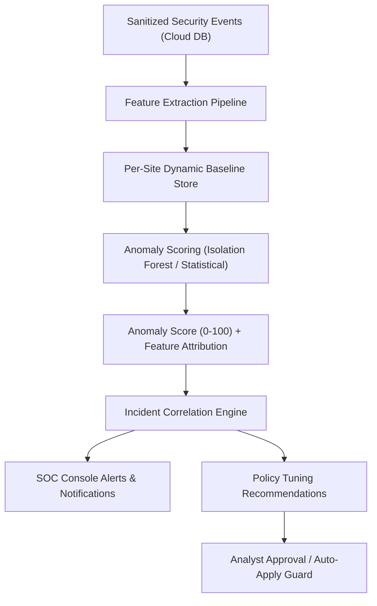

# SentinelGrid AI-Based Behavioral Anomaly Detection

## 1. Overview & Phased Architecture
SentinelGrid employs a hybrid security paradigm: **deterministic rules** provide low-latency edge protection, while **cloud-side machine learning** analyzes aggregated telemetry to detect subtle, distributed, and zero-day abuse patterns.



## 2. Multi-Stage AI Roadmap

| Stage | Technology | Focus | Deployment |
|---|---|---|---|
| **AI 1: Statistical Baselines** | Rolling mean, standard deviation, IQR, z-score | Per-site hourly request rates, typical 4xx/5xx ratios, path cardinality. | Production Day 1 |
| **AI 2: Isolation Forest** | `scikit-learn` IsolationForest with tree depth tuning | Multivariate outlier detection over 7-dimensional behavioral windows. | Milestone 13 |
| **AI 3: Behavioral Clustering** | DBSCAN / MiniBatch KMeans | Grouping traffic by client behavioral clusters (scrapers vs humans). | Milestone 14 |
| **AI 4: Time-Series Forecasting** | Holt-Winters Exponential Smoothing / Prophet | Predicting expected diurnal traffic curves to detect stealthy low-and-slow DDoS. | Milestone 14 |
| **AI 5: Sequence Modeling** | Markov Chains / Lightweight LSTM | Detecting anomalous state transitions (e.g. accessing `/checkout` without `/cart`). | Future Release |

## 3. Feature Vector Specification (7 Core Dimensions)
Every 5-minute sliding analysis window per client group / IP evaluates:

```json
{
  "requests_per_minute": 240,
  "unique_paths": 12,
  "failed_logins": 35,
  "http_4xx_ratio": 0.42,
  "sensitive_endpoint_ratio": 0.65,
  "unique_user_agents": 2,
  "request_rate_change": 3.8
}
```

- `requests_per_minute` (Float): Average request rate in the current window.
- `unique_paths` (Int): Distinct URL endpoints requested.
- `failed_logins` (Int): Count of HTTP 401/403 responses on authentication routes.
- `http_4xx_ratio` (Float $\in [0, 1]$): Proportion of client requests triggering 4xx errors.
- `sensitive_endpoint_ratio` (Float $\in [0, 1]$): Proportion targeting high-value paths.
- `unique_user_agents` (Int): Number of distinct User-Agent headers presented.
- `request_rate_change` (Float): Ratio of current rate relative to historical site baseline.

## 4. Safety & Governance Principles
1. **No Autonomous Blocking on Outliers**: Anomaly scores contribute to incident elevation and operator alerts. Automated blocking requires either corroborating deterministic signatures or an active customer-approved automated remediation rule.
2. **Cold Start Protection**: Newly onboarded websites (< 7 days of history) use industry-wide conservative heuristics rather than triggering false-positive alerts due to lack of historical baselines.
3. **Model Explainability**: Every anomaly alert includes feature SHAP/importance scores indicating exactly which dimensions drove the outlier rating.
4. **Data Privacy**: ML pipelines consume only sanitized telemetry; raw request bodies and personally identifiable information (PII) are strictly excluded from training.
