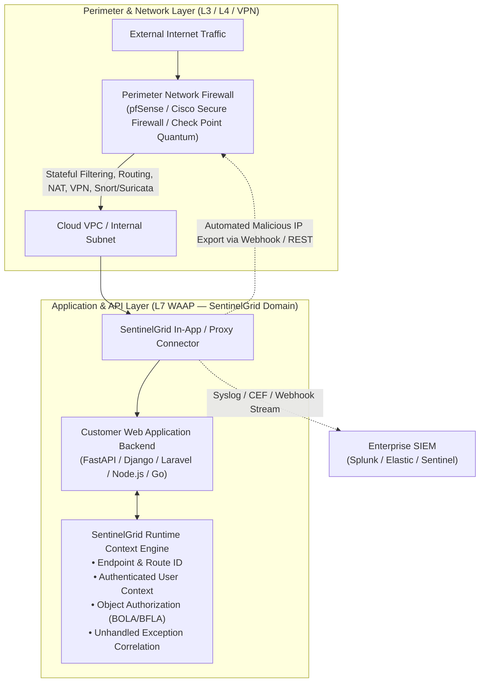

# SentinelGrid — Strategic Market Positioning & Competitive Architecture
## Comparative Analysis: SentinelGrid vs. pfSense vs. Cisco Secure Firewall vs. Check Point Quantum

---

## 1. Executive Summary & Market Positioning
SentinelGrid is an **Application-Aware Web Application and API Protection (WAAP) platform**. It is **not** a general-purpose network firewall, router, or VPN gateway.

The comparison with **pfSense** is especially instructive:
- **pfSense** demonstrates what an open-source, flexible, and cost-effective FreeBSD-based network platform can deliver: stateful packet filtering, NAT, CARP high availability, WireGuard/IPsec/OpenVPN, and optional IDS/IPS packages (Snort/Suricata).
- Attempting to build an "affordable network firewall with AI" is an unviable strategy because pfSense/OPNsense already fulfills that role at near-zero software cost.
- Similarly, attempting to replicate the massive enterprise hardware footprints of **Cisco Secure Firewall** (FMC/FTD) or **Check Point Quantum** would cause fatal scope bloat.

### The Clear Division of Labor

SentinelGrid operates **above and alongside** perimeter firewalls. Network firewalls guard the perimeter; SentinelGrid protects application logic, APIs, and business workflows.

---

## 2. Four-Way Architectural Comparison

| Dimension | SentinelGrid WAAP | pfSense (Netgate) | Cisco Secure Firewall | Check Point Quantum |
|---|---|---|---|---|
| **Primary Architectural Role** | **Application & API Protection (L7 WAAP)** | **Network Firewall, Router & VPN (L3/L4)** | **Enterprise Network NGFW & Threat Gateway** | **Enterprise Network NGFW & Threat Prevention** |
| **Network Routing & NAT** | *Out of Scope (Deferred)* | **Core Capability** (BGP, OSPF, static, NAT) | **Core Capability** | **Core Capability** |
| **VPN & Connectivity** | *Out of Scope (Deferred)* | **Core Capability** (WireGuard, OpenVPN, IPsec) | **Core Capability** (AnyConnect, IPsec) | **Core Capability** (Remote Access, IPsec) |
| **Network IDS/IPS** | *Out of Scope* | Supported via Snort / Suricata packages | Core Snort 3 Network IPS | Core ThreatCloud IPS blades |
| **Web Request Inspection (WAF)** | **Core P0 WAAP**: Normalization, full OWASP Top 10 | Available via HAProxy package / basic rules | Network AppID; not a specialized in-app WAF | Dedicated CloudGuard add-on portfolio |
| **API Discovery & Inventory** | **Core P0**: Auto-discovery of endpoints, shadow APIs | Not a built-in capability | Limited AppID protocol classification | Separate CloudGuard AppSec add-on |
| **OpenAPI Schema Validation** | **Core P0**: In-line OpenAPI 3.0/3.1 contract enforcement | Not supported | Not supported | Separate CloudGuard AppSec module |
| **Application Context & RASP** | **Differentiator 1**: In-app hooks (route, user auth, unhandled 500s) | No internal application execution context | No internal application execution context | Requires separate runtime agent |
| **False-Positive Management** | **Differentiator 2**: Dry-run simulation on historical events + 1-click rollback | Manual rule tuning | Manual suppression lists | Rule exception management |
| **Explainable Reversible Response** | **Differentiator 3**: Auto-actions with evidence, blast-radius & TTL expiry | Manual/automated firewall table blocks | Automated shun via FMC / ISE | ThreatCloud automated drop |
| **Continuous Validation** | **Differentiator 4**: Attack replay & regression testing sandbox | Not a built-in feature | Requires external test tools | Requires external test tools |
| **GenAI / LLM Guardrails** | **Core P2**: Prompt injection detection, tool-call auth | Not supported | Not supported | Add-on modules |
| **Deployment Footprint** | Lightweight in-app middleware or sidecar container | Dedicated hardware appliance or FreeBSD VM | Heavy hardware appliance or VM | Heavy hardware appliance or VM |

---

## 3. How SentinelGrid Integrates with pfSense, Cisco & Check Point

Rather than competing with network firewalls, SentinelGrid provides **bi-directional perimeter integration**:

1. **pfSense Alias Integration (`pfBlockerNG` / URL Tables)**:
   - SentinelGrid publishes an authenticated HTTP JSON / text endpoint listing confirmed, active high-confidence attacker IPs with TTL.
   - pfSense consumes this as a **URL Table Alias**, allowing pfSense to drop malicious traffic at the network interface before it ever consumes application CPU or bandwidth.
2. **Cisco Secure Firewall Management Center (FMC) Integration**:
   - SentinelGrid emits CEF (Common Event Format) syslog messages over TLS to FMC or Cisco Defense Orchestrator (CDO).
   - High-severity incidents trigger Cisco FMC REST API calls to update dynamic threat objects.
3. **Check Point SmartConsole & Splunk Integration**:
   - SentinelGrid forwards normalized security events to Check Point Log Server or Splunk via standard Syslog / Webhooks.

---

## 4. What SentinelGrid Explicitly Does NOT Build

To maintain engineering discipline and prevent project failure, SentinelGrid will **never**:
1. Build stateful layer 3/4 packet inspection or state tracking.
2. Build IPsec, OpenVPN, or WireGuard VPN servers.
3. Build BGP/OSPF dynamic routing or DHCP servers.
4. Manufacture physical hardware firewall appliances.

SentinelGrid is 100% focused on **application-aware L7 web, API, and GenAI security**.
