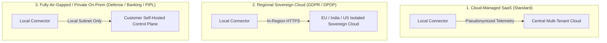

# SentinelGrid — Global Legal, Regulatory & Cross-Border Compliance Framework

> **Status**: Mandatory Architectural Governance  
> **Applicability**: All Connectors, Cloud Services, Telemetry Pipelines, and Response Engines  
> **Jurisdictional Objective**: Ensure SentinelGrid is **strictly legal and compliant across all major global jurisdictions** (European Union, United States, United Kingdom, India, Singapore, Australia, Canada, Brazil, UAE/GCC, and East Asia).

---

## 1. Executive Summary & Core Legal Tenet
SentinelGrid is designed as a **strictly defensive, passive-interception, privacy-preserving Web Application & API Protection (WAAP)** system. 

To maintain global legality:
1. **Zero Offensive Actions ("No Hack-Back")**: SentinelGrid operates strictly within the customer's owned or authorized digital boundary. It never launches counter-probes, reverse port scans, or retaliatory payloads against threat actor IP addresses.
2. **Zero Sensitive Payload Retention**: Raw passwords, session tokens, personal identity numbers, and credit cards are masked locally at the ingestion boundary before telemetry is buffered or transmitted.
3. **Data Sovereignty & Local Enforcement**: Traffic decisions are executed locally on the customer's infrastructure. No cross-border telemetry transmission is required for core blocking and protection to function.

---

## 2. Jurisdictional Privacy & Data Protection Compliance

### 2.1 European Union (GDPR - Regulation (EU) 2016/679 & ePrivacy Directive)
- **Legal Challenge**: Under CJEU *Breyer v. Bundesrepublik Deutschland* (C-582/14), dynamic IP addresses are classified as personal data (PII). Transmitting raw IP addresses or request bodies outside the EEA violates GDPR Articles 44–49 (Schrems II).
- **SentinelGrid Architectural Safeguard**:
  1. **Pseudonymization at Source**: The connector computes a salted, rotating cryptographic HMAC hash of the client IP (`client_ip_hash`) for general threat telemetry.
  2. **Data Minimization (Art. 5(1)(c))**: Request bodies are never mirrored to the cloud. Only metadata, matched rule IDs, normalized URIs, and risk scores are transmitted.
  3. **Strict Parameter Masking**: Sensitive fields (`password`, `authorization`, `cookie`, `token`, `ssn`, `card_number`) are redacted locally to `[REDACTED_SENSITIVE]`.
  4. **Legal Basis**: Processing is justified under **Article 6(1)(f) GDPR (Legitimate Interest)** — specifically Recital 49, which explicitly states that the processing of personal data to the extent strictly necessary and proportionate for the purpose of ensuring network and information security constitutes a legitimate interest.
  5. **Data Subject Rights (Art. 15–17)**: Automated TTL purge policies ensure security logs expire and are deleted within configurable retention limits (default 30–90 days).

### 2.2 United States (CCPA/CPRA, ECPA, Wiretap Act 18 U.S.C. § 2511)
- **Legal Challenge**: The federal Wiretap Act prohibits unauthorized interception of electronic communications. State privacy laws (CCPA/CPRA) restrict sharing personal identifiers.
- **SentinelGrid Architectural Safeguard**:
  1. **System Administrator Exemption (18 U.S.C. § 2511(2)(a)(i))**: SentinelGrid is installed directly by the system operator (the website owner), who has explicit statutory authority to monitor communications on their own facilities to protect their rights and property.
  2. **No "Sale" of Personal Information**: Telemetry is strictly scoped to the tenant organization. Indicators shared globally are anonymized threat vectors (e.g., malicious payload signatures and known public scanner CIDRs) containing zero customer user identities.

### 2.3 India (Digital Personal Data Protection Act 2023 - DPDP & IT Act 2000)
- **Legal Challenge**: DPDP Act mandates explicit consent or legitimate use for processing personal data, while Section 43/66 of the IT Act penalizes unauthorized access.
- **SentinelGrid Architectural Safeguard**:
  1. Processing qualifies under **Section 7(b) DPDP Act (Legitimate Use for Information Security)**.
  2. Data localization support: The control plane backend can be deployed entirely within Indian data centers (e.g. AWS ap-south-1 Mumbai/Hyderabad) to satisfy sector-specific data residency requirements (RBI, CERT-In guidelines).
  3. CERT-In Direction 2022 Compliance: 6-hour cybersecurity incident reporting readiness via automated SIEM webhooks.

### 2.4 China (Personal Information Protection Law - PIPL & Data Security Law - DSL)
- **Legal Challenge**: Strict cross-border data transfer security assessments (CAC approval) and data localization mandates for critical information infrastructure operators (CIIOs).
- **SentinelGrid Architectural Safeguard**:
  1. **Air-Gapped / Private Cloud Mode**: SentinelGrid supports 100% self-hosted deployment where PostgreSQL, Redis, RabbitMQ, and the control plane reside strictly within China's borders.
  2. Zero telemetry leaves the local boundary when running in standalone mode.

### 2.5 Brazil (LGPD), Singapore (PDPA), Australia (Privacy Act 1988)
- SentinelGrid's default data minimization, automated pseudonymization, and bounded retention ensure immediate compatibility with LGPD, Singapore PDPA, and Australian Privacy Principles (APPs).

---

## 3. Computer Misuse & Anti-Hacking Laws: The "No Hack-Back" Rule

| Jurisdiction | Statute | Legal Risk | SentinelGrid Compliance Control |
|---|---|---|---|
| **United States** | Computer Fraud and Abuse Act (CFAA) 18 U.S.C. § 1030 | Accessing or damaging external computers without authorization | **Strictly Passive**: Connectors only drop, reject, rate-limit, or challenge incoming traffic. Zero outbound scans or exploit payloads. |
| **United Kingdom** | Computer Misuse Act 1990 (Sections 1–3) | Unauthorized acts with intent to impair computer operations | No active counter-probing of threat actors. IP reputation is aggregated passively. |
| **India** | Information Technology Act 2000 (§ 43, § 66) | Unauthorized interception or source code tampering | Connectors inspect incoming traffic on customer's own host only. |
| **Singapore** | Cybersecurity Act 2018 & Computer Misuse Act | Impairing operation of foreign systems | All threat mitigation is strictly internal (HTTP 403, 429, CAPTCHA). |
| **International** | Budapest Convention on Cybercrime (ETS No. 185) | Cross-border offensive digital operations | SentinelGrid is classified as purely defensive software. |

> [!CAUTION]
> **Strict Legal Mandate**: SentinelGrid developers and modules MUST NEVER implement features that send unsolicited probe requests, exploit payloads, or automated retaliation back to an attacking IP. Doing so constitutes a criminal offense under the CFAA, CMA, and international cyber legislation.

---

## 4. Cryptographic Export Controls (Wassenaar Arrangement & US EAR)
- **Regulatory Framework**: Dual-use export controls restrict the cross-border distribution of advanced cryptanalytic tools and high-assurance military cryptography under Category 5, Part 2 of the Commerce Control List (CCL).
- **SentinelGrid Compliance**:
  1. SentinelGrid utilizes **standard, publicly documented, non-proprietary cryptographic algorithms**:
     - **HMAC-SHA256 / SHA-384** (FIPS 198-1)
     - **Ed25519** (RFC 8032) for asymmetric digital signatures
     - **AES-256-GCM** (NIST SP 800-38D) for data at rest
  2. **Publicly Available / Mass Market Exemption**: Under US Export Administration Regulations (EAR 15 C.F.R. § 742.15(b)) and equivalent European Dual-Use Regulation (EU 2021/821), open and standard security management software using publicly available cryptographic libraries qualifies for license exemptions (NLR - No License Required).

---

## 5. Deployment Flexibility for Global Sovereign Compliance

SentinelGrid provides three deployment topologies to comply with any customer's national legal constraints:

1. **Multi-Tenant SaaS**: Ideal for international commercial businesses conforming to standard GDPR/CCPA data transfer frameworks (Standard Contractual Clauses - SCCs).
2. **Dedicated Regional Cloud**: Dedicated control plane deployed in the customer's jurisdiction (e.g. Frankfurt for EU, Mumbai for India, Ashburn for US) with zero cross-border data replication.
3. **Air-Gapped / Private Self-Hosted**: 100% on-premises deployment for defense, critical national infrastructure, banking, or entities subject to strict data localization laws where data cannot touch public cloud infrastructure.

---

## 6. Audit & Compliance Certification Mapping

SentinelGrid is built to assist customers in fulfilling mandatory security compliance controls:

- **PCI-DSS v4.0 Requirement 6.4.1 & 6.4.2**: Requires an automated technical solution (WAF/WAAP) to detect and prevent web-based attacks on public-facing web applications.
- **SOC 2 Type II (Trust Services Criteria)**: Security, Availability, and Confidentiality controls backed by tamper-evident audit logs and signed policies.
- **HIPAA Security Rule (45 C.F.R. Part 164)**: Technical safeguards for electronic protected health information (ePHI) via strict request sanitization and encryption at rest/transit.
- **ISO/IEC 27001:2022 Control A.8.26 & A.8.28**: Application security requirements and secure coding validation.
