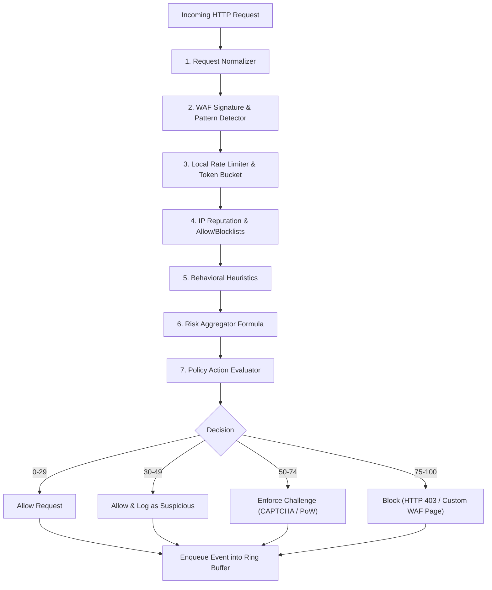

# SentinelGrid WAF & Risk Scoring Engine Specification

## 1. Engine Modules
The local security engine is embedded in the customer data plane (connector middleware or agent). It executes completely offline from the cloud API to make immediate sub-10ms blocking decisions.

## 2. Risk Scoring Formula
The risk score $R$ is an explainable composite score bounded in $[0, 100]$:

$$R = 0.35S + 0.20B + 0.15I + 0.15F + 0.15A$$

Where each component is normalized to $[0, 100]$:
1. **$S$ (Signature Detection Strength)**:
   - Sum of matched WAF rule contributions with diminishing returns:
     $$S = \min\left(100, \sum_{r \in \text{matches}} \text{risk\_contribution}(r) \times \text{confidence}(r)\right)$$
2. **$B$ (Behavioral Anomaly Score)**:
   - Evaluates deviation from established request patterns (e.g. abrupt change in path depth, non-browser header signatures).
3. **$I$ (Threat Intelligence & Reputation)**:
   - Sourced from active local threat cache (malicious CIDRs, Tor exit nodes, public VPNs, known scanners).
4. **$F$ (Frequency & Rate-Abuse Signal)**:
   - Token bucket saturation percentage over moving 10s and 60s windows.
5. **$A$ (Additional Contextual Evidence)**:
   - Sensitivity of endpoint targeted (e.g. `/wp-admin`, `/.env`, `/admin`, `/api/v1/auth/reset-password`).

## 3. Thresholds & Actions

| Score Range | Action | HTTP Response | Description |
|---|---|---|---|
| **0 – 29** | `allow` | Original upstream response | Benign traffic, sample 5% for baseline profiling. |
| **30 – 49** | `monitor` | Original upstream response | Minor anomalies; logged with complete telemetry. |
| **50 – 74** | `challenge` | HTTP 401 / 429 / Interactive Challenge | Elevated risk; prompt JavaScript challenge / CAPTCHA. |
| **75 – 100** | `block` | HTTP 403 Forbidden | Confirmed high-confidence threat; terminate request locally. |

## 4. Hard Override Rules
- **Allowlist Precedence**: Any client IP, path, or API key explicitly declared in the policy `allowlist` bypasses blocking (action forced to `allow` with `audit` flag).
- **Critical Signature Immediate Block**: A rule flagged as `critical` with confidence $\ge 0.95$ (e.g. active command injection payload `rm -rf /` or `/etc/shadow` extraction) sets $S = 100$, triggering immediate local blockage regardless of other weights.
