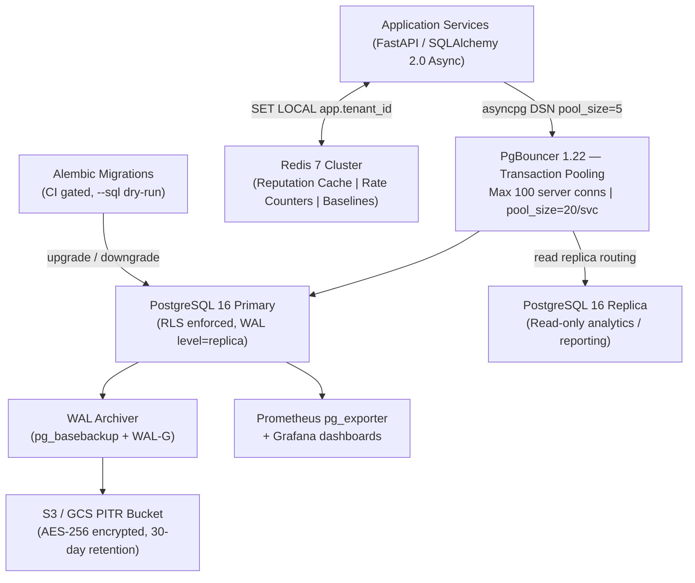

# Team Plan 01 — Database Architecture, Tenant Isolation & Storage Engineering

> **Owner**: Database & Storage Engineering Team (1 engineer)
> **Sprint Target**: M3 — PostgreSQL Data Layer & Tenant Isolation Complete
> **Key Dependents**: Team 02 (Security Engine), Team 03 (Ingestion), Team 04 (Policy API), Team 05 (Incidents), Team 06 (AI/ML)

---

## 1. Overview & Mission

The Database Team is the single source of truth for all persistent data in SentinelGrid. This team owns the complete PostgreSQL 16 relational schema, enforces strict row-level multi-tenant isolation (zero cross-tenant data leakage guaranteed at the database layer), manages Alembic migrations, maintains Redis 7 real-time data structures for sub-millisecond decisions, and operates PgBouncer connection pooling. Every design decision prioritises correctness, auditability, and GDPR-compliant data minimization over convenience.

**Core constraint**: Any query executed by any application service that returns data belonging to Tenant B when authenticated as Tenant A is a P0 security incident, not a bug.

---

## 2. Scope & Core Responsibilities

- Design, version, and migrate the canonical PostgreSQL 16 schema (DDL, indexes, partitioning).
- Author and enforce Row-Level Security (RLS) policies for every tenant-scoped table.
- Provide SQLAlchemy 2.0 async ORM models and `TenantScopedModel` base class consumed by all other teams.
- Maintain PgBouncer transaction-mode pooling configuration and connection-count budgets.
- Design Redis 7 data structures for real-time IP reputation, rate-limit counters, and baseline caches.
- Operate WAL-archiving-based Point-In-Time Recovery (PITR) to S3/GCS with ≤ 5-minute RPO.
- Write and gate Alembic migration scripts with `--sql` dry-run verification in CI.
- Document and enforce data-retention schedules (security_events: 90 days hot, 1 year cold archive).
- Evaluate and maintain TimescaleDB vs native PostgreSQL range partitioning decision.

---

## 3. Architecture Diagram



---

## 4. Full PostgreSQL 16 Schema DDL

### 4.1 Foundation Tables

```sql
-- Enable required extensions
CREATE EXTENSION IF NOT EXISTS "uuid-ossp";
CREATE EXTENSION IF NOT EXISTS "pgcrypto";
CREATE EXTENSION IF NOT EXISTS "pg_trgm";  -- fuzzy search on paths

-- ============================================================
-- ORGANIZATIONS (root tenant entity)
-- ============================================================
CREATE TABLE organizations (
    id                  UUID        PRIMARY KEY DEFAULT gen_random_uuid(),
    name                VARCHAR(255) NOT NULL,
    slug                VARCHAR(100) NOT NULL UNIQUE,          -- URL-safe identifier
    plan_tier           VARCHAR(50)  NOT NULL DEFAULT 'starter'  -- starter|pro|enterprise
                        CHECK (plan_tier IN ('starter','pro','enterprise')),
    billing_email       VARCHAR(255) NOT NULL,
    timezone            VARCHAR(60)  NOT NULL DEFAULT 'UTC',
    mfa_enforced        BOOLEAN     NOT NULL DEFAULT FALSE,
    sso_provider        VARCHAR(100),                           -- okta|azure_ad|google
    max_websites        SMALLINT    NOT NULL DEFAULT 5,
    is_active           BOOLEAN     NOT NULL DEFAULT TRUE,
    trial_ends_at       TIMESTAMPTZ,
    created_at          TIMESTAMPTZ NOT NULL DEFAULT NOW(),
    updated_at          TIMESTAMPTZ NOT NULL DEFAULT NOW()
);
CREATE INDEX idx_org_slug ON organizations (slug);

-- ============================================================
-- USERS
-- ============================================================
CREATE TABLE users (
    id                  UUID        PRIMARY KEY DEFAULT gen_random_uuid(),
    organization_id     UUID        NOT NULL REFERENCES organizations(id) ON DELETE CASCADE,
    email               VARCHAR(320) NOT NULL UNIQUE,
    hashed_password     TEXT,                                   -- NULL when SSO-only
    role                VARCHAR(50)  NOT NULL DEFAULT 'security_analyst'
                        CHECK (role IN ('super_admin','org_admin','security_analyst','read_only')),
    display_name        VARCHAR(255),
    is_active           BOOLEAN     NOT NULL DEFAULT TRUE,
    last_login_at       TIMESTAMPTZ,
    created_at          TIMESTAMPTZ NOT NULL DEFAULT NOW()
);
CREATE INDEX idx_users_org ON users (organization_id);
ALTER TABLE users ENABLE ROW LEVEL SECURITY;
CREATE POLICY users_tenant_isolation ON users
    USING (organization_id = current_setting('app.tenant_id')::UUID);

-- ============================================================
-- WEBSITES
-- ============================================================
CREATE TABLE websites (
    id                  UUID        PRIMARY KEY DEFAULT gen_random_uuid(),
    organization_id     UUID        NOT NULL REFERENCES organizations(id) ON DELETE CASCADE,
    domain              VARCHAR(253) NOT NULL,
    display_name        VARCHAR(255),
    connector_key_hash  VARCHAR(64),                            -- SHA-256 of connector API key
    connector_version   VARCHAR(20),
    openapi_spec_url    TEXT,
    environment         VARCHAR(30)  NOT NULL DEFAULT 'production'
                        CHECK (environment IN ('production','staging','development')),
    mode                VARCHAR(20)  NOT NULL DEFAULT 'monitor'
                        CHECK (mode IN ('monitor','block','off')),
    is_active           BOOLEAN     NOT NULL DEFAULT TRUE,
    created_at          TIMESTAMPTZ NOT NULL DEFAULT NOW(),
    updated_at          TIMESTAMPTZ NOT NULL DEFAULT NOW(),
    UNIQUE (organization_id, domain)
);
CREATE INDEX idx_websites_org ON websites (organization_id);
ALTER TABLE websites ENABLE ROW LEVEL SECURITY;
CREATE POLICY websites_tenant_isolation ON websites
    USING (organization_id = current_setting('app.tenant_id')::UUID);

-- ============================================================
-- API ENDPOINTS (Shadow & Zombie API Inventory)
-- ============================================================
CREATE TABLE api_endpoints (
    id                  UUID        PRIMARY KEY DEFAULT gen_random_uuid(),
    website_id          UUID        NOT NULL REFERENCES websites(id) ON DELETE CASCADE,
    organization_id     UUID        NOT NULL REFERENCES organizations(id) ON DELETE CASCADE,
    path_pattern        VARCHAR(2048) NOT NULL,
    http_method         VARCHAR(10)  NOT NULL CHECK (http_method IN ('GET','POST','PUT','PATCH','DELETE','HEAD','OPTIONS')),
    status              VARCHAR(50)  NOT NULL DEFAULT 'documented'
                        CHECK (status IN ('documented','shadow_detected','zombie_deprecated','deprecated')),
    parameters_schema   JSONB,
    response_schema     JSONB,
    first_seen_at       TIMESTAMPTZ NOT NULL DEFAULT NOW(),
    last_seen_at        TIMESTAMPTZ NOT NULL DEFAULT NOW(),
    request_count_24h   BIGINT       NOT NULL DEFAULT 0,
    risk_level          VARCHAR(20)  NOT NULL DEFAULT 'low'
                        CHECK (risk_level IN ('low','medium','high','critical')),
    notes               TEXT,
    UNIQUE (website_id, path_pattern, http_method)
);
CREATE INDEX idx_api_endpoints_site ON api_endpoints (website_id);
CREATE INDEX idx_api_endpoints_org  ON api_endpoints (organization_id);
CREATE INDEX idx_api_endpoints_status ON api_endpoints (status) WHERE status != 'documented';
ALTER TABLE api_endpoints ENABLE ROW LEVEL SECURITY;
CREATE POLICY api_endpoints_tenant_isolation ON api_endpoints
    USING (organization_id = current_setting('app.tenant_id')::UUID);
```

### 4.2 Security Events (Range-Partitioned by Month)

```sql
-- ============================================================
-- SECURITY EVENTS — partitioned by month (range on timestamp)
-- ============================================================
CREATE TABLE security_events (
    id                  UUID        NOT NULL DEFAULT gen_random_uuid(),
    organization_id     UUID        NOT NULL,
    website_id          UUID        NOT NULL,
    timestamp           TIMESTAMPTZ NOT NULL DEFAULT NOW(),
    -- Request identity
    client_ip           INET        NOT NULL,
    client_asn          INT,
    client_country      CHAR(2),
    user_agent          TEXT,
    -- Request details
    http_method         VARCHAR(10),
    request_path        VARCHAR(4096),
    request_headers     JSONB,
    -- Detection results
    risk_score          SMALLINT    NOT NULL DEFAULT 0 CHECK (risk_score BETWEEN 0 AND 100),
    action_taken        VARCHAR(20) NOT NULL CHECK (action_taken IN ('allow','block','challenge','monitor')),
    triggered_rules     TEXT[]      NOT NULL DEFAULT '{}',
    attack_categories   TEXT[]      NOT NULL DEFAULT '{}',
    -- DLP flags
    dlp_triggered       BOOLEAN     NOT NULL DEFAULT FALSE,
    dlp_types           TEXT[]      NOT NULL DEFAULT '{}',
    -- Connector context
    connector_version   VARCHAR(20),
    response_status     SMALLINT,
    PRIMARY KEY (id, timestamp)        -- composite PK required for partitioned tables
) PARTITION BY RANGE (timestamp);

-- Create monthly partitions for the next 12 months (automate via pg_partman or cron)
CREATE TABLE security_events_2025_01 PARTITION OF security_events
    FOR VALUES FROM ('2025-01-01') TO ('2025-02-01');
CREATE TABLE security_events_2025_02 PARTITION OF security_events
    FOR VALUES FROM ('2025-02-01') TO ('2025-03-01');
-- ... (additional months auto-created by partition management worker)

-- Indexes on the parent table propagate to all partitions
CREATE INDEX idx_sevents_org_ts      ON security_events (organization_id, timestamp DESC);
CREATE INDEX idx_sevents_website_ts  ON security_events (website_id, timestamp DESC);
CREATE INDEX idx_sevents_client_ip   ON security_events USING HASH (client_ip);
CREATE INDEX idx_sevents_risk_action ON security_events (risk_score, action_taken)
    WHERE action_taken IN ('block','challenge');

-- RLS on partitioned parent applies to all child partitions
ALTER TABLE security_events ENABLE ROW LEVEL SECURITY;
CREATE POLICY security_events_tenant_isolation ON security_events
    USING (organization_id = current_setting('app.tenant_id')::UUID);
```

### 4.3 Incidents, Policies & Threat Intelligence

```sql
-- ============================================================
-- INCIDENTS
-- ============================================================
CREATE TABLE incidents (
    id                  UUID        PRIMARY KEY DEFAULT gen_random_uuid(),
    organization_id     UUID        NOT NULL REFERENCES organizations(id) ON DELETE CASCADE,
    website_id          UUID        REFERENCES websites(id) ON DELETE SET NULL,
    title               VARCHAR(512) NOT NULL,
    severity            VARCHAR(20)  NOT NULL DEFAULT 'medium'
                        CHECK (severity IN ('info','low','medium','high','critical')),
    status              VARCHAR(30)  NOT NULL DEFAULT 'open'
                        CHECK (status IN ('open','investigating','contained','resolved','false_positive')),
    attack_type         VARCHAR(100),
    source_ip           INET,
    affected_endpoints  TEXT[]      NOT NULL DEFAULT '{}',
    first_event_id      UUID,
    last_event_id       UUID,
    event_count         INT          NOT NULL DEFAULT 1,
    assigned_to         UUID        REFERENCES users(id) ON DELETE SET NULL,
    notes               TEXT,
    resolved_at         TIMESTAMPTZ,
    created_at          TIMESTAMPTZ NOT NULL DEFAULT NOW(),
    updated_at          TIMESTAMPTZ NOT NULL DEFAULT NOW()
);
CREATE INDEX idx_incidents_org_status ON incidents (organization_id, status);
CREATE INDEX idx_incidents_severity   ON incidents (severity, created_at DESC);
ALTER TABLE incidents ENABLE ROW LEVEL SECURITY;
CREATE POLICY incidents_tenant_isolation ON incidents
    USING (organization_id = current_setting('app.tenant_id')::UUID);

-- ============================================================
-- SECURITY POLICIES
-- ============================================================
CREATE TABLE security_policies (
    id                  UUID        PRIMARY KEY DEFAULT gen_random_uuid(),
    organization_id     UUID        NOT NULL REFERENCES organizations(id) ON DELETE CASCADE,
    website_id          UUID        NOT NULL REFERENCES websites(id) ON DELETE CASCADE,
    name                VARCHAR(255) NOT NULL,
    description         TEXT,
    is_active           BOOLEAN     NOT NULL DEFAULT FALSE,
    active_version_id   UUID,                                  -- FK set after first version
    created_at          TIMESTAMPTZ NOT NULL DEFAULT NOW(),
    updated_at          TIMESTAMPTZ NOT NULL DEFAULT NOW()
);
ALTER TABLE security_policies ENABLE ROW LEVEL SECURITY;
CREATE POLICY policies_tenant_isolation ON security_policies
    USING (organization_id = current_setting('app.tenant_id')::UUID);

-- ============================================================
-- POLICY VERSIONS (immutable, append-only)
-- ============================================================
CREATE TABLE policy_versions (
    id                  UUID        PRIMARY KEY DEFAULT gen_random_uuid(),
    policy_id           UUID        NOT NULL REFERENCES security_policies(id) ON DELETE CASCADE,
    organization_id     UUID        NOT NULL REFERENCES organizations(id) ON DELETE CASCADE,
    version_number      INT         NOT NULL,
    rules_payload       JSONB       NOT NULL,                  -- full rule set snapshot
    signature_ed25519   TEXT        NOT NULL,                  -- base64 Ed25519 sig
    signing_key_id      VARCHAR(64) NOT NULL,                  -- key rotation reference
    published_by        UUID        REFERENCES users(id),
    rollout_percentage  SMALLINT    NOT NULL DEFAULT 100 CHECK (rollout_percentage BETWEEN 0 AND 100),
    is_active           BOOLEAN     NOT NULL DEFAULT FALSE,
    created_at          TIMESTAMPTZ NOT NULL DEFAULT NOW(),
    UNIQUE (policy_id, version_number)
);
ALTER TABLE policy_versions ENABLE ROW LEVEL SECURITY;
CREATE POLICY policy_versions_tenant_isolation ON policy_versions
    USING (organization_id = current_setting('app.tenant_id')::UUID);

-- ============================================================
-- THREAT INTEL FEEDS
-- ============================================================
CREATE TABLE threat_intel_feeds (
    id                  UUID        PRIMARY KEY DEFAULT gen_random_uuid(),
    name                VARCHAR(255) NOT NULL UNIQUE,
    source_url          TEXT        NOT NULL,
    feed_type           VARCHAR(50)  NOT NULL CHECK (feed_type IN ('ip_blocklist','asn_blocklist','tor_exit','malware_c2','tor_relay')),
    last_fetched_at     TIMESTAMPTZ,
    last_entry_count    INT         NOT NULL DEFAULT 0,
    fetch_interval_sec  INT         NOT NULL DEFAULT 3600,
    is_enabled          BOOLEAN     NOT NULL DEFAULT TRUE,
    etag                VARCHAR(255),
    created_at          TIMESTAMPTZ NOT NULL DEFAULT NOW()
);

-- ============================================================
-- SIMULATION RUNS (Policy Dry-Run Records)
-- ============================================================
CREATE TABLE simulation_runs (
    id                  UUID        PRIMARY KEY DEFAULT gen_random_uuid(),
    policy_id           UUID        NOT NULL REFERENCES security_policies(id) ON DELETE CASCADE,
    organization_id     UUID        NOT NULL REFERENCES organizations(id) ON DELETE CASCADE,
    proposed_rules      JSONB       NOT NULL,
    status              VARCHAR(30)  NOT NULL DEFAULT 'queued'
                        CHECK (status IN ('queued','running','completed','failed')),
    lookback_days       SMALLINT    NOT NULL DEFAULT 7,
    events_evaluated    INT         NOT NULL DEFAULT 0,
    projected_blocks    INT         NOT NULL DEFAULT 0,
    fp_rate_pct         NUMERIC(5,2) NOT NULL DEFAULT 0.0,
    impact_summary      JSONB,
    error_message       TEXT,
    initiated_by        UUID        REFERENCES users(id),
    started_at          TIMESTAMPTZ,
    completed_at        TIMESTAMPTZ,
    created_at          TIMESTAMPTZ NOT NULL DEFAULT NOW()
);
ALTER TABLE simulation_runs ENABLE ROW LEVEL SECURITY;
CREATE POLICY simulation_runs_tenant_isolation ON simulation_runs
    USING (organization_id = current_setting('app.tenant_id')::UUID);

-- ============================================================
-- AUDIT LOG (immutable append-only, no RLS — system-level reads only)
-- ============================================================
CREATE TABLE audit_log (
    id                  BIGSERIAL   PRIMARY KEY,
    organization_id     UUID,
    actor_id            UUID,
    actor_email         VARCHAR(320),
    action              VARCHAR(100) NOT NULL,                 -- e.g. policy.deploy, user.delete
    resource_type       VARCHAR(100),
    resource_id         UUID,
    old_value           JSONB,
    new_value           JSONB,
    ip_address          INET,
    user_agent          TEXT,
    occurred_at         TIMESTAMPTZ NOT NULL DEFAULT NOW()
);
CREATE INDEX idx_audit_log_org_ts  ON audit_log (organization_id, occurred_at DESC);
CREATE INDEX idx_audit_log_actor   ON audit_log (actor_id, occurred_at DESC);
-- NO RLS on audit_log — reads are performed only by super_admin service account
```

### 4.4 Row-Level Security — Activation Helper

```sql
-- ============================================================
-- RLS SESSION CONTEXT SETTER (call once per transaction)
-- Usage in application:  SET LOCAL app.tenant_id = '<uuid>';
-- ============================================================
-- PgBouncer passes the same physical connection to many tenants.
-- Using SET LOCAL (transaction-scoped) guarantees the setting
-- resets after COMMIT/ROLLBACK regardless of connection reuse.

CREATE OR REPLACE FUNCTION set_tenant_context(tenant_id UUID)
RETURNS VOID LANGUAGE plpgsql AS $$
BEGIN
    PERFORM set_config('app.tenant_id', tenant_id::TEXT, TRUE);  -- TRUE = transaction-local
END;
$$;

-- Verify RLS is working:
-- SELECT set_tenant_context('org-uuid-here');
-- SELECT count(*) FROM security_events;  -- must return only this tenant's rows
```

---

## 5. Technical Functions

### 5.1 Partition Auto-Creator

**What it does**: Checks whether the next 2 monthly partitions exist on `security_events` and creates them if not. Runs daily via APScheduler.

**Performance target**: < 50 ms per execution; zero locking impact on live queries.

```python
# backend/app/db/partition_manager.py
import asyncpg
from datetime import datetime, timedelta
from dateutil.relativedelta import relativedelta
import logging

logger = logging.getLogger(__name__)

async def ensure_future_partitions(conn: asyncpg.Connection, months_ahead: int = 2) -> None:
    """
    Creates range partitions on security_events for the next `months_ahead` months.
    Idempotent — safe to run repeatedly; skips existing partitions.

    Performance target: < 50 ms / execution.
    """
    today = datetime.utcnow().replace(day=1, hour=0, minute=0, second=0, microsecond=0)
    for offset in range(months_ahead + 1):
        start_dt = today + relativedelta(months=offset)
        end_dt   = start_dt + relativedelta(months=1)
        partition_name = f"security_events_{start_dt.strftime('%Y_%m')}"
        ddl = f"""
            CREATE TABLE IF NOT EXISTS {partition_name}
            PARTITION OF security_events
            FOR VALUES FROM ('{start_dt.isoformat()}') TO ('{end_dt.isoformat()}');
        """
        try:
            await conn.execute(ddl)
            logger.info("Partition ensured: %s", partition_name)
        except asyncpg.exceptions.DuplicateTableError:
            pass  # Already exists — idempotent
```

**Architectural alternatives:**

| Option | Approach | Ops Overhead | Verdict |
|---|---|---|---|
| **A (Chosen)** | **Native PG RANGE partitioning + custom cron** | Low | Simple, no extra deps |
| B | pg_partman extension | Medium | More features, extra extension to maintain |
| C | **TimescaleDB hypertables** | Low | Auto-chunking, compression, continuous aggs — see §5.2 |

### 5.2 TimescaleDB vs Native Partitioning — Decision Record

| Criterion | Native PG 16 Range | TimescaleDB 2.x |
|---|---|---|
| Auto chunk creation | ❌ Manual/cron | ✅ Automatic |
| Compression (columnar) | ❌ No | ✅ Yes (10x typical) |
| Continuous aggregates | ❌ Materialized views manually | ✅ Built-in |
| PITR / WAL compat. | ✅ Full | ✅ Full |
| RLS support | ✅ Full | ✅ Full |
| Extra dependency | ❌ None | ⚠️ Extension required |
| **Verdict** | ✅ **Phase 1** | 🔜 **Migrate in M8** |

**Decision**: Start with native PG 16 range partitioning. Migrate `security_events` to TimescaleDB at M8 when data volume justifies compression and continuous aggregates.

### 5.3 PgBouncer Configuration

```ini
# /etc/pgbouncer/pgbouncer.ini
[databases]
sentinelgrid = host=postgres-primary port=5432 dbname=sentinelgrid
               pool_size=25 max_db_connections=100

[pgbouncer]
pool_mode        = transaction       # REQUIRED for SET LOCAL tenant context
max_client_conn  = 1000
default_pool_size = 20
reserve_pool_size = 5
reserve_pool_timeout = 3
server_idle_timeout  = 600
log_connections  = 0
log_disconnections = 0
auth_type        = scram-sha-256
```

> [!IMPORTANT]
> `pool_mode = transaction` is **mandatory**. Statement mode breaks multi-statement transactions; session mode prevents `SET LOCAL` from resetting between tenants.

### 5.4 PITR & Backup Strategy

```bash
# WAL-G configuration (environment variables)
WALG_S3_PREFIX="s3://sentinelgrid-backups/wal-g"
WALG_COMPRESSION_METHOD="lz4"
WALG_DELTA_MAX_STEPS=6

# Full base backup — runs Sunday 02:00 UTC
wal-g backup-push /var/lib/postgresql/data

# Continuous WAL archiving (postgresql.conf)
# archive_command = 'wal-g wal-push %p'
# archive_mode = on
# wal_level = replica

# Retention: 7 full backups, WAL retained 30 days
wal-g delete retain FULL 7 --confirm
```

**RPO**: ≤ 5 minutes (WAL archive lag). **RTO**: ≤ 30 minutes for 100 GB database.

---

## 6. Redis 7 Real-Time Data Structures

```python
# backend/app/cache/redis_schemas.py
"""
Redis keyspace design for SentinelGrid real-time decisions.
All keys are namespaced by organization_id to enforce tenant isolation.
"""

# --- IP Reputation Score (sorted set, score = risk 0-100) ---
# Key:   sg:rep:{org_id}:ip_scores
# Cmd:   ZADD sg:rep:{org_id}:ip_scores 85.0 "1.2.3.4"
# TTL:   24 hours (refreshed on each new event)

# --- Rate Limit Counters (sliding window) ---
# Key:   sg:rl:{org_id}:{website_id}:ip:{ip}:min:{epoch_minute}
# Cmd:   INCR + EXPIRE 90
# Lua:   atomic check-and-increment to prevent race

RATE_LIMIT_LUA = """
local key = KEYS[1]
local limit = tonumber(ARGV[1])
local window = tonumber(ARGV[2])
local current = redis.call('INCR', key)
if current == 1 then
    redis.call('EXPIRE', key, window)
end
if current > limit then
    return 0  -- over limit
end
return 1  -- allowed
"""

# --- Threat Intel IP Set (Bloom filter via RedisBloom) ---
# Key:   sg:threat:{feed_id}:bloom
# Cmd:   BF.ADD / BF.EXISTS
# False-positive rate: 0.1%,  capacity: 10M IPs

# --- Real-Time Attack Baseline (time-series via RedisTimeSeries) ---
# Key:   sg:ts:{org_id}:{website_id}:rps
# Cmd:   TS.ADD sg:ts:... * {requests_per_second}
# Retention: 7 days (604800000 ms)
```

---

## 7. Alembic Migration Strategy

```
backend/alembic/
├── env.py                            # asyncpg-based async env
├── script.py.mako
└── versions/
    ├── V001_initial_schema.py        # organizations, users, websites
    ├── V002_security_events_part.py  # partitioned security_events
    ├── V003_policies_and_versions.py # security_policies, policy_versions
    ├── V004_incidents.py             # incidents table
    ├── V005_api_endpoints.py         # api_endpoints + RLS
    ├── V006_threat_intel_feeds.py    # threat_intel_feeds
    ├── V007_simulation_runs.py       # simulation_runs
    └── V008_audit_log.py             # audit_log
```

```python
# alembic/env.py (critical snippet — async migration runner)
from alembic import context
from sqlalchemy.ext.asyncio import create_async_engine

async def run_migrations_online() -> None:
    engine = create_async_engine(config.get_main_option("sqlalchemy.url"))
    async with engine.connect() as connection:
        await connection.run_sync(do_run_migrations)

# CI gate: alembic upgrade head --sql | psql --dry-run (syntax check only)
# Never auto-migrate in production; require manual approval for destructive ops.
```

---

## 8. Milestones & Deliverables

| # | Milestone | Week Target | Definition of Done |
|---|---|---|---|
| M3.1 | Base schema + RLS | Week 2 | All DDL applied to fresh PG16; RLS verified with cross-tenant query test |
| M3.2 | Partition manager | Week 3 | `ensure_future_partitions` tested; 24 partitions created; pruning confirmed |
| M3.3 | PgBouncer + PITR | Week 3 | PgBouncer `transaction` mode; WAL-G backup + restore tested end-to-end |
| M3.4 | Redis schemas | Week 4 | Rate-limit Lua script benchmarked ≥ 50k ops/sec; Bloom filter loaded with 1M IPs |
| M3.5 | Alembic CI pipeline | Week 4 | `alembic upgrade head` passes in CI; `alembic downgrade -1` verified |
| M3.6 | ORM models + base class | Week 5 | `TenantScopedModel`, all 9 entity models, unit tests 100% coverage |

---

## 9. Testing Strategy

### Unit Tests
```python
# tests/unit/test_tenant_isolation.py
async def test_cross_tenant_data_leakage_blocked():
    """Org B must receive zero rows when querying Org A's security events."""
    async with tenant_context(ORG_A_ID):
        await insert_events(count=10)
    async with tenant_context(ORG_B_ID):
        result = await db.execute(select(SecurityEvent))
        assert result.scalars().all() == []  # Strict assertion — zero rows

async def test_rls_missing_context_raises():
    """Queries without SET LOCAL app.tenant_id must raise, not return all rows."""
    with pytest.raises(asyncpg.exceptions.InvalidRowLevelSecurityPolicyError):
        await db.execute(select(SecurityEvent))
```

### Integration Tests
- Apply all migrations on a clean PG16 Docker container; verify 19 tables, 11 indexes, 8 RLS policies.
- Insert 100k events across 5 tenant orgs; verify per-tenant counts match exactly.

### Load Tests
- `pgbench` at 500 concurrent connections → PgBouncer → PG16 primary; assert p99 < 15 ms.
- Partition pruning: `EXPLAIN ANALYZE` a 30-day window query; assert only 1–2 partitions scanned.

### Security Tests
- Penetration test: authenticated API call with Org A JWT attempting to read Org B's incidents → assert HTTP 200 with empty array (not 403 leaking existence).
- Verify `audit_log` is append-only for the application database user (no UPDATE/DELETE privileges granted).

---

## 10. Dependencies

### This Team Provides
- `TenantScopedModel` base class and session factory → **Team 02, 03, 04, 05, 06**
- `set_tenant_context()` async context manager → **All teams**
- Published ORM models package `sentinelgrid.db.models` → **All teams**
- Redis client singleton with Lua scripts → **Team 02, 03**

### This Team Needs From
- **Team 04**: `policy_versions` signing key ID format (for FK design)
- **Team 05**: Incident correlation query patterns (to add covering indexes)
- **Team 06**: AI/ML feature query patterns (to add BRIN indexes for analytics)

---

## 11. Security & Legal Notes

> [!CAUTION]
> **GDPR Art. 25 — Data Minimisation**: `security_events` must never store unmasked passwords, full request bodies containing PII, or untruncated payment card data. The connector must mask before transmission. The ingestion API must reject events where `request_body_snippet` length > 512 bytes.

> [!WARNING]
> **No Hack-Back**: This team must not implement any schema or function that stores target infrastructure data for offensive purposes (CFAA §1030, UK CMA, Indian IT Act §66). Threat intel feed storage is defensive-read-only.

- **GDPR Art. 17 Right to Erasure**: `users` and `audit_log` rows for deleted organizations must be anonymized (email → `deleted@{uuid}.invalid`, IP → `0.0.0.0`) within 30 days via scheduled worker.
- **Data Retention**: `security_events` hot partition = 90 days. Cold archive (Parquet on S3) = 1 year. Partitions older than 90 days are `pg_dump`-archived and then `DETACH PARTITION` + `DROP`.
- **Encryption at Rest**: PostgreSQL data directory encrypted via cloud provider disk encryption (AES-256). WAL-G backups encrypted with customer-managed KMS key.
