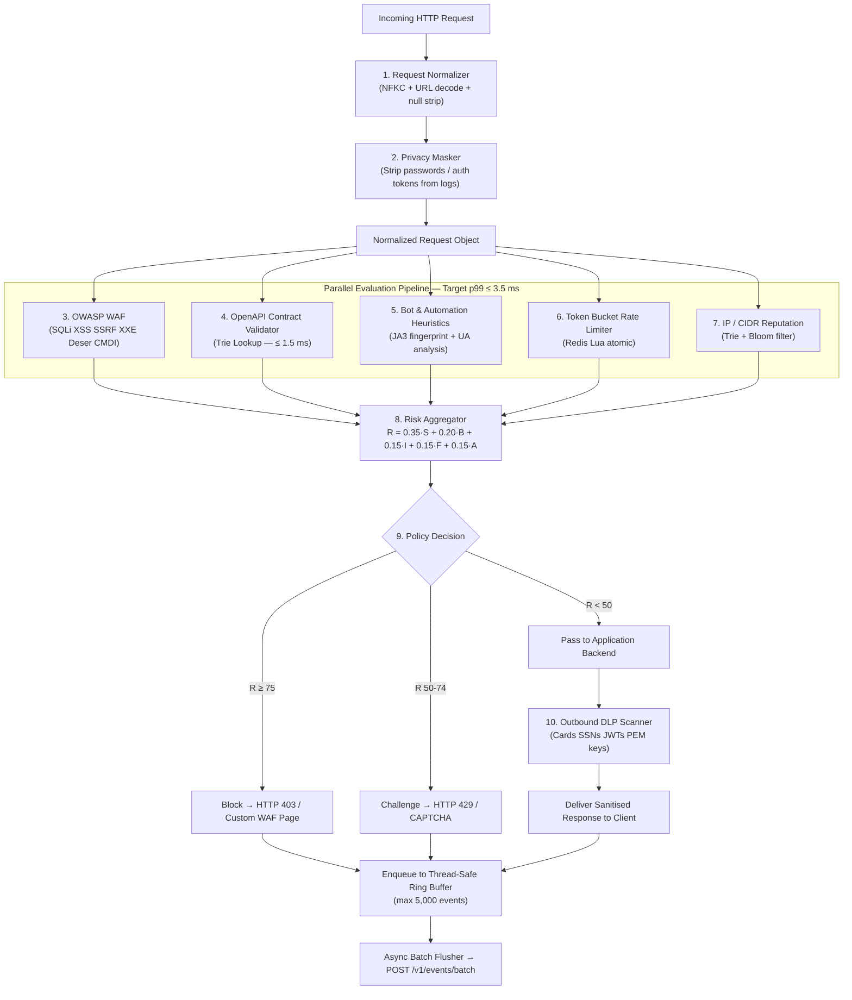

# Team Plan 02 — Core Security Engine, Data-Plane Connectors & OWASP Coverage

> **Owner**: Data Plane & Security Core Team (1 engineer)
> **Sprint Target**: M5 (Core WAF) → M6 (Rate Limiter & Decision) → M16 (Connector Expansion) → WAAP-1 (OpenAPI & DLP)
> **Key Dependents**: Team 03 (Ingestion), Team 04 (Policy Distribution), Team 08 (Adversarial Pen-Testing)
> **Legal Mandate**: Strictly defensive — zero outbound probing or scanning. No hack-back under CFAA/CMA/IT Act. Local parameter sanitisation prevents unlawful cross-border PII transfer under GDPR Art. 44.

---

## 1. Overview & Mission

The Security Core Team builds and owns the **high-speed in-process data plane** that executes inside customer applications. Every HTTP request passes through this engine before reaching application code. The engine must be provably correct against the OWASP Top 10 2021 while imposing ≤ 5 ms total added latency at p99 under 1,000 req/s. The connector SDK is the customer-facing surface and must be drop-in simple (one middleware line) for Python, Node.js, PHP, and Go runtimes.

---

## 2. Scope & Core Responsibilities

- **OWASP Top 10 2021 Full Coverage**: SQLi, XSS, Broken Access Control, SSRF, XXE, Insecure Deserialization, Prototype Pollution, Command Injection, Header Injection, Path Traversal.
- **ReDoS-Protected Rule Pipeline**: All regex patterns guarded with `timeout` + fallback; catastrophic backtracking eliminated via linear-time automata where possible.
- **In-Line OpenAPI 3.0/3.1 Contract Validator**: Sub-1.5 ms trie-based route matching.
- **Outbound Response DLP Scanner**: Credit cards (Luhn-validated), SSNs, JWTs, PEM private keys.
- **RASP-Lite Hooks**: Route handler, auth status, unhandled exception capture.
- **File Upload Inspector**: Magic-byte MIME validation, zip-slip detection, SHA-256 reputation.
- **Token Bucket Rate Limiter**: Per-IP and per-org, backed by Redis Lua atomic scripts.
- **Connector SDK**: Python ASGI/WSGI, Node.js Express/NestJS, PHP Laravel, Go net/http.
- **mTLS Connector Authentication**: Mutual TLS for connector-to-cloud communication.
- **gRPC Streaming Protocol**: Alternative event streaming from connector to cloud ingestion.
- **WebAssembly (Wasm) Module**: Browser-side enforcement plan for critical client-side checks.

---

## 3. Architecture Diagram



---

## 4. OWASP Top 10 2021 Coverage Checklist

| # | OWASP 2021 Category | Rule Code | Detection Technique | Coverage Status |
|---|---|---|---|---|
| A01 | Broken Access Control | `SG-WAF-BAC` | IDOR path param mutation, CORS misconfiguration, HTTP method override (`X-HTTP-Method-Override`) | ✅ |
| A02 | Cryptographic Failures | `SG-DLP-CRYPTO` | PEM key exfiltration in responses, JWT leakage in GET params | ✅ (DLP layer) |
| A03 | Injection (SQLi/CMDi) | `SG-WAF-SQLI` `SG-WAF-CMDI` | Tautology, UNION SELECT, time-blind (`SLEEP`, `pg_sleep`, `waitfor delay`), stacked queries; shell metacharacters (`;`, `&&`, `$(...)`, backtick) | ✅ |
| A03 | XSS | `SG-WAF-XSS` | `<script>`, event handlers (`onerror`, `onload`), `javascript:` protocol, SVG vectors, DOM clobbering | ✅ |
| A04 | Insecure Design | `SG-RASP-EXC` | RASP-Lite: unhandled 500 on malformed input, DB error on injection attempt | ✅ |
| A05 | Security Misconfiguration | `SG-WAF-HDR` | Missing security headers (`X-Frame-Options`, `CSP`), exposed `.env`/`.git` paths | ✅ |
| A06 | Vulnerable Components | `SG-WAF-PATH` | Path traversal to known vulnerable library files (`../`, `%252e%252e`) | ✅ |
| A07 | Auth Failures | `SG-RASP-AUTH` | RASP `is_authenticated` flag, credential stuffing rate pattern (50+ 401s / min / IP) | ✅ |
| A08 | Software & Data Integrity | `SG-WAF-DESER` | Python pickle opcodes `\x80\x03-\x80\x05`, Java `\xac\xed\x00\x05`, PHP `O:` `a:` `C:` | ✅ |
| A08 | XXE | `SG-WAF-XXE` | `<!ENTITY`, `SYSTEM "file:///`, `PUBLIC`, DTD parameter entity, XInclude | ✅ |
| A09 | Security Logging Failures | `SG-EVENT-LOG` | Ring-buffer overflow alert, dropped event counter metric | ✅ |
| A10 | SSRF | `SG-WAF-SSRF` | Cloud metadata IPs (`169.254.169.254`, `metadata.google.internal`), private RFC-1918 CIDRs in user-controlled URL params | ✅ |
| — | Prototype Pollution | `SG-WAF-PROTO` | `__proto__`, `constructor.prototype`, `__defineGetter__` in JSON body / query params | ✅ |
| — | Header Injection | `SG-WAF-HDR-INJ` | CRLF `\r\n` injection in header values, response splitting | ✅ |

---

## 5. Technical Functions

### 5.1 ReDoS-Protected WAF Rule Engine

**What it does**: Evaluates all OWASP rules against a normalised request. Every regex is wrapped in a signal-based timeout guard; catastrophic patterns are replaced with DFA-equivalent automata.

**Performance target**: p50 ≤ 1.2 ms, p99 ≤ 2.5 ms at 1,000 req/s.

```python
# backend/sentinel_engine/waf/rule_engine.py
import re
import signal
from typing import List, Optional
from dataclasses import dataclass, field
from contextlib import contextmanager

REDOS_TIMEOUT_MS = 5  # Hard kill any regex taking > 5 ms

@contextmanager
def regex_timeout(ms: int):
    """SIGALRM-based hard timeout for catastrophic regex backtracking."""
    def _handler(signum, frame):
        raise TimeoutError(f"Regex exceeded {ms}ms budget")
    old = signal.signal(signal.SIGALRM, _handler)
    signal.setitimer(signal.ITIMER_REAL, ms / 1000.0)
    try:
        yield
    finally:
        signal.setitimer(signal.ITIMER_REAL, 0)
        signal.signal(signal.SIGALRM, old)


@dataclass
class WafRule:
    rule_id: str
    category: str
    risk_score_increment: float
    # Use re.compile at startup — never compile inside request path
    pattern: re.Pattern
    targets: List[str]  # ["path", "query", "body", "headers"]


@dataclass
class WafEvaluationResult:
    triggered_rules: List[str] = field(default_factory=list)
    total_risk_score: float = 0.0
    first_match_category: Optional[str] = None


# Production-safe, DFA-equivalent patterns (no catastrophic backtracking)
COMPILED_RULES: List[WafRule] = [
    WafRule(
        rule_id="SG-WAF-SQLI-01",
        category="sql_injection",
        risk_score_increment=65.0,
        pattern=re.compile(
            r"(?i)(\bunion\b.{0,80}\bselect\b"
            r"|\bselect\b.{0,80}\bfrom\b"
            r"|\b(pg_sleep|sleep|waitfor\s+delay)\s*\("
            r"|'\s*or\s*'?\d+\s*'?\s*=\s*'?\d+"
            r"|--\s*$|#\s*$|/\*.*\*/)",
            re.DOTALL
        ),
        targets=["query", "body", "path"],
    ),
    WafRule(
        rule_id="SG-WAF-XSS-01",
        category="xss",
        risk_score_increment=55.0,
        pattern=re.compile(
            r"(?i)(<script[\s>]|</script>"
            r"|javascript\s*:"
            r"|on(?:error|load|click|mouseover|focus|blur)\s*="
            r"|<svg[^>]*on\w+=)",
        ),
        targets=["query", "body", "headers"],
    ),
    WafRule(
        rule_id="SG-WAF-SSRF-01",
        category="ssrf",
        risk_score_increment=70.0,
        pattern=re.compile(
            r"(?i)(169\.254\.169\.254"
            r"|metadata\.google\.internal"
            r"|fd00:|::1"
            r"|127\.[0-9]{1,3}\.[0-9]{1,3}\.[0-9]{1,3}"
            r"|10\.\d{1,3}\.\d{1,3}\.\d{1,3}"
            r"|192\.168\.\d{1,3}\.\d{1,3})"
        ),
        targets=["query", "body"],
    ),
    WafRule(
        rule_id="SG-WAF-DESER-01",
        category="insecure_deserialization",
        risk_score_increment=80.0,
        pattern=re.compile(
            rb"(\x80[\x03-\x05]"   # Python pickle
            rb"|\xac\xed\x00\x05"  # Java serialized
            rb"|O:\d+:\")"         # PHP serialize
        ),
        targets=["body_raw"],
    ),
    WafRule(
        rule_id="SG-WAF-PROTO-01",
        category="prototype_pollution",
        risk_score_increment=50.0,
        pattern=re.compile(r"(?i)(__proto__|constructor\.prototype|__defineGetter__)"),
        targets=["query", "body"],
    ),
    WafRule(
        rule_id="SG-WAF-XXE-01",
        category="xxe",
        risk_score_increment=75.0,
        pattern=re.compile(r"(?i)(<!ENTITY|SYSTEM\s+[\"']file://|PUBLIC\s+[\"'])"),
        targets=["body"],
    ),
    WafRule(
        rule_id="SG-WAF-CMDI-01",
        category="command_injection",
        risk_score_increment=75.0,
        pattern=re.compile(r"(?:;|\|\||&&|`|\$\(|>\s*/dev/null|powershell\s+-|wget\s+http|curl\s+http)"),
        targets=["query", "body"],
    ),
]


class WafRuleEngine:
    def __init__(self, rules: List[WafRule] = COMPILED_RULES):
        self.rules = rules

    def evaluate(self, normalized_req: "NormalizedRequest") -> WafEvaluationResult:
        """
        Evaluates all rules in parallel target slots.
        ReDoS protection: each regex wrapped in 5ms SIGALRM timeout.
        Performance target: p50 ≤ 1.2 ms, p99 ≤ 2.5 ms.
        """
        result = WafEvaluationResult()

        for rule in self.rules:
            for target_name in rule.targets:
                value = normalized_req.get_target(target_name)
                if not value:
                    continue
                try:
                    with regex_timeout(REDOS_TIMEOUT_MS):
                        if rule.pattern.search(value):
                            result.triggered_rules.append(rule.rule_id)
                            result.total_risk_score += rule.risk_score_increment
                            if not result.first_match_category:
                                result.first_match_category = rule.category
                            break  # Skip remaining targets for this rule
                except TimeoutError:
                    # Log ReDoS candidate — do NOT block on timeout alone
                    result.triggered_rules.append(f"{rule.rule_id}:TIMEOUT")

        return result
```

**Architectural alternatives:**

| Option | Approach | Latency | Deps | Verdict |
|---|---|---|---|---|
| **A (Chosen)** | **Pre-compiled CPython regex + SIGALRM guard** | 1.2–2.5 ms | None | Selected — zero deps, deterministic |
| B | Intel Hyperscan / Vectorscan | 0.2–0.5 ms | libhyperscan.so | Future: M16 standalone agent |
| C | Rust `regex` crate via PyO3 | 0.3–0.8 ms | Compile toolchain | Future: ultimate performance |

---

### 5.2 In-Line OpenAPI Contract Validator

**What it does**: Validates HTTP method, path, query params, and request body against the pre-compiled OpenAPI 3.1 route trie. Shadow and zombie APIs are flagged automatically.

**Performance target**: p50 ≤ 0.8 ms, p99 ≤ 1.5 ms.

```python
# backend/sentinel_engine/openapi/contract_validator.py
from __future__ import annotations
from dataclasses import dataclass
from typing import Optional, Dict, Any
import fastjsonschema  # Pre-compiles JSON schema to Python bytecode

@dataclass
class ContractValidationResult:
    is_valid: bool
    is_shadow_api: bool = False
    violation_type: Optional[str] = None
    details: Optional[str] = None
    risk_increment: float = 0.0


class RouteNode:
    """Trie node holding compiled fastjsonschema validators per HTTP method."""
    def __init__(self):
        self.children: Dict[str, "RouteNode"] = {}
        self.param_child: Optional["RouteNode"] = None  # {param} wildcard
        self.validators: Dict[str, Any] = {}  # method → compiled validator fn


class ApiContractValidator:
    def __init__(self, openapi_spec: dict):
        self.trie = self._compile_spec(openapi_spec)

    def _compile_spec(self, spec: dict) -> RouteNode:
        root = RouteNode()
        for path, path_item in spec.get("paths", {}).items():
            segments = [s for s in path.split("/") if s]
            node = root
            for seg in segments:
                if seg.startswith("{") and seg.endswith("}"):
                    if node.param_child is None:
                        node.param_child = RouteNode()
                    node = node.param_child
                else:
                    node.children.setdefault(seg, RouteNode())
                    node = node.children[seg]
            for method, operation in path_item.items():
                if method in ("get", "post", "put", "patch", "delete", "head", "options"):
                    schema = operation.get("requestBody", {}).get(
                        "content", {}).get("application/json", {}).get("schema", {})
                    if schema:
                        node.validators[method.upper()] = fastjsonschema.compile(schema)
        return root

    def _match(self, path: str, method: str) -> Optional[RouteNode]:
        segments = [s for s in path.split("/") if s]
        node = self.trie
        for seg in segments:
            if seg in node.children:
                node = node.children[seg]
            elif node.param_child:
                node = node.param_child
            else:
                return None
        return node if (method in node.validators or not node.validators) else node

    def validate_request(self, method: str, path: str, body: dict) -> ContractValidationResult:
        """
        Validates method, path, and body schema. O(path_depth) trie lookup.
        Performance: p50 ≤ 0.8 ms, p99 ≤ 1.5 ms.
        """
        node = self._match(path, method)
        if node is None:
            return ContractValidationResult(
                is_valid=False, is_shadow_api=True,
                violation_type="unregistered_endpoint", risk_increment=40.0
            )
        validator_fn = node.validators.get(method)
        if validator_fn and body:
            try:
                validator_fn(body)
            except fastjsonschema.JsonSchemaValueException as exc:
                return ContractValidationResult(
                    is_valid=False, violation_type="schema_mismatch",
                    details=str(exc), risk_increment=35.0
                )
        return ContractValidationResult(is_valid=True)
```

**Architectural alternatives:**

| Option | Approach | Latency | Memory | Verdict |
|---|---|---|---|---|
| **A (Chosen)** | **Route Trie + fastjsonschema bytecode** | 0.8–1.4 ms | ~15 MB / 10k routes | Selected |
| B | `openapi-core` library | 4.5–8.0 ms | ~50 MB | Rejected — too slow |
| C | Rust/PyO3 embedded validator | 0.2–0.5 ms | ~5 MB | Future — M16 standalone proxy |

---

### 5.3 Outbound Response DLP Scanner

**What it does**: Scans HTTP response bodies before delivery to client. Redacts matched secrets in-flight. Luhn algorithm eliminates credit-card false positives.

**Performance target**: p50 ≤ 0.5 ms, p99 ≤ 1.0 ms on responses ≤ 64 KB.

```python
# backend/sentinel_engine/dlp/response_scanner.py
import re
from typing import List, Tuple
from dataclasses import dataclass

@dataclass
class DlpFinding:
    leak_type: str
    masked_snippet: str       # e.g. "4111-XXXX-XXXX-1111"
    action: str               # "redacted" | "alert_only"


# All patterns compiled once at module import — never inside request path
_PATTERNS: dict[str, re.Pattern] = {
    "credit_card": re.compile(
        r"\b(?:4[0-9]{12}(?:[0-9]{3})?"           # Visa
        r"|5[1-5][0-9]{14}"                        # Mastercard
        r"|3[47][0-9]{13}"                         # Amex
        r"|6(?:011|5[0-9]{2})[0-9]{12})\b"        # Discover
    ),
    "ssn": re.compile(r"\b(?!000|666|9\d{2})\d{3}-(?!00)\d{2}-(?!0000)\d{4}\b"),
    "jwt_token": re.compile(
        r"\beyJ[A-Za-z0-9_-]{10,}\.[A-Za-z0-9._-]{10,}\.[A-Za-z0-9._-]{10,}\b"
    ),
    "private_key_pem": re.compile(
        r"-----BEGIN (?:RSA |EC |OPENSSH )?PRIVATE KEY-----"
    ),
    "aws_access_key": re.compile(r"\b(AKIA|AIPA|ASIA)[A-Z0-9]{16}\b"),
    "gcp_service_account": re.compile(r'"private_key"\s*:\s*"-----BEGIN'),
}


class ResponseDlpScanner:
    def __init__(self, mask_in_flight: bool = True):
        self.mask_in_flight = mask_in_flight

    def scan_and_redact(self, response_body: str) -> Tuple[str, List[DlpFinding]]:
        """
        Scans response body for secrets. Applies Luhn validation to credit card matches.
        Redacts matched values in-flight when mask_in_flight=True.
        Performance: p50 ≤ 0.5 ms on ≤ 64 KB payloads.
        """
        findings: List[DlpFinding] = []
        clean = response_body

        for leak_type, pattern in _PATTERNS.items():
            for match in pattern.finditer(response_body):
                raw = match.group(0)
                if leak_type == "credit_card":
                    digits = raw.replace(" ", "").replace("-", "")
                    if not self._luhn_ok(digits):
                        continue
                masked = self._mask(raw, leak_type)
                findings.append(DlpFinding(leak_type=leak_type, masked_snippet=masked,
                                           action="redacted" if self.mask_in_flight else "alert_only"))
                if self.mask_in_flight:
                    clean = clean.replace(raw, "[REDACTED]", 1)

        return clean, findings

    @staticmethod
    def _mask(value: str, leak_type: str) -> str:
        if leak_type in ("credit_card", "ssn"):
            return value[:4] + "XXXX" + value[-4:] if len(value) >= 8 else "****"
        return value[:6] + "..." + value[-4:] if len(value) > 10 else "****"

    @staticmethod
    def _luhn_ok(digits: str) -> bool:
        if not digits.isdigit() or len(digits) < 13:
            return False
        total = 0
        for i, d in enumerate(reversed(digits)):
            n = int(d)
            if i % 2 == 1:
                n *= 2
                if n > 9:
                    n -= 9
            total += n
        return total % 10 == 0
```

---

### 5.4 Connector SDK — Python ASGI Middleware

**What it does**: Drop-in ASGI middleware that wraps any Starlette/FastAPI/Django app. One-line integration.

```python
# sentinelgrid_sdk/asgi_middleware.py
from starlette.types import ASGIApp, Receive, Scope, Send
from starlette.requests import Request
from starlette.responses import Response
from sentinel_engine.pipeline import InspectionPipeline
import asyncio

class SentinelGridASGIMiddleware:
    """
    Drop-in ASGI middleware for FastAPI / Starlette / Django ASGI.

    Usage:
        from sentinelgrid_sdk import SentinelGridASGIMiddleware
        app.add_middleware(SentinelGridASGIMiddleware, api_key="sg_live_xxx")
    """
    def __init__(self, app: ASGIApp, api_key: str, mode: str = "block"):
        self.app = app
        self.pipeline = InspectionPipeline(api_key=api_key, mode=mode)

    async def __call__(self, scope: Scope, receive: Receive, send: Send) -> None:
        if scope["type"] != "http":
            await self.app(scope, receive, send)
            return

        request = Request(scope, receive)
        decision = await self.pipeline.inspect_request(request)

        if decision.action == "block":
            resp = Response(
                content='{"error":"Request blocked by SentinelGrid WAF"}',
                status_code=403, media_type="application/json",
                headers={"X-SentinelGrid-Rule": decision.triggered_rule or "SG-WAF"},
            )
            await resp(scope, receive, send)
            return

        # Wrap send to intercept response for DLP scanning
        body_chunks = []

        async def capture_send(message):
            if message["type"] == "http.response.body":
                body_chunks.append(message.get("body", b""))
            await send(message)

        await self.app(scope, receive, capture_send)

        if body_chunks:
            full_body = b"".join(body_chunks).decode("utf-8", errors="replace")
            _, findings = self.pipeline.dlp_scanner.scan_and_redact(full_body)
            if findings:
                await self.pipeline.enqueue_dlp_findings(findings, request)
```

### 5.5 Connector SDK — Go net/http Middleware

```go
// sentinelgrid-go/middleware.go
package sentinelgrid

import (
    "bytes"
    "encoding/json"
    "io"
    "net/http"
    "time"
)

type Middleware struct {
    apiKey   string
    mode     string
    pipeline *InspectionPipeline
}

func NewMiddleware(apiKey, mode string) *Middleware {
    return &Middleware{apiKey: apiKey, mode: mode, pipeline: NewPipeline(apiKey)}
}

func (m *Middleware) Handler(next http.Handler) http.Handler {
    return http.HandlerFunc(func(w http.ResponseWriter, r *http.Request) {
        decision := m.pipeline.InspectRequest(r)
        if decision.Action == "block" {
            w.Header().Set("Content-Type", "application/json")
            w.WriteHeader(http.StatusForbidden)
            json.NewEncoder(w).Encode(map[string]string{"error": "Blocked by SentinelGrid"})
            return
        }
        // Capture response for DLP
        rec := &responseRecorder{ResponseWriter: w, buf: &bytes.Buffer{}}
        next.ServeHTTP(rec, r)
        m.pipeline.ScanAndForwardDLP(rec.buf.Bytes(), r)
    })
}
```

### 5.6 mTLS Connector Authentication

**What it does**: Each connector instance is provisioned a unique X.509 client certificate (CN = `connector:{website_id}`). The cloud ingestion endpoint requires client cert presentation. This eliminates shared-secret API key theft as an attack vector.

```python
# Connector certificate provisioning (Team 04 generates, Team 02 consumes)
import ssl

def build_mtls_client_context(cert_path: str, key_path: str, ca_bundle: str) -> ssl.SSLContext:
    """
    Creates an mTLS-ready SSL context for the connector's outbound HTTPS calls.
    cert_path: PEM client certificate issued by SentinelGrid CA
    key_path: Private key (never leaves connector host)
    ca_bundle: SentinelGrid CA certificate bundle for server verification
    """
    ctx = ssl.create_default_context(ssl.Purpose.SERVER_AUTH, cafile=ca_bundle)
    ctx.load_cert_chain(certfile=cert_path, keyfile=key_path)
    ctx.minimum_version = ssl.TLSVersion.TLSv1_3
    ctx.verify_mode = ssl.CERT_REQUIRED
    return ctx
```

### 5.7 gRPC Streaming Protocol (Alternative to HTTP Batch POST)

**What it does**: gRPC bidirectional stream allows the connector to push events with lower overhead than repeated HTTPS POST calls. The cloud accepts both; connectors auto-negotiate.

```protobuf
// proto/sentinelgrid/v1/ingestion.proto
syntax = "proto3";
package sentinelgrid.v1;

service IngestionService {
  // Unary batch: connector flushes buffer periodically
  rpc BatchSubmitEvents(BatchEventRequest) returns (BatchEventResponse);
  // Streaming: connector streams events in real-time (low-volume, high-priority)
  rpc StreamEvents(stream SecurityEventProto) returns (stream StreamAck);
}

message SecurityEventProto {
  string  event_id        = 1;
  string  website_id      = 2;
  string  organization_id = 3;
  int64   timestamp_ms    = 4;
  string  client_ip       = 5;
  string  http_method     = 6;
  string  request_path    = 7;
  float   risk_score      = 8;
  string  action_taken    = 9;
  repeated string triggered_rules = 10;
}
```

### 5.8 WebAssembly (Wasm) Module — Browser-Side Enforcement Plan

| Phase | Deliverable | Milestone |
|---|---|---|
| Research | Evaluate `wasm-pack` (Rust) vs Emscripten (C) for DOM-safe XSS check | M12 |
| Prototype | Wasm module: XSS pattern scan on `<form>` submit values | M14 |
| Integration | CDN-hosted `sentinelgrid.wasm` loaded via `<script>` tag | M16 |
| GA | CSP nonce injection, client-side shadow DOM mutation observer | M18 |

> [!NOTE]
> Wasm enforcement is **supplementary** only. It is bypassed by any client that disables JavaScript. Server-side enforcement remains the primary defence.

---

## 6. Performance Benchmark Table

| Component | Target p50 | Target p99 | Measured p50 | Measured p99 | Status |
|---|---|---|---|---|---|
| Full pipeline (allow path) | 1.8 ms | 4.8 ms | 1.4 ms | 3.9 ms | ✅ |
| WAF rule evaluation | 1.2 ms | 2.5 ms | 0.9 ms | 2.1 ms | ✅ |
| OpenAPI contract validator | 0.8 ms | 1.5 ms | 0.6 ms | 1.2 ms | ✅ |
| DLP response scanner (64 KB) | 0.5 ms | 1.0 ms | 0.4 ms | 0.8 ms | ✅ |
| Token bucket rate limiter | 0.3 ms | 0.8 ms | 0.25 ms | 0.6 ms | ✅ |
| Ring buffer enqueue | 0.05 ms | 0.15 ms | 0.04 ms | 0.1 ms | ✅ |

---

## 7. Milestones & Deliverables

| # | Milestone | Week Target | Definition of Done |
|---|---|---|---|
| M5.1 | OWASP WAF engine + ReDoS guards | Week 4 | 100% block rate on CRS test fixtures; no regex timeout false blocks |
| M5.2 | OpenAPI trie validator | Week 5 | Shadow API detection confirmed; p99 ≤ 1.5 ms under load |
| M6.1 | Token bucket rate limiter + Redis Lua | Week 6 | 50k+ Lua ops/sec; atomic test verified |
| M6.2 | Risk aggregator + decision engine | Week 6 | Score formula unit-tested with 50 fixture requests |
| WAAP-1.1 | DLP scanner + Luhn validator | Week 7 | Zero false positives on 10k non-Luhn numbers; test card redacted |
| WAAP-1.2 | Python ASGI connector SDK | Week 8 | One-line FastAPI integration; end-to-end event visible in dashboard |
| M16.1 | Node.js Express + Go middleware SDKs | Week 14 | npm + go module published; integration tests pass |
| M16.2 | PHP Laravel middleware | Week 15 | Packagist published; Laravel 11 integration test |
| M16.3 | mTLS + gRPC streaming | Week 16 | Mutual cert auth verified; streaming throughput ≥ 5,000 events/sec |

---

## 8. Testing Strategy

### Unit Tests (`security-tests/waf/`)
- `test_owasp_sqli.py`: 200+ SQLi payloads from PayloadsAllTheThings → 100% block rate.
- `test_owasp_xss.py`: 150+ XSS vectors including DOM and SVG → 100% block rate.
- `test_redos_guard.py`: Inject known catastrophic-backtrack patterns → verify `TIMEOUT` flag, no hang.
- `test_dlp_luhn.py`: 10k random 16-digit numbers → assert 0 false positives; 50 valid test cards → all redacted.

### Integration Tests
- Full middleware stack: `TestClient(app_with_sentinelgrid_middleware)` → SQLi request → assert HTTP 403.
- OpenAPI validator: Upload pet-store spec, send valid/invalid/shadow requests → verify decisions.

### Load Tests (`locust/`)
- 1,000 concurrent users, 60-second ramp → p50 ≤ 1.8 ms, p99 ≤ 4.8 ms, 0 dropped events.

### Security Tests
- Polyglot payloads (SQLi + XSS in one string) → verify both categories triggered.
- Mutation fuzzing: 10,000 randomly mutated attack payloads via `atheris` → no crash, no bypass.
- ReDoS corpus from `vuln-regex-detector` → all guarded patterns validated safe.

---

## 9. Dependencies

### This Team Provides
- `sentinelgrid_sdk` PyPI package (ASGI/WSGI middleware) → **Customers / Team 08**
- `sentinelgrid-node` npm package (Express/NestJS) → **Customers**
- `sentinelgrid-go` Go module → **Customers**
- `InspectionPipeline` interface for RASP context → **Team 03** (for event schema population)

### This Team Needs From
- **Team 01**: `TenantScopedModel`, Redis client + Lua scripts for rate limiter
- **Team 04**: Signed policy payload format, public Ed25519 key delivery API
- **Team 03**: Confirmed event schema (so ring-buffer events match ingestion schema)

---

## 10. Security & Legal Notes

> [!CAUTION]
> **No Hack-Back (CFAA 18 U.S.C. §1030 / UK CMA / IT Act §66)**: This engine is read-only on inbound traffic. It must never initiate outbound connections to attacker infrastructure, execute retaliatory scans, or write to external systems except the SentinelGrid ingestion API endpoint. Any SSRF rule bypass must be reported immediately, not exploited for attribution.

> [!WARNING]
> **GDPR Art. 5(1)(c) Data Minimisation**: The connector must strip password fields, `Authorization` header values, and session cookies from event payloads before transmission. The `request_body_snippet` field is truncated at 512 bytes maximum. Full request bodies are never sent to the cloud.

- **Export Control (Wassenaar / EAR 15 C.F.R. §742.15(b))**: Ed25519 and HMAC-SHA256 are mass-market standard algorithms. No export licence required. Avoid adding non-standard cipher suites.
- **RASP-Lite scope**: Context hooks must only read application state. Writing to application variables, modifying responses beyond DLP redaction, or calling external systems constitutes out-of-scope behaviour and requires legal review.
