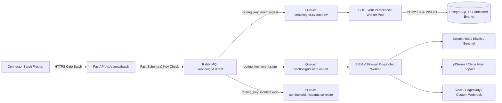

# Team Plan 03 — Ingestion API, RabbitMQ Broker & SIEM Forwarding

> **Owner**: Ingestion & Distributed Systems Team  
> **Target Milestones**: M7 (Cloud Ingestion API & Message Queue), WAAP-SIEM (Enterprise SecOps Forwarding)  
> **Key Dependents**: Team 01 (Database), Team 05 (Incidents), Team 08 (Testing)  
> **Legal Baseline**: Zero retention of unmasked passwords or PII in message queues; TLS encryption in transit for all SIEM feeds.

---

## 1. Scope & Core Responsibilities
The Ingestion Team is responsible for:
1. High-throughput, low-latency **Event Ingestion API** (`POST /v1/events/batch`) processing 1,000+ events/sec.
2. Managing **RabbitMQ 3.12** exchange topologies, consumer prefetch, and Dead Letter Queues (DLQ).
3. Developing asynchronous **Bulk Persistence Workers** writing micro-batches to PostgreSQL 16.
4. Implementing the **SIEM & Firewall Dispatch Worker**:
   - Forwarding events in **Common Event Format (CEF)** or JSON to Splunk HEC, Elasticsearch, and Microsoft Sentinel.
   - Serving **Dynamic Firewall Alias Feeds** for pfSense (URL Table Aliases) and Cisco FMC.
   - Pushing immediate alerts to Webhooks, Slack, and PagerDuty.

---

## 2. Ingestion & SIEM Topologies



---

## 3. Technical Function Details & Architectural Alternatives

### 3.1 SIEM & Firewall Export Dispatcher
Consumes events from `sentinelgrid.siem.export` and delivers to configured integrations.

```python
class SiemDispatcher:
    def __init__(self, http_client: httpx.AsyncClient):
        self.client = http_client

    async def dispatch_event(self, integration: SiemIntegration, event: Dict[str, Any]) -> None:
        """
        Dispatches security event to external enterprise SIEM or perimeter firewall feed.
        Formats: CEF (Common Event Format), Syslog (RFC 5424), or JSON.
        """
        if integration.integration_type == "splunk":
            # Splunk HEC JSON format
            payload = {
                "time": event["timestamp"],
                "sourcetype": "sentinelgrid:waap:event",
                "event": event
            }
            headers = {"Authorization": f"Splunk {integration.auth_token}"}
            await self.client.post(integration.endpoint_url, json=payload, headers=headers, timeout=5.0)

        elif integration.integration_type == "syslog_cef":
            # ArcSight / Cisco CEF standard
            cef_message = self._format_cef(event)
            await self._send_udp_or_tcp_syslog(integration.endpoint_url, cef_message)

        elif integration.integration_type == "webhook":
            headers = {"X-SentinelGrid-Signature": self._calculate_hmac(event, integration.auth_token)}
            await self.client.post(integration.endpoint_url, json=event, headers=headers, timeout=5.0)

    @staticmethod
    def _format_cef(event: Dict[str, Any]) -> str:
        # CEF:Version|Device Vendor|Device Product|Device Version|SignatureID|Name|Severity|Extension
        return (
            f"CEF:0|SentinelGrid|WAAP|1.0.0|{event.get('rule_id', 'SG-001')}|"
            f"{event.get('action_taken', 'blocked')}|{event.get('risk_score', 50)}|"
            f"src={event.get('client_ip')} act={event.get('action_taken')} "
            f"request={event.get('path')} method={event.get('method')}"
        )
```

#### Architectural Alternatives Analysis
| Option | Tool / Approach | Throughput | Reliability | Verdict |
|---|---|---|---|---|
| **Option A (Chosen)** | **RabbitMQ Dedicated Queue + Async Python Worker** | **1,500 msgs/sec** | **High (At-least-once, retry backoff)** | **Selected**: Fully integrated into backend stack; zero additional infrastructure to maintain. |
| **Option B** | Logstash / Fluentbit Sidecar Container | 5,000+ msgs/sec | High | *Alternative*: Great for very large enterprise clusters, but adds operational overhead for single-tenant customers. |
| **Option C** | Apache Kafka | 50,000+ msgs/sec | Very High | *Overkill*: Premature complexity for initial engineering phase. RabbitMQ satisfies targets with lower resource consumption. |

---

### 3.2 pfSense & Cisco Dynamic Blocklist Feed Endpoint
Provides an authenticated, cacheable HTTP feed that pfSense (`pfBlockerNG` or URL Table Alias) and Cisco FMC can poll every 5–15 minutes:
- Endpoint: `GET /v1/organizations/{id}/firewall-feed/active-blocks.txt`
- Response: Plaintext CIDR / IP list (one per line) of high-confidence attacker IPs currently undergoing active mitigation.
- Benefit: Allows perimeter network firewalls to drop layer 3/4 packets before they reach application ingress!

---

## 4. Verification & Testing Gates

1. **Ingestion Benchmark**: Sustained $\ge 1,000\text{ events/sec}$ with zero dropped messages over 30-minute stress run.
2. **SIEM Dispatch Test**:
   - Send simulated attack event -> verify event delivered to mock Splunk HEC and syslog listener in $< 500\text{ms}$.
3. **pfSense Feed Test**:
   - Trigger automated mitigation on IP `203.0.113.50` -> verify IP appears immediately in `/firewall-feed/active-blocks.txt`.
