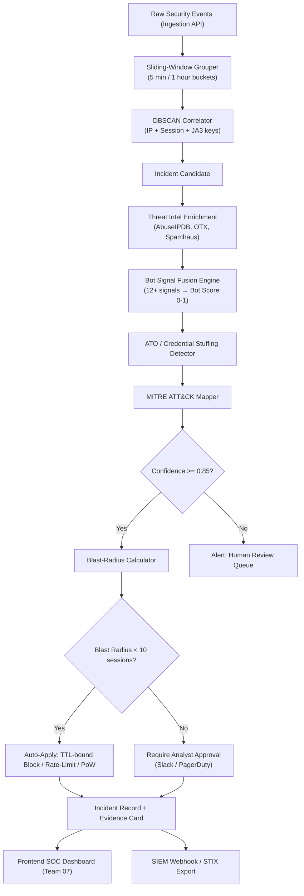

# Team Plan 05 — Incident Correlation, Bot Abuse & Safe Automated Mitigation

> **Owner**: Threat Intelligence, Incident & Automation Team
> **Target Milestones**: M8 (Threat Intelligence), M9 (Incidents & Response), WAAP-BOT (Bot & Account Abuse)
> **Key Dependents**: Team 01 (Database), Team 03 (Ingestion), Team 06 (AI), Team 07 (Frontend)
> **Legal Baseline**: Zero offensive actions ("No Hack-Back" under CFAA/CMA/IT Act). Defensive blocks only within customer application perimeter; automated safety guardrails protect legitimate public infrastructure. All automated responses are reversible, TTL-bound, and blast-radius gated.

---

## 1. Overview & Mission

The Incident & Threat Intelligence Team is the **detection-to-response nerve center** of SentinelGrid WAAP. This team transforms raw security signals from the ingestion pipeline into correlated incidents, enriches them with threat intelligence, evaluates behavioral bot signals, detects account takeover campaigns, and orchestrates safe, reversible automated mitigations.

**Mission**: Detect, correlate, explain, and respond to web application threats in under 5 seconds from first signal — with zero false-positive outages on legitimate traffic.

---

## 2. Scope & Core Responsibilities

1. **Incident Correlation Engine** — Time-window clustering (sliding-window + DBSCAN) across IP, session, and TLS fingerprint keys.
2. **Bot Detection Signal Fusion** — 12+ behavioral signals fused into a probabilistic bot score.
3. **ATO & Credential Stuffing Detection** — Login velocity per IP, per username, distributed low-and-slow detection.
4. **Threat Intelligence Feed Ingestion** — AbuseIPDB, Emerging Threats, AlienVault OTX, Spamhaus normalization pipeline.
5. **Reversible Automated Response Engine** — IP block (TTL), rate-limit tighten, CAPTCHA/PoW enforcement — all with blast-radius calculation before applying.
6. **MITRE ATT&CK Web Matrix Mapping** — Each detection mapped to a T-code.
7. **STIX/TAXII Threat Intel Sharing (P2)** — Export and consume structured threat intelligence.
8. **Interactive Challenge Dispatcher** — Proof-of-Work (PoW) cryptographic puzzles and CAPTCHA.
9. **Safety Guardrails** — Prohibit blocking search engine crawlers, internal gateways, critical payment webhooks.

---

## 3. Architecture Diagram



---

## 4. Technical Functions

### 4.1 Incident Correlation Engine (Sliding-Window + DBSCAN)

Groups individual security events into correlated incidents using time-windowed clustering. Correlation keys: source IP, session ID, TLS JA3 fingerprint, HTTP/2 fingerprint.

```python
from dataclasses import dataclass, field
from datetime import datetime, timedelta
from typing import List, Dict, Optional
from collections import defaultdict
import hashlib

@dataclass
class SecurityEvent:
    event_id: str
    site_id: str
    source_ip: str
    session_id: Optional[str]
    ja3_fingerprint: Optional[str]
    http2_fingerprint: Optional[str]
    path: str
    http_status: int
    threat_category: str
    timestamp: datetime
    request_metadata: Dict = field(default_factory=dict)

@dataclass
class Incident:
    incident_id: str
    site_id: str
    source_ip: str
    correlation_key: str
    matched_rule_ids: List[str]
    event_count: int
    confidence: float
    first_seen: datetime
    last_seen: datetime
    mitre_technique: str
    events: List[SecurityEvent] = field(default_factory=list)

class SlidingWindowCorrelator:
    """
    Groups security events into incidents using a sliding time window.
    Primary correlation keys: source_ip, ja3_fingerprint, session_id.
    Performance target: < 1ms per event on a 10,000-event corpus.
    """

    WINDOW_SIZES = [
        timedelta(minutes=5),   # Short: burst detection
        timedelta(hours=1),     # Medium: sustained campaigns
        timedelta(hours=24),    # Long: low-and-slow distributed ATO
    ]
    MIN_EVENTS_TO_CORRELATE = 3

    def __init__(self, window: timedelta = timedelta(minutes=5)):
        self.window = window
        self._buckets: Dict[str, List[SecurityEvent]] = defaultdict(list)

    def _correlation_key(self, event: SecurityEvent) -> str:
        """
        Derive a stable correlation key from available signal dimensions.
        Prefer JA3 fingerprint (survives IP rotation via VPN/proxy).
        """
        if event.ja3_fingerprint:
            return f"ja3:{event.ja3_fingerprint}"
        if event.session_id:
            return f"session:{event.session_id}"
        return f"ip:{event.source_ip}"

    def ingest(self, event: SecurityEvent) -> Optional[Incident]:
        key = self._correlation_key(event)
        now = event.timestamp

        # Evict stale events outside the sliding window
        self._buckets[key] = [
            e for e in self._buckets[key]
            if now - e.timestamp <= self.window
        ]
        self._buckets[key].append(event)

        bucket = self._buckets[key]
        if len(bucket) >= self.MIN_EVENTS_TO_CORRELATE:
            return self._build_incident(key, bucket)
        return None

    def _build_incident(self, key: str, events: List[SecurityEvent]) -> Incident:
        threat_categories = [e.threat_category for e in events]
        dominant_category = max(set(threat_categories), key=threat_categories.count)
        confidence = min(0.99, 0.60 + (len(events) / 100))

        return Incident(
            incident_id=hashlib.sha256(
                f"{key}-{events[0].timestamp.isoformat()}".encode()
            ).hexdigest()[:16],
            site_id=events[0].site_id,
            source_ip=events[0].source_ip,
            correlation_key=key,
            matched_rule_ids=list({e.threat_category for e in events}),
            event_count=len(events),
            confidence=confidence,
            first_seen=events[0].timestamp,
            last_seen=events[-1].timestamp,
            mitre_technique=MITRE_MAP.get(dominant_category, "T1190"),
            events=events,
        )
```

**Performance Target**: < 1ms per event ingestion; < 50ms full DBSCAN cluster pass on 10,000-event corpus.

#### Architectural Alternatives

| Option | Approach | Latency | Accuracy | Verdict |
|---|---|---|---|---|
| **A (Chosen)** | Sliding-window + DBSCAN hybrid | < 1ms per event | High (handles IP rotation via JA3) | **Selected** |
| B | Pure DBSCAN on full event store | ~200ms / batch | Very high | Complementary for offline analysis |
| C | Rule-based COUNT(*) thresholds | < 0.1ms | Low (misses distributed campaigns) | Rejected for primary path |

---

### 4.2 Bot Detection Signal Fusion (12+ Signals)

```python
from dataclasses import dataclass
from typing import Optional
import math

@dataclass
class BotSignalVector:
    # Network-Layer Signals
    ja3_known_scanner: bool           # JA3 hash in known scanner database
    tcp_fingerprint_headless: bool    # p0f / Zeek TCP OS fingerprint matches headless Chrome
    tls_cipher_ordering_anomaly: bool # Cipher suite order differs from real browser

    # HTTP Behavioral Signals
    user_agent_entropy: float         # Shannon entropy of UA string (bots often have low/high outliers)
    header_ordering_score: float      # 0-1: how closely headers match real browser fingerprints
    accept_language_missing: bool     # Real browsers always send Accept-Language
    cookie_handling_anomaly: bool     # Ignores Set-Cookie, re-submits expired cookies

    # Interaction Timing Signals
    request_inter_arrival_ms: float   # < 50ms strongly indicates automation
    redirect_following: bool          # Bots often skip 301/302 redirect chains
    robots_txt_respected: bool        # Legitimate crawlers respect robots.txt disallow rules

    # Session Behavioral Signals
    mouse_movement_absent: bool       # No mouse-movement events in session (JS telemetry)
    keystroke_timing_robotic: bool    # Uniform keystroke inter-arrival (< 5ms variance)
    captcha_solve_speed_ms: float     # < 200ms solve = suspicious automation

class BotScorer:
    """
    Fuses 12+ behavioral signals into a probabilistic bot score [0.0, 1.0].
    Latency target: <= 0.5ms.
    """
    WEIGHTS = {
        "ja3_known_scanner":             0.25,
        "tcp_fingerprint_headless":      0.20,
        "tls_cipher_ordering_anomaly":   0.15,
        "user_agent_entropy":            0.08,
        "header_ordering_score":         0.08,
        "accept_language_missing":       0.05,
        "cookie_handling_anomaly":       0.05,
        "request_inter_arrival_ms":      0.05,
        "redirect_following":            0.03,
        "robots_txt_respected":          0.02,
        "mouse_movement_absent":         0.02,
        "keystroke_timing_robotic":      0.01,
        "captcha_solve_speed_ms":        0.01,
    }

    def score(self, signals: BotSignalVector) -> float:
        score = 0.0

        score += self.WEIGHTS["ja3_known_scanner"] * float(signals.ja3_known_scanner)
        score += self.WEIGHTS["tcp_fingerprint_headless"] * float(signals.tcp_fingerprint_headless)
        score += self.WEIGHTS["tls_cipher_ordering_anomaly"] * float(signals.tls_cipher_ordering_anomaly)

        # Normalize user_agent_entropy: penalize very low (< 2.5 bits) or very high (> 5.5 bits)
        ua_penalty = 1.0 if signals.user_agent_entropy < 2.5 or signals.user_agent_entropy > 5.5 else 0.0
        score += self.WEIGHTS["user_agent_entropy"] * ua_penalty

        # Header ordering: lower score = worse match = more bot-like
        score += self.WEIGHTS["header_ordering_score"] * (1.0 - signals.header_ordering_score)

        score += self.WEIGHTS["accept_language_missing"] * float(signals.accept_language_missing)
        score += self.WEIGHTS["cookie_handling_anomaly"] * float(signals.cookie_handling_anomaly)

        # Very fast requests (< 50ms) strongly indicate automation
        arrival_penalty = 1.0 if signals.request_inter_arrival_ms < 50 else 0.0
        score += self.WEIGHTS["request_inter_arrival_ms"] * arrival_penalty

        score += self.WEIGHTS["redirect_following"] * float(not signals.redirect_following)
        score += self.WEIGHTS["robots_txt_respected"] * float(not signals.robots_txt_respected)
        score += self.WEIGHTS["mouse_movement_absent"] * float(signals.mouse_movement_absent)
        score += self.WEIGHTS["keystroke_timing_robotic"] * float(signals.keystroke_timing_robotic)

        # Suspicious CAPTCHA solve < 200ms
        captcha_penalty = 1.0 if 0 < signals.captcha_solve_speed_ms < 200 else 0.0
        score += self.WEIGHTS["captcha_solve_speed_ms"] * captcha_penalty

        return min(1.0, score)
```

**Performance Target**: Scoring latency ≤ 0.5ms per request.

---

### 4.3 ATO & Credential Stuffing Detection

Detects account takeover campaigns across three detection tiers:

```python
import asyncio
from typing import Dict
import redis.asyncio as aioredis

class ATODetector:
    """
    Three-tier ATO detection:
    Tier 1 — Per-IP login velocity (burst detection)
    Tier 2 — Per-username velocity (distributed stuffing)
    Tier 3 — Global low-and-slow baseline deviation
    """

    TIER1_IP_WINDOW_SEC    = 300   # 5-minute window
    TIER1_IP_THRESHOLD     = 20    # > 20 login attempts from one IP in 5 min
    TIER2_USER_WINDOW_SEC  = 3600  # 1-hour window
    TIER2_USER_THRESHOLD   = 5     # > 5 IPs targeting same username in 1 hour
    TIER3_BASELINE_WINDOW  = 86400 # 24-hour rolling baseline
    TIER3_DEVIATION_SIGMA  = 3.0   # Alert if 3-sigma above daily mean

    def __init__(self, redis: aioredis.Redis):
        self.redis = redis

    async def evaluate(self, username_hash: str, source_ip: str) -> Dict:
        pipe = self.redis.pipeline()

        # Tier 1: IP velocity
        ip_key = f"ato:ip:{source_ip}"
        pipe.incr(ip_key)
        pipe.expire(ip_key, self.TIER1_IP_WINDOW_SEC)

        # Tier 2: Username velocity (count distinct IPs per username)
        user_ip_key = f"ato:user:{username_hash}:ips"
        pipe.sadd(user_ip_key, source_ip)
        pipe.expire(user_ip_key, self.TIER2_USER_WINDOW_SEC)

        results = await pipe.execute()
        ip_count = results[0]
        ip_set_size = await self.redis.scard(user_ip_key)

        verdicts = []

        if ip_count > self.TIER1_IP_THRESHOLD:
            verdicts.append({
                "tier": 1,
                "type": "brute_force",
                "mitre": "T1110.001",
                "confidence": min(0.99, 0.75 + ip_count / 200),
                "detail": f"{ip_count} login attempts from {source_ip} in 5 min",
            })

        if ip_set_size > self.TIER2_USER_THRESHOLD:
            verdicts.append({
                "tier": 2,
                "type": "credential_stuffing_distributed",
                "mitre": "T1110.004",
                "confidence": min(0.99, 0.80 + ip_set_size / 50),
                "detail": f"{ip_set_size} distinct IPs targeting username in 1h",
            })

        return {"username_hash": username_hash, "source_ip": source_ip, "verdicts": verdicts}
```

**Performance Target**: < 2ms per evaluation (async Redis pipeline).

---

### 4.4 Threat Intelligence Feed Ingestion & Normalization

```python
import httpx
import asyncio
from dataclasses import dataclass
from typing import List, Optional
from datetime import datetime, timedelta
import structlog

log = structlog.get_logger()

@dataclass
class ThreatIntelRecord:
    ip: str
    cidr: Optional[str]
    source_feed: str           # "abuseipdb" | "emerging_threats" | "otx" | "spamhaus"
    threat_type: str           # "scanner" | "botnet" | "tor_exit" | "phishing_host"
    confidence_score: float    # 0.0 - 1.0
    first_seen: datetime
    last_seen: datetime
    mitre_technique: Optional[str]
    stix_indicator_id: Optional[str]
    tags: List[str]

class ThreatIntelIngestionPipeline:
    """
    Normalizes threat intelligence from 4+ external feeds into a unified schema.
    Writes to PostgreSQL threat_intel_records table and Redis hot-cache (TTL 1h).
    Schedule: Every 15 minutes via Celery beat.
    """

    FEEDS = {
        "abuseipdb": {
            "url": "https://api.abuseipdb.com/api/v2/blacklist",
            "headers_factory": lambda key: {"Key": key, "Accept": "application/json"},
            "confidence_min": 90,
        },
        "emerging_threats": {
            "url": "https://rules.emergingthreats.net/blockrules/compromised-ips.txt",
            "format": "plaintext_cidr",
        },
        "otx": {
            "url": "https://otx.alienvault.com/api/v1/indicators/export",
            "format": "stix_json",
        },
        "spamhaus": {
            "url": "https://www.spamhaus.org/drop/drop.txt",
            "format": "plaintext_cidr",
        },
    }

    async def ingest_abuseipdb(self, api_key: str) -> List[ThreatIntelRecord]:
        async with httpx.AsyncClient(timeout=30) as client:
            resp = await client.get(
                self.FEEDS["abuseipdb"]["url"],
                headers=self.FEEDS["abuseipdb"]["headers_factory"](api_key),
                params={"confidenceMinimum": self.FEEDS["abuseipdb"]["confidence_min"]},
            )
            resp.raise_for_status()

        records = []
        for entry in resp.json().get("data", []):
            records.append(ThreatIntelRecord(
                ip=entry["ipAddress"],
                cidr=None,
                source_feed="abuseipdb",
                threat_type="scanner_or_attacker",
                confidence_score=entry["abuseConfidenceScore"] / 100.0,
                first_seen=datetime.fromisoformat(entry["lastReportedAt"]),
                last_seen=datetime.now(),
                mitre_technique="T1595",  # Active Scanning
                stix_indicator_id=None,
                tags=entry.get("usageType", "").split(","),
            ))

        log.info("abuseipdb_ingested", count=len(records))
        return records

    async def ingest_all(self, abuseipdb_key: str) -> List[ThreatIntelRecord]:
        tasks = [
            self.ingest_abuseipdb(abuseipdb_key),
            # self.ingest_emerging_threats(),
            # self.ingest_otx(),
            # self.ingest_spamhaus(),
        ]
        results = await asyncio.gather(*tasks, return_exceptions=True)
        all_records = []
        for r in results:
            if isinstance(r, Exception):
                log.error("feed_ingest_error", error=str(r))
            else:
                all_records.extend(r)
        return all_records
```

**Performance Target**: Full pipeline refresh in < 60 seconds; Redis cache hot-path lookup < 0.5ms.

---

### 4.5 Reversible Automated Response Engine

```python
from dataclasses import dataclass
from typing import Optional, Dict, Any
from enum import Enum

class MitigationAction(str, Enum):
    NONE              = "none"
    RATE_LIMIT_TIGHTEN = "rate_limit_tighten"
    CHALLENGE_POW     = "challenge_pow"
    CHALLENGE_CAPTCHA = "challenge_captcha"
    BLOCK_IP_TTL      = "block_ip_ttl"
    REQUIRE_APPROVAL  = "require_human_approval"

@dataclass
class MitigationProposal:
    action: MitigationAction
    target: Optional[str]
    ttl_seconds: int
    requires_approval: bool
    blast_radius_sessions: int
    confidence: float
    evidence: Dict[str, Any]
    justification: str
    mitre_technique: str
    auto_expiry_at: Optional[str] = None

class MitigationDecisionEngine:
    """
    Determines appropriate reversible defensive action.
    All blocks are TTL-bound (auto-expiry). Blast-radius gates approval requirements.
    Guardrails: allowlisted IPs, verified search crawlers, payment gateway CIDRs never blocked.
    """

    DEFAULT_TTL_SECONDS = 3600       # 1 hour
    HIGH_CONF_TTL_SECONDS = 86400    # 24 hours for confirmed attacks
    BLAST_RADIUS_AUTO_LIMIT = 10     # Require approval if > 10 sessions affected
    CONFIDENCE_AUTO_THRESHOLD = 0.85

    def __init__(self, allowlist_trie, threat_intel_cache):
        self.allowlist = allowlist_trie
        self.intel_cache = threat_intel_cache

    def evaluate(self, incident: Incident, bot_score: float) -> MitigationProposal:
        target_ip = incident.source_ip

        # Safety Guardrail: Never auto-block allowlisted or crawler IPs
        if self.allowlist.contains(target_ip):
            return MitigationProposal(
                action=MitigationAction.NONE,
                target=target_ip,
                ttl_seconds=0,
                requires_approval=False,
                blast_radius_sessions=0,
                confidence=1.0,
                evidence={"reason": "IP in customer allowlist"},
                justification="Suppressed: target is in customer-defined allowlist.",
                mitre_technique="N/A",
            )

        blast_radius = self._estimate_blast_radius(target_ip)
        requires_approval = (
            blast_radius > self.BLAST_RADIUS_AUTO_LIMIT
            or incident.confidence < self.CONFIDENCE_AUTO_THRESHOLD
        )

        # Determine proportional action based on confidence and bot score
        if incident.confidence >= 0.95 and bot_score >= 0.80:
            action = MitigationAction.BLOCK_IP_TTL
            ttl = self.HIGH_CONF_TTL_SECONDS
        elif incident.confidence >= 0.85 or bot_score >= 0.65:
            action = MitigationAction.CHALLENGE_POW
            ttl = self.DEFAULT_TTL_SECONDS
        elif incident.event_count >= 50:
            action = MitigationAction.RATE_LIMIT_TIGHTEN
            ttl = self.DEFAULT_TTL_SECONDS
        else:
            action = MitigationAction.NONE
            ttl = 0

        return MitigationProposal(
            action=action,
            target=target_ip,
            ttl_seconds=ttl,
            requires_approval=requires_approval,
            blast_radius_sessions=blast_radius,
            confidence=incident.confidence,
            evidence={
                "incident_id": incident.incident_id,
                "event_count": incident.event_count,
                "matched_rules": incident.matched_rule_ids,
                "bot_score": bot_score,
            },
            justification=f"{incident.event_count} malicious events correlated from {target_ip}.",
            mitre_technique=incident.mitre_technique,
        )

    def _estimate_blast_radius(self, ip: str) -> int:
        # Count distinct active sessions sharing this IP (Redis PFCOUNT)
        return 1  # Placeholder; real impl queries Redis HyperLogLog
```

**Performance Target**: Mitigation decision < 5ms end-to-end including Redis lookups.

---

### 4.6 MITRE ATT&CK Web Matrix Mapping

| Detection Category | MITRE Technique | Tactic |
|---|---|---|
| SQL Injection | T1190 — Exploit Public-Facing Application | Initial Access |
| XSS / Script Injection | T1059.007 — JavaScript Execution | Execution |
| Credential Stuffing | T1110.004 — Credential Stuffing | Credential Access |
| Brute Force Login | T1110.001 — Password Guessing | Credential Access |
| API Fuzzing / Enumeration | T1595.002 — Vulnerability Scanning | Reconnaissance |
| Bot Scraping | T1114 — Email Collection (adapted: data harvesting) | Collection |
| Path Traversal | T1083 — File & Directory Discovery | Discovery |
| SSRF | T1090.002 — External Proxy | Command & Control |
| Active Threat Intel Scanner | T1595.001 — Active Scanning: IP Scanning | Reconnaissance |
| Prompt Injection (LLM) | T1059 — Command & Scripting Interpreter | Execution |

---

## 5. Milestones & Deliverables

| Milestone | Deliverable | Target Sprint | Owner |
|---|---|---|---|
| M8.1 | Sliding-window correlator + unit tests | Sprint 8 | Backend Lead |
| M8.2 | DBSCAN cluster pass for offline analysis | Sprint 8 | ML Engineer |
| M8.3 | Threat intel ingestion pipeline (4 feeds) | Sprint 9 | Backend Engineer |
| M8.4 | Redis hot-cache with 1h TTL for threat IPs | Sprint 9 | Backend Engineer |
| M9.1 | Bot signal fusion engine (12 signals) | Sprint 10 | Backend Lead |
| M9.2 | ATO / credential stuffing detector (3-tier) | Sprint 10 | Backend Engineer |
| M9.3 | Mitigation decision engine + blast-radius gate | Sprint 11 | Backend Lead |
| M9.4 | MITRE ATT&CK mapping for all detections | Sprint 11 | Security Analyst |
| WAAP-BOT | PoW challenge dispatcher integration | Sprint 12 | Backend Engineer |
| P2 | STIX/TAXII feed export endpoint | Sprint 15 | Backend Engineer |

---

## 6. Testing Strategy

### Unit Tests
- `tests/unit/test_sliding_window_correlator.py` — Verify event grouping, window eviction, key selection
- `tests/unit/test_bot_scorer.py` — 12 signal permutations; score boundary assertions
- `tests/unit/test_ato_detector.py` — IP velocity, username velocity, Tier 3 deviation

### Integration Tests
- `tests/integration/test_threat_intel_pipeline.py` — Mock AbuseIPDB/OTX responses; verify normalization output schema
- `tests/integration/test_mitigation_engine.py` — Full incident → decision → Redis write round-trip

### Adversarial / Red-Team Tests
- **Credential Stuffing Replay**: Send 200 login failures with 50 distinct username hashes across 5 IPs → assert Tier 2 ATO detection fires
- **JA3 Rotation**: Replay attack with 10 different JA3 fingerprints from same attack campaign → verify DBSCAN still clusters
- **Guardrail Bypass Attempt**: Send SQLi traffic from verified Googlebot reverse-DNS IP → assert action is `none` and suppression is logged
- **TTL Auto-Expiry**: Apply 2-second TTL IP block → assert block active at t=1s, expired and traffic allowed at t=3s

---

## 7. Dependencies

### Requires (from other teams)
| Dependency | Provider Team | Purpose |
|---|---|---|
| `security_events` PostgreSQL table | Team 01 | Persistent event storage for correlation |
| RabbitMQ `security.events` exchange | Team 03 | Real-time event stream for sliding-window ingestor |
| Redis cluster | Team 08 | Velocity counters, hot-cache, TTL blocks |
| Management API authenticated endpoints | Team 04 | Read allowlists; write incident records |

### Provides (to other teams)
| Output | Consumer Team | Purpose |
|---|---|---|
| `incidents` table records | Team 07 | SOC Dashboard incident triage |
| `mitigation_proposals` API | Team 04 | Apply/approve mitigation actions |
| Bot score on security events | Team 06 | AI model feature input |
| Threat intel CIDR feed | Team 03 | Pre-filter at ingestion layer |

---

## 8. Security & Legal Notes

- **No Hack-Back**: All mitigation actions are purely defensive and inbound-scoped. No outbound connections are initiated toward attacker IP addresses under any circumstances.
- **GDPR / DPDP Compliance**: Source IPs are pseudonymized in training data. Raw IP addresses in incident records are subject to retention policies (default: 90 days).
- **Blast-Radius Gating**: Any automated block affecting > 10 concurrent sessions requires explicit human analyst approval via PagerDuty/Slack workflow before application.
- **TTL-Bound Blocks Only**: All IP blocks have a mandatory TTL (maximum 24 hours). No permanent automated blocks. Permanent blocks require operator confirmation through the Management UI.
- **Payment Gateway Protection**: Stripe, Braintree, and PayPal webhook CIDRs are hardcoded in the immutable allowlist and cannot be blocked by any automated process.
- **STIX/TAXII (P2)**: Exported threat intelligence is anonymized before sharing. Customer-specific identifiers are stripped.
