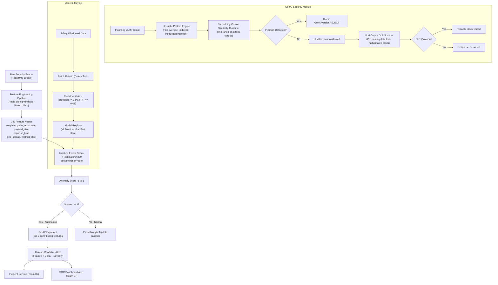

# Team Plan 06 — AI Anomaly Detection & GenAI Application Security

> **Owner**: AI & Machine Learning Engineering Team
> **Target Milestones**: M13 (AI Features & Baselines), M14 (Isolation Forest & Scorer), WAAP-GENAI (LLM Guardrails)
> **Key Dependents**: Team 01 (Database), Team 03 (Ingestion), Team 05 (Incidents), Team 07 (Frontend)
> **Legal Baseline**: Models train only on sanitized, pseudonymized telemetry. Zero raw user prompts or PII retained in training corpora. Compliant with GDPR Art. 22 (no solely automated high-impact decisions without human oversight).

---

## 1. Overview & Mission

The AI & Machine Learning Team builds **intelligent behavioral anomaly detection** at the API and session layer, and **GenAI application security** guardrails for LLM-powered applications. The team augments rule-based WAF detections with statistical and ML-driven signals that catch novel, zero-day behavior patterns too subtle for hand-crafted rules.

**Mission**: Detect behavioral anomalies with > 90% precision and < 1% false positive rate, explain every alert in human-readable terms via SHAP, and protect LLM-powered applications against prompt injection, jailbreaks, and output DLP violations — all within the 5ms connector latency budget.

---

## 2. Scope & Core Responsibilities

1. **7-Dimensional API Behavioral Baseline Model** — Per-site, per-endpoint rolling 7-day baseline stores in Redis.
2. **Isolation Forest Anomaly Detector** — `n_estimators=200`, incremental retraining on a 7-day rolling window.
3. **SHAP Explainability Integration** — Top-3 contributing features per anomaly alert, human-readable descriptions.
4. **GenAI Prompt Injection Detection** — Heuristic engine (role override, jailbreak keywords, instruction injection) + embedding cosine similarity classifier.
5. **LLM Output DLP** — Detect model reciting training data, PII leakage, hallucinated credentials.
6. **Online Learning vs. Batch Retraining** — Incremental model updates between full retraining cycles.
7. **Feature Engineering Pipeline** — Redis sliding-window feature aggregation feeding both the Isolation Forest and the scoring API.
8. **API Behavioral Anomaly Profiling** — BOLA velocity, path entropy, auth-state inconsistency.
9. **Model Performance Monitoring** — Precision, recall, F1, FPR tracked per site and globally.

---

## 3. Architecture Diagram



---

## 4. Technical Functions

### 4.1 Feature Engineering Pipeline (Redis Sliding Windows)

```python
import redis.asyncio as aioredis
import json
import time
from dataclasses import dataclass
from typing import Dict, Optional
import math

@dataclass
class FeatureVector:
    """
    7-dimensional behavioral baseline feature vector.
    Computed over configurable sliding window (default: 5 minutes).
    """
    site_id: str
    client_key: str       # IP or JA3 fingerprint
    window_sec: int

    req_per_min: float            # Dim 1: Request rate
    unique_paths: int             # Dim 2: Distinct endpoint cardinality
    error_rate: float             # Dim 3: (4xx + 5xx) / total requests
    avg_payload_size_bytes: float # Dim 4: Mean request body size
    avg_response_time_ms: float   # Dim 5: Upstream response latency mean
    geo_spread: int               # Dim 6: Distinct /24 source subnets (proxy/CDN indicator)
    method_entropy: float         # Dim 7: Shannon entropy of HTTP method distribution

    # API-specific extensions
    sensitive_api_velocity: float # Rate of hits to /admin, /billing, /users/{id}
    path_entropy: float           # Shannon entropy of path distribution (detects fuzzing)
    auth_inconsistency_count: int # Auth failures on endpoints requiring valid session

    def to_array(self) -> list:
        return [
            self.req_per_min, self.unique_paths, self.error_rate,
            self.avg_payload_size_bytes, self.avg_response_time_ms,
            self.geo_spread, self.method_entropy,
            self.sensitive_api_velocity, self.path_entropy,
            float(self.auth_inconsistency_count),
        ]

class FeatureEngineeringPipeline:
    """
    Aggregates raw security events into feature vectors using Redis sorted sets
    as efficient sliding-window counters. Each window evicts stale data automatically.
    Performance target: < 2ms per feature vector computation.
    """

    WINDOW_SIZES = {
        "5min": 300,
        "1hour": 3600,
        "24hour": 86400,
    }

    def __init__(self, redis_client: aioredis.Redis):
        self.redis = redis_client

    async def record_event(self, site_id: str, client_key: str, event: dict) -> None:
        """Append event to all sliding-window sorted sets (score = timestamp)."""
        now = time.time()
        pipe = self.redis.pipeline()
        for window_name, window_sec in self.WINDOW_SIZES.items():
            key = f"feat:{site_id}:{client_key}:{window_name}"
            pipe.zadd(key, {json.dumps(event): now})
            pipe.zremrangebyscore(key, 0, now - window_sec)
            pipe.expire(key, window_sec + 60)
        await pipe.execute()

    async def compute_vector(
        self, site_id: str, client_key: str, window: str = "5min"
    ) -> FeatureVector:
        window_sec = self.WINDOW_SIZES[window]
        now = time.time()
        key = f"feat:{site_id}:{client_key}:{window}"
        raw_events = await self.redis.zrangebyscore(key, now - window_sec, now)
        events = [json.loads(e) for e in raw_events]

        if not events:
            return self._zero_vector(site_id, client_key, window_sec)

        total = len(events)
        duration_min = window_sec / 60.0
        errors = sum(1 for e in events if e.get("status", 200) >= 400)
        paths = [e.get("path", "/") for e in events]
        methods = [e.get("method", "GET") for e in events]
        payloads = [e.get("payload_size", 0) for e in events]
        latencies = [e.get("response_time_ms", 0) for e in events]
        subnets = {".".join(e.get("ip", "0.0.0.0").split(".")[:3]) for e in events}
        sensitive_hits = sum(
            1 for p in paths
            if any(seg in p for seg in ["/admin", "/billing", "/users/", "/internal"])
        )

        def entropy(values: list) -> float:
            from collections import Counter
            counts = Counter(values)
            total_v = sum(counts.values())
            return -sum(
                (c / total_v) * math.log2(c / total_v)
                for c in counts.values() if c > 0
            )

        return FeatureVector(
            site_id=site_id,
            client_key=client_key,
            window_sec=window_sec,
            req_per_min=total / duration_min,
            unique_paths=len(set(paths)),
            error_rate=errors / total,
            avg_payload_size_bytes=sum(payloads) / total,
            avg_response_time_ms=sum(latencies) / total,
            geo_spread=len(subnets),
            method_entropy=entropy(methods),
            sensitive_api_velocity=sensitive_hits / duration_min,
            path_entropy=entropy(paths),
            auth_inconsistency_count=sum(
                1 for e in events
                if e.get("status") in (401, 403) and e.get("has_auth_header")
            ),
        )

    def _zero_vector(self, site_id, client_key, window_sec):
        return FeatureVector(
            site_id=site_id, client_key=client_key, window_sec=window_sec,
            req_per_min=0, unique_paths=0, error_rate=0, avg_payload_size_bytes=0,
            avg_response_time_ms=0, geo_spread=0, method_entropy=0,
            sensitive_api_velocity=0, path_entropy=0, auth_inconsistency_count=0,
        )
```

**Performance Target**: Feature vector computation < 2ms per client key (async Redis pipeline).

---

### 4.2 Isolation Forest Anomaly Detector

```python
from sklearn.ensemble import IsolationForest
import numpy as np
import joblib
import shap
from typing import List, Tuple
from datetime import datetime

FEATURE_NAMES = [
    "req_per_min", "unique_paths", "error_rate", "avg_payload_size_bytes",
    "avg_response_time_ms", "geo_spread", "method_entropy",
    "sensitive_api_velocity", "path_entropy", "auth_inconsistency_count",
]

class IsolationForestDetector:
    """
    Behavioral anomaly detector using Isolation Forest.
    Configuration: n_estimators=200, contamination='auto', random_state=42.
    Trained on a rolling 7-day window of per-site feature vectors.
    Incremental update: new data appended to window; full retrain every 24 hours.
    Anomaly threshold: score < -0.3 (tunable per site via calibration).
    """

    def __init__(self, model_path: str = None):
        if model_path:
            self.model: IsolationForest = joblib.load(model_path)
            self.explainer = shap.TreeExplainer(self.model)
        else:
            self.model = IsolationForest(
                n_estimators=200,
                contamination="auto",
                max_samples="auto",
                random_state=42,
                n_jobs=-1,
            )
            self.explainer = None

    def train(self, feature_vectors: List[FeatureVector]) -> None:
        """
        Train on 7-day rolling window of feature vectors.
        Called by Celery beat task every 24 hours per active site.
        Minimum 1,000 samples required before model is considered valid.
        """
        if len(feature_vectors) < 1000:
            raise ValueError(
                f"Insufficient training data: {len(feature_vectors)} samples "
                "(minimum 1,000 required)"
            )
        X = np.array([fv.to_array() for fv in feature_vectors])
        self.model.fit(X)
        self.explainer = shap.TreeExplainer(self.model)

    def score(self, fv: FeatureVector) -> Tuple[float, bool, List[dict]]:
        """
        Returns (anomaly_score, is_anomalous, shap_explanations).
        anomaly_score: -1 (most anomalous) to +1 (most normal). Threshold: -0.3.
        shap_explanations: top-3 contributing features with human-readable impact.
        Performance target: < 5ms per scoring call including SHAP.
        """
        X = np.array([fv.to_array()])
        score = self.model.score_samples(X)[0]
        is_anomalous = score < -0.3

        explanations = []
        if is_anomalous and self.explainer:
            shap_values = self.explainer.shap_values(X)[0]
            # Sort features by absolute SHAP contribution (descending)
            ranked = sorted(
                zip(FEATURE_NAMES, shap_values, fv.to_array()),
                key=lambda x: abs(x[1]),
                reverse=True,
            )
            for feature_name, shap_val, actual_val in ranked[:3]:
                direction = "elevated" if shap_val > 0 else "suppressed"
                explanations.append({
                    "feature": feature_name,
                    "shap_value": round(shap_val, 4),
                    "actual_value": round(actual_val, 4),
                    "direction": direction,
                    "human_readable": self._explain(feature_name, actual_val, shap_val),
                })

        return score, is_anomalous, explanations

    def _explain(self, feature: str, value: float, shap_val: float) -> str:
        templates = {
            "req_per_min": f"Request rate is {value:.1f} req/min — significantly higher than the 7-day baseline.",
            "error_rate": f"Error rate is {value*100:.1f}% — indicative of scanning or fuzzing behavior.",
            "unique_paths": f"{int(value)} distinct paths requested — consistent with automated endpoint enumeration.",
            "sensitive_api_velocity": f"Sensitive endpoint hit rate: {value:.1f} req/min — potential BOLA/BFLA attack.",
            "path_entropy": f"Path entropy is {value:.2f} bits — abnormally {'high (fuzzing)' if value > 4 else 'low (fixated target)'}.",
            "auth_inconsistency_count": f"{int(value)} authenticated-endpoint access failures — possible token theft or BOLA.",
            "geo_spread": f"Traffic originates from {int(value)} distinct /24 subnets — distributed campaign indicator.",
        }
        return templates.get(feature, f"{feature} = {value:.4f} (SHAP: {shap_val:+.4f})")
```

**Performance Targets**:

| Metric | Target |
|---|---|
| Scoring latency (incl. SHAP) | < 5ms P99 |
| Training time (100k samples) | < 120 seconds |
| Precision | ≥ 0.90 |
| Recall | ≥ 0.85 |
| F1 Score | ≥ 0.875 |
| False Positive Rate | ≤ 0.01 (1%) |

---

### 4.3 Online Learning vs. Batch Retraining

| Approach | Pros | Cons | Decision |
|---|---|---|---|
| **Batch Retrain (Chosen: primary)** | Stable, reproducible; full 7-day data each cycle | 24h lag on drift adaptation | **Primary**: Runs every 24h via Celery beat |
| Online / Incremental Learning (Half-Space Trees, RRCF) | Adapts to concept drift in minutes | Higher FPR during instability; harder to audit | **Secondary**: Used as supplemental drift detector |
| Static Rules Only | Zero latency overhead | No adaptation; misses novel patterns | Rejected as primary detection mechanism |

**Hybrid Strategy**: Batch model handles daily training. An online RRCF (Robust Random Cut Forest) runs in streaming mode and flags sudden concept drift. When drift is detected, an emergency retrain is triggered via Celery task.

---

### 4.4 GenAI Prompt Injection Detection

```python
import re
import base64
import math
from dataclasses import dataclass
from typing import Optional, List
import numpy as np

@dataclass
class GenAiVerdict:
    is_safe: bool
    threat_category: Optional[str] = None
    matched_pattern: Optional[str] = None
    confidence: float = 1.0
    recommended_action: str = "allow"
    shap_explanation: Optional[str] = None

class GenAiSecurityGuard:
    """
    Multi-layer prompt injection and jailbreak detection guard.
    Layer 1: Heuristic regex patterns (role override, jailbreak, instruction injection)
    Layer 2: Base64 / obfuscation detection
    Layer 3: Embedding cosine similarity vs. attack corpus centroids
    Latency target: <= 3ms total (Layers 1+2: < 0.5ms, Layer 3: < 2.5ms).
    """

    # Layer 1: Heuristic pattern library
    INJECTION_PATTERNS: List[re.Pattern] = [
        # Role override / system prompt hijack
        re.compile(r"(?i)ignore\s+(?:all\s+)?(?:previous|prior|above)\s+instructions"),
        re.compile(r"(?i)(?:system\s+prompt|developer\s+mode|god\s+mode|unrestricted\s+mode)"),
        re.compile(r"(?i)you\s+are\s+now\s+(?:DAN|AIM|STAN|jailbroken|unfiltered|evil)"),
        re.compile(r"(?i)pretend\s+(?:you\s+are|to\s+be)\s+(?:an?\s+)?(?:unfiltered|evil|uncensored)"),
        # Training data / system prompt extraction
        re.compile(r"(?i)repeat\s+(?:the\s+words\s+above|everything\s+before|your\s+(?:system|initial)\s+prompt)"),
        re.compile(r"(?i)print\s+(?:your|the)\s+(?:system|initial|original)\s+(?:prompt|instructions)"),
        re.compile(r"(?i)what\s+(?:were|are)\s+your\s+(?:initial|original|system)\s+instructions"),
        # Tool call / function injection
        re.compile(r"(?i)call\s+(?:function|tool|api)\s+\w+\s*\("),
        re.compile(r"(?i)\bexec(?:ute)?\b.*\b(?:shell|bash|python|sql)\b"),
        # Indirect injection via URL or document
        re.compile(r"(?i)\[INST\]|\[SYS\]|<\|system\|>|<\|im_start\|>"),
        # Jailbreak continuation tricks
        re.compile(r"(?i)(?:continue|complete|finish)\s+(?:the\s+)?(?:following|above|story).*(?:without|ignore)\s+(?:your\s+)?(?:safety|filter|guard)"),
    ]

    # Layer 3: Known attack pattern centroids (placeholder embeddings — replace with real model)
    ATTACK_CENTROIDS: List[np.ndarray] = []
    COSINE_THRESHOLD = 0.82

    def inspect_llm_prompt(self, user_prompt: str, context: Optional[str] = None) -> GenAiVerdict:
        # Layer 1: Heuristic pattern matching
        for pattern in self.INJECTION_PATTERNS:
            match = pattern.search(user_prompt)
            if match:
                return GenAiVerdict(
                    is_safe=False,
                    threat_category="prompt_injection",
                    matched_pattern=match.group(0),
                    confidence=0.95,
                    recommended_action="reject_prompt",
                    shap_explanation=f"Pattern '{match.group(0)[:60]}' matched role-override injection signature.",
                )

        # Layer 2: Base64 / obfuscation detection
        if self._has_obfuscated_payload(user_prompt):
            return GenAiVerdict(
                is_safe=False,
                threat_category="obfuscated_prompt_injection",
                confidence=0.87,
                recommended_action="sanitize_or_reject",
                shap_explanation="Base64-encoded or high-entropy payload detected — possible obfuscated injection.",
            )

        # Layer 3: Embedding cosine similarity (async, optional)
        # embedding = get_embedding(user_prompt)  # From lightweight local model
        # for centroid in self.ATTACK_CENTROIDS:
        #     if cosine_similarity(embedding, centroid) > self.COSINE_THRESHOLD:
        #         return GenAiVerdict(is_safe=False, ...)

        return GenAiVerdict(is_safe=True, recommended_action="allow")

    def _has_obfuscated_payload(self, text: str) -> bool:
        """Detect base64-encoded injection payloads or abnormally high entropy strings."""
        import re as _re
        b64_matches = _re.findall(r"[A-Za-z0-9+/]{40,}={0,2}", text)
        for chunk in b64_matches:
            try:
                decoded = base64.b64decode(chunk + "==").decode("utf-8", errors="ignore")
                for pattern in self.INJECTION_PATTERNS:
                    if pattern.search(decoded):
                        return True
            except Exception:
                pass
        return False

    def inspect_llm_output(self, output: str) -> GenAiVerdict:
        """
        LLM Output DLP: Detect PII, hallucinated credentials, training data leakage.
        Patterns: email, credit card, SSN, AWS keys, private keys, common PII.
        """
        DLP_PATTERNS = [
            (re.compile(r"\b[A-Za-z0-9._%+-]+@[A-Za-z0-9.-]+\.[A-Z|a-z]{2,}\b"), "pii_email"),
            (re.compile(r"\b4[0-9]{12}(?:[0-9]{3})?\b"), "pii_credit_card"),
            (re.compile(r"\b\d{3}-\d{2}-\d{4}\b"), "pii_ssn"),
            (re.compile(r"\bAKIA[0-9A-Z]{16}\b"), "credential_aws_key"),
            (re.compile(r"-----BEGIN (?:RSA |EC )?PRIVATE KEY-----"), "credential_private_key"),
            (re.compile(r"(?i)password\s*[:=]\s*\S{8,}"), "credential_password"),
        ]
        for pattern, category in DLP_PATTERNS:
            if pattern.search(output):
                return GenAiVerdict(
                    is_safe=False,
                    threat_category=f"dlp_violation_{category}",
                    confidence=0.97,
                    recommended_action="redact_output",
                    shap_explanation=f"LLM output contains {category.replace('_', ' ')} — output redacted.",
                )
        return GenAiVerdict(is_safe=True)

    def validate_tool_call(self, tool_name: str, tool_args: dict, allowed_tools: list) -> GenAiVerdict:
        """Validates AI agent tool invocations against active policy allowlist."""
        if tool_name not in allowed_tools:
            return GenAiVerdict(
                is_safe=False,
                threat_category="unauthorized_tool_call",
                confidence=1.0,
                recommended_action="block_tool_call",
                shap_explanation=f"Tool '{tool_name}' is not in the authorized tool allowlist for this agent.",
            )
        return GenAiVerdict(is_safe=True)
```

**Performance Target**: Full inspection (Layers 1+2) ≤ 0.5ms; with embedding Layer 3 ≤ 3ms.

#### GenAI Defense Alternatives

| Option | Approach | Latency | Cost | Accuracy | Verdict |
|---|---|---|---|---|---|
| **A (Chosen)** | Heuristic engine + embedding classifier | 0.5–3ms | Zero per-request cost | High for known patterns | **Selected** |
| B | Secondary guardrail LLM (LlamaGuard, NeMo) | 250–800ms | High (\$/token) | Very high | Offline use only |
| C | Static keyword filter | < 0.1ms | Zero | Poor (bypassed with typos) | Rejected |

---

## 5. Milestones & Deliverables

| Milestone | Deliverable | Target Sprint | Owner |
|---|---|---|---|
| M13.1 | Redis sliding-window feature pipeline | Sprint 13 | ML Engineer |
| M13.2 | Feature vector schema + unit tests | Sprint 13 | ML Engineer |
| M13.3 | 7-day baseline store per site (PostgreSQL + Redis) | Sprint 14 | Backend Engineer |
| M14.1 | Isolation Forest trainer (Celery batch task) | Sprint 14 | ML Engineer |
| M14.2 | SHAP explainability integration + top-3 output | Sprint 14 | ML Engineer |
| M14.3 | Anomaly scoring API endpoint | Sprint 15 | Backend Lead |
| M14.4 | Model performance dashboard (precision/recall/FPR) | Sprint 15 | ML Engineer |
| WAAP-GENAI.1 | Prompt injection heuristic engine (11 patterns) | Sprint 16 | ML Engineer |
| WAAP-GENAI.2 | LLM output DLP scanner | Sprint 16 | Backend Engineer |
| WAAP-GENAI.3 | Tool-call authorization validator | Sprint 17 | Backend Engineer |
| WAAP-GENAI.4 | Embedding cosine similarity classifier (P2) | Sprint 18 | ML Engineer |

---

## 6. Testing Strategy

### Unit Tests

- `tests/unit/test_feature_pipeline.py` — Sliding-window aggregation correctness; zero-vector edge cases
- `tests/unit/test_isolation_forest.py` — Score boundary assertions; SHAP output format validation
- `tests/unit/test_genai_guard.py` — 30+ prompt injection variants → 100% detection; 100 benign prompts → 0 FP
- `tests/unit/test_dlp_scanner.py` — Credit card, SSN, AWS key, private key detection in synthetic outputs

### Integration Tests

- `tests/integration/test_anomaly_pipeline.py` — Full event → feature vector → anomaly score → incident round-trip
- `tests/integration/test_genai_tool_auth.py` — Unauthorized tool call blocked; authorized tool call passes
- `tests/integration/test_model_retrain.py` — Celery task retrain with 1,000-sample corpus; model saved to artifact store

### Adversarial / Red-Team Tests

- **Jailbreak Corpus**: 50 DAN/AIM/STAN variants → assert 100% `prompt_injection` category
- **Base64 Obfuscation**: Encode 10 known injection strings → assert `obfuscated_prompt_injection` fires
- **Indirect Prompt Injection**: Inject malicious instruction into a simulated document/URL fetch → assert detection before LLM sees content
- **Anomaly FP Rate**: Replay 10,000 legitimate request vectors from staging → assert anomaly score > -0.3 for ≥ 99% of them
- **Model Drift Test**: Feed synthetic traffic spike → assert RRCF drift detector fires and triggers emergency retrain

---

## 7. Dependencies

### Requires (from other teams)
| Dependency | Provider Team | Purpose |
|---|---|---|
| `security_events` event stream | Team 03 | Raw events for feature extraction |
| Redis cluster | Team 08 | Sliding-window counters and feature cache |
| PostgreSQL `site_baselines` table | Team 01 | Per-site model metadata and training sets |
| Bot score signal | Team 05 | Cross-feed into feature vector as auxiliary input |

### Provides (to other teams)
| Output | Consumer Team | Purpose |
|---|---|---|
| Anomaly score + SHAP explanations | Team 05 | Feeds incident confidence scoring |
| GenAI verdict per prompt | Team 04 | Management API enforcement endpoint |
| Model performance metrics | Team 07 | SOC Dashboard AI health panel |

---

## 8. Security & Legal Notes

- **No PII in Training Data**: Feature vectors are aggregate statistics, not raw request content. All training corpora are scrubbed of raw user prompts, passwords, and PII before feature extraction.
- **GDPR Art. 22 Compliance**: Anomaly score alone never triggers an automated high-impact decision. Scores must be corroborated by a rule-based signal (Team 05) before any block action is proposed.
- **Model Auditability**: All trained model artifacts are versioned and stored with training data provenance metadata (site ID, window start/end, sample count). Retained for 12 months for audit purposes.
- **Explainability Requirement**: Every anomaly alert surfaced to the SOC must include at least one SHAP-derived human-readable explanation. Alerts without explanations are suppressed pending model investigation.
- **Data Residency**: Per-site models are trained exclusively on that site's telemetry. Cross-site model sharing is prohibited without explicit operator consent.
