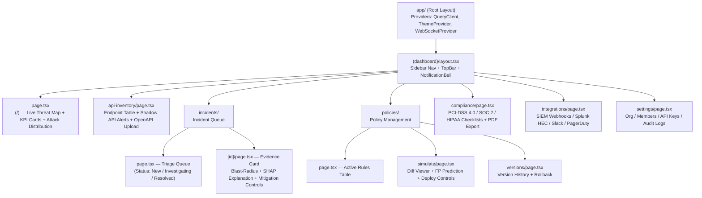
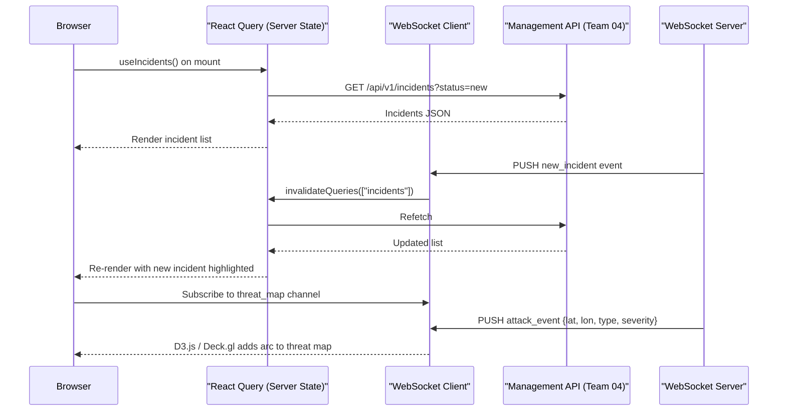
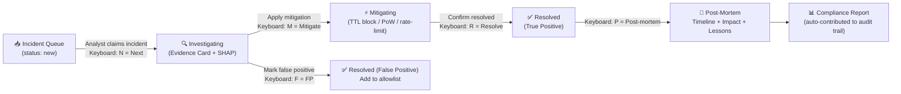

# Team Plan 07 — Frontend WAAP Console & SOC Operations Dashboard

> **Owner**: Frontend & User Experience Team
> **Target Milestones**: M12 (Operations Dashboard & Live Feeds), WAAP-UI (API Inventory & Simulation Workbench)
> **Key Dependents**: Team 04 (Management API), Team 05 (Incidents), Team 06 (AI Alerts)
> **Tech Stack**: Next.js 14 (App Router), TypeScript, shadcn/ui, Tailwind CSS, Zustand, React Query, WebSocket, D3.js / Deck.gl

---

## 1. Overview & Mission

The Frontend Team delivers the **SentinelGrid WAAP Security Operations Console** — a professional-grade, real-time web application built for SOC analysts, security engineers, and compliance officers. The console unifies threat visibility, incident triage, API governance, policy simulation, and compliance reporting into a single, fast, keyboard-navigable interface.

**Mission**: Give SOC analysts a sub-second situational awareness update cycle, a zero-friction incident triage workflow, and auditor-ready compliance reports — all within a single browser tab.

---

## 2. Scope & Core Responsibilities

1. **Real-Time Threat Map** — Live WebSocket-fed geospatial attack visualization using D3.js or Deck.gl.
2. **API Discovery & Inventory Console** — Table of all endpoints with status badges (Documented / Shadow / Zombie / Deprecated), risk scores, last-seen timestamps.
3. **Policy Simulation Diff Viewer** — Side-by-side before/after with false-positive prediction highlighted in red.
4. **Incident Triage Workflow** — Queue → Investigate → Resolve → Post-Mortem pipeline with keyboard shortcuts.
5. **Compliance Report Generator** — PCI-DSS 4.0, SOC 2, HIPAA checklists as auto-filled PDF exports.
6. **Dark/Light Mode** — System-aware theme with manual toggle; persistent via localStorage.
7. **Component Library** — shadcn/ui + Tailwind CSS design system.
8. **State Management** — Zustand for UI/global state; Jotai for fine-grained atom state; React Query for server state.
9. **Live Feed Architecture** — React Query polling + WebSocket push for real-time alert streaming.
10. **Accessibility & Performance** — WCAG 2.1 AA, keyboard shortcuts for SOC efficiency, Core Web Vitals targets.

---

## 3. Architecture Diagram

### 3.1 Next.js 14 App Router Component Tree



### 3.2 Real-Time Data Flow



---

## 4. Technical Functions

### 4.1 Real-Time Threat Map (WebSocket + D3.js)

```typescript
// components/threat-map/ThreatMap.tsx
"use client";

import { useEffect, useRef } from "react";
import * as d3 from "d3";
import { feature } from "topojson-client";
import { useThreatMapWebSocket } from "@/hooks/use-threat-map-ws";

export interface AttackEvent {
  id: string;
  source_lat: number;
  source_lon: number;
  target_lat: number;
  target_lon: number;
  threat_type: "sqli" | "xss" | "bot" | "ato" | "prompt_injection";
  severity: "low" | "medium" | "high" | "critical";
  timestamp: string;
}

const SEVERITY_COLORS: Record<AttackEvent["severity"], string> = {
  low: "#3b82f6",
  medium: "#f59e0b",
  high: "#ef4444",
  critical: "#7c3aed",
};

export function ThreatMap() {
  const svgRef = useRef<SVGSVGElement>(null);
  const { events } = useThreatMapWebSocket("/ws/threat-map");

  useEffect(() => {
    if (!svgRef.current) return;
    const svg = d3.select(svgRef.current);
    const width = svgRef.current.clientWidth;
    const height = svgRef.current.clientHeight;

    const projection = d3.geoNaturalEarth1()
      .scale(width / 6.2)
      .translate([width / 2, height / 2]);
    const path = d3.geoPath().projection(projection);

    // Draw world basemap (topojson world-110m)
    svg.selectAll(".country").data([]).exit().remove(); // placeholder

    // Render attack arcs
    events.forEach((event) => {
      const source = projection([event.source_lon, event.source_lat]);
      const target = projection([event.target_lon, event.target_lat]);
      if (!source || !target) return;

      svg.append("line")
        .attr("x1", source[0]).attr("y1", source[1])
        .attr("x2", target[0]).attr("y2", target[1])
        .attr("stroke", SEVERITY_COLORS[event.severity])
        .attr("stroke-width", event.severity === "critical" ? 2 : 1)
        .attr("stroke-opacity", 0.7)
        .attr("class", "attack-arc")
        .transition()
        .duration(2000)
        .attr("stroke-opacity", 0)
        .remove();
    });
  }, [events]);

  return (
    <div className="relative w-full h-96 bg-slate-900 rounded-lg overflow-hidden">
      <svg ref={svgRef} className="w-full h-full" />
      <div className="absolute top-3 right-3 flex gap-2 flex-wrap">
        {Object.entries(SEVERITY_COLORS).map(([sev, color]) => (
          <span key={sev} className="text-xs px-2 py-1 rounded-full text-white font-mono"
            style={{ backgroundColor: color }}>
            {sev}
          </span>
        ))}
      </div>
    </div>
  );
}
```

---

### 4.2 API Discovery & Inventory Console

```typescript
// components/api-inventory/EndpointTable.tsx
"use client";

import { useQuery } from "@tanstack/react-query";
import { Badge } from "@/components/ui/badge";
import { Button } from "@/components/ui/button";
import {
  Table, TableBody, TableCell, TableHead, TableHeader, TableRow,
} from "@/components/ui/table";

export type EndpointStatus =
  | "documented"   // Present in uploaded OpenAPI spec
  | "shadow"       // Observed in traffic, NOT in OpenAPI spec
  | "zombie"       // In OpenAPI spec, zero traffic in last 30 days
  | "deprecated";  // Marked deprecated in OpenAPI spec but still receiving traffic

export interface DiscoveredEndpoint {
  id: string;
  method: "GET" | "POST" | "PUT" | "PATCH" | "DELETE" | "OPTIONS";
  path: string;
  status: EndpointStatus;
  risk_score: number;  // 0-100
  last_seen_at: string;
  request_count_7d: number;
  anomaly_flags: string[];
}

const STATUS_BADGE: Record<EndpointStatus, { label: string; variant: "default" | "destructive" | "outline" | "secondary" }> = {
  documented:  { label: "Documented",  variant: "default" },
  shadow:      { label: "⚠ Shadow",    variant: "destructive" },
  zombie:      { label: "Zombie",      variant: "secondary" },
  deprecated:  { label: "Deprecated",  variant: "outline" },
};

const METHOD_COLORS: Record<string, string> = {
  GET: "text-green-400", POST: "text-blue-400", PUT: "text-amber-400",
  PATCH: "text-amber-400", DELETE: "text-red-500", OPTIONS: "text-slate-400",
};

export function EndpointTable() {
  const { data, isLoading } = useQuery<DiscoveredEndpoint[]>({
    queryKey: ["api-inventory"],
    queryFn: () => fetch("/api/v1/api-discovery/endpoints").then((r) => r.json()),
    refetchInterval: 30_000,
  });

  if (isLoading) return <div className="animate-pulse h-64 bg-muted rounded-lg" />;

  return (
    <div className="rounded-lg border">
      <Table>
        <TableHeader>
          <TableRow>
            <TableHead className="w-20">Method</TableHead>
            <TableHead>Path</TableHead>
            <TableHead>Status</TableHead>
            <TableHead className="text-right">Risk Score</TableHead>
            <TableHead>Last Seen</TableHead>
            <TableHead>7d Requests</TableHead>
            <TableHead>Actions</TableHead>
          </TableRow>
        </TableHeader>
        <TableBody>
          {data?.map((endpoint) => {
            const { label, variant } = STATUS_BADGE[endpoint.status];
            const riskColor =
              endpoint.risk_score >= 75 ? "text-red-500 font-bold" :
              endpoint.risk_score >= 40 ? "text-amber-500" : "text-green-500";
            return (
              <TableRow key={endpoint.id}
                className={endpoint.status === "shadow" ? "bg-red-950/20" : ""}>
                <TableCell className={`font-mono font-bold ${METHOD_COLORS[endpoint.method]}`}>
                  {endpoint.method}
                </TableCell>
                <TableCell className="font-mono text-sm">{endpoint.path}</TableCell>
                <TableCell>
                  <Badge variant={variant}>{label}</Badge>
                </TableCell>
                <TableCell className={`text-right ${riskColor}`}>
                  {endpoint.risk_score}
                </TableCell>
                <TableCell className="text-muted-foreground text-sm">
                  {new Date(endpoint.last_seen_at).toLocaleDateString()}
                </TableCell>
                <TableCell>{endpoint.request_count_7d.toLocaleString()}</TableCell>
                <TableCell>
                  <div className="flex gap-1">
                    <Button size="sm" variant="outline">Inspect</Button>
                    {endpoint.status === "shadow" && (
                      <Button size="sm" variant="destructive">Quarantine</Button>
                    )}
                  </div>
                </TableCell>
              </TableRow>
            );
          })}
        </TableBody>
      </Table>
    </div>
  );
}
```

---

### 4.3 Policy Simulation Diff Viewer

```typescript
// components/policy-sim/PolicyDiffViewer.tsx
"use client";

import { useState } from "react";
import { useMutation, useQuery } from "@tanstack/react-query";
import { cn } from "@/lib/utils";
import { Button } from "@/components/ui/button";
import { Alert, AlertDescription } from "@/components/ui/alert";

interface SimulationResult {
  current_policy_version: string;
  candidate_policy_version: string;
  simulated_events_count: number;
  current_blocks: number;
  candidate_blocks: number;
  delta_blocks: number;
  false_positive_estimate_pct: number;
  affected_crawlers: { googlebot: number; bingbot: number };
  risk_assessment: "low" | "medium" | "high";
  fp_breakdown: Array<{ rule_id: string; fp_count: number; example_path: string }>;
}

export function PolicyDiffViewer({
  candidatePolicyId,
}: {
  candidatePolicyId: string;
}) {
  const [deploying, setDeploying] = useState(false);

  const { data: sim } = useQuery<SimulationResult>({
    queryKey: ["policy-sim", candidatePolicyId],
    queryFn: () =>
      fetch(`/api/v1/policies/${candidatePolicyId}/simulate`).then((r) => r.json()),
  });

  const deployMutation = useMutation({
    mutationFn: (rolloutPct: number) =>
      fetch(`/api/v1/policies/${candidatePolicyId}/deploy`, {
        method: "POST",
        headers: { "Content-Type": "application/json" },
        body: JSON.stringify({ rollout_percentage: rolloutPct }),
      }),
  });

  if (!sim) return <div className="animate-pulse h-48 bg-muted rounded-lg" />;

  const fpHigh = sim.false_positive_estimate_pct > 0.05;

  return (
    <div className="space-y-6">
      {/* Side-by-side comparison */}
      <div className="grid grid-cols-2 gap-4">
        {/* Current Policy */}
        <div className="rounded-lg border p-4 space-y-2">
          <div className="text-sm font-semibold text-muted-foreground">
            Current Active — v{sim.current_policy_version}
          </div>
          <div className="font-mono text-sm space-y-1">
            <div>Projected Blocks: <span className="font-bold">{sim.current_blocks.toLocaleString()}</span></div>
            <div>FP Rate: <span className="font-bold">baseline</span></div>
            <div>Crawler Impact: 0</div>
          </div>
        </div>

        {/* Candidate Policy */}
        <div className={cn(
          "rounded-lg border p-4 space-y-2",
          fpHigh ? "border-red-500 bg-red-950/20" : "border-green-500 bg-green-950/10",
        )}>
          <div className="text-sm font-semibold text-muted-foreground">
            Candidate — v{sim.candidate_policy_version}
          </div>
          <div className="font-mono text-sm space-y-1">
            <div>
              Projected Blocks:{" "}
              <span className="font-bold">{sim.candidate_blocks.toLocaleString()}</span>
              <span className={cn(
                "ml-2 text-xs",
                sim.delta_blocks > 0 ? "text-amber-400" : "text-green-400",
              )}>
                ({sim.delta_blocks > 0 ? "+" : ""}{sim.delta_blocks.toLocaleString()})
              </span>
            </div>
            <div className={fpHigh ? "text-red-400 font-bold" : ""}>
              FP Estimate:{" "}
              <span>{sim.false_positive_estimate_pct.toFixed(3)}%</span>
              {fpHigh && " ⚠ HIGH RISK"}
            </div>
            <div>
              Crawler Impact: Googlebot {sim.affected_crawlers.googlebot} /
              Bingbot {sim.affected_crawlers.bingbot}
            </div>
          </div>
        </div>
      </div>

      {/* FP Breakdown (highlighted in red when high) */}
      {fpHigh && (
        <Alert variant="destructive">
          <AlertDescription>
            <strong>High false-positive risk detected.</strong> Rules contributing most:
            <ul className="mt-2 list-disc list-inside text-sm">
              {sim.fp_breakdown.map((fp) => (
                <li key={fp.rule_id}>
                  Rule <code>{fp.rule_id}</code>: {fp.fp_count} projected FPs
                  (e.g. <code>{fp.example_path}</code>)
                </li>
              ))}
            </ul>
          </AlertDescription>
        </Alert>
      )}

      {/* Deployment controls */}
      <div className="flex gap-3">
        <Button
          disabled={fpHigh || deployMutation.isPending}
          onClick={() => deployMutation.mutate(10)}
          variant="outline"
        >
          Deploy 10% Staged Rollout
        </Button>
        <Button
          disabled={fpHigh || deployMutation.isPending}
          onClick={() => deployMutation.mutate(100)}
        >
          Full 100% Deploy
        </Button>
        <Button variant="ghost" onClick={() => window.history.back()}>
          Cancel
        </Button>
      </div>
    </div>
  );
}
```

---

### 4.4 Incident Triage Workflow



**SOC Keyboard Shortcuts**:

| Key | Action |
|---|---|
| `N` | Claim next incident from queue |
| `M` | Open mitigation action panel |
| `F` | Mark as false positive |
| `R` | Resolve current incident |
| `P` | Open post-mortem form |
| `Esc` | Return to incident queue |
| `?` | Toggle keyboard shortcut help overlay |
| `Ctrl+K` | Global command palette |
| `D` | Toggle dark / light mode |

---

### 4.5 Compliance Report Generator

```typescript
// lib/compliance/report-generator.ts
import jsPDF from "jspdf";
import autoTable from "jspdf-autotable";

export type ComplianceFramework = "pci-dss-4" | "soc2" | "hipaa";

interface ComplianceControl {
  control_id: string;
  description: string;
  status: "pass" | "fail" | "partial" | "n/a";
  evidence: string;
  waap_feature: string;
}

const PCI_DSS_4_CONTROLS: ComplianceControl[] = [
  {
    control_id: "6.4.1",
    description: "All security vulnerabilities managed via defined process",
    status: "pass",
    evidence: "SentinelGrid WAAP rule updates deployed via signed CI/CD pipeline",
    waap_feature: "Policy versioning + cryptographic signatures",
  },
  {
    control_id: "6.4.2",
    description: "Automated technical solution deployed to defend web-facing apps",
    status: "pass",
    evidence: "WAAP connector active on all public endpoints; detection confirmed",
    waap_feature: "WAAP connector + real-time inspection",
  },
  {
    control_id: "6.4.3",
    description: "All payment page scripts authorized and integrity checked",
    status: "partial",
    evidence: "Script inventory requires manual review for third-party tags",
    waap_feature: "API Inventory shadow detection",
  },
  // ... additional controls
];

export function generateComplianceReport(
  framework: ComplianceFramework,
  siteId: string,
  reportDate: Date,
): Blob {
  const doc = new jsPDF({ orientation: "portrait", unit: "mm", format: "a4" });
  const controls = framework === "pci-dss-4" ? PCI_DSS_4_CONTROLS : [];

  // Header
  doc.setFontSize(18);
  doc.text("SentinelGrid WAAP — Compliance Report", 14, 20);
  doc.setFontSize(11);
  doc.text(`Framework: ${framework.toUpperCase()}`, 14, 30);
  doc.text(`Site: ${siteId}`, 14, 36);
  doc.text(`Generated: ${reportDate.toISOString().split("T")[0]}`, 14, 42);

  // Controls table
  autoTable(doc, {
    startY: 50,
    head: [["Control ID", "Description", "Status", "WAAP Feature", "Evidence"]],
    body: controls.map((c) => [
      c.control_id,
      c.description,
      c.status.toUpperCase(),
      c.waap_feature,
      c.evidence,
    ]),
    styles: { fontSize: 8, cellPadding: 2 },
    headStyles: { fillColor: [30, 64, 175] },
    bodyStyles: (row) => ({
      fillColor:
        controls[row.row.index]?.status === "fail" ? [254, 226, 226]
        : controls[row.row.index]?.status === "pass" ? [220, 252, 231]
        : undefined,
    }),
  });

  return doc.output("blob");
}
```

**Supported Compliance Frameworks**:

| Framework | Controls Mapped | Export Format |
|---|---|---|
| PCI-DSS 4.0 | Req 6.4.1, 6.4.2, 6.4.3, 11.6.1 | PDF + CSV |
| SOC 2 Type II | CC6.1, CC6.6, CC7.1, CC7.2 | PDF + CSV |
| HIPAA Security Rule | § 164.312(a)(1), (e)(2)(i) | PDF |

---

### 4.6 State Management Architecture

```typescript
// store/incident-store.ts (Zustand)
import { create } from "zustand";
import { devtools, subscribeWithSelector } from "zustand/middleware";

interface IncidentStore {
  selectedIncidentId: string | null;
  triageFilter: "new" | "investigating" | "resolved" | "all";
  setSelectedIncident: (id: string | null) => void;
  setTriageFilter: (f: IncidentStore["triageFilter"]) => void;
}

export const useIncidentStore = create<IncidentStore>()(
  devtools(
    subscribeWithSelector((set) => ({
      selectedIncidentId: null,
      triageFilter: "new",
      setSelectedIncident: (id) => set({ selectedIncidentId: id }),
      setTriageFilter: (f) => set({ triageFilter: f }),
    })),
    { name: "incident-store" }
  )
);

// hooks/use-incidents.ts (React Query)
import { useQuery, useMutation, useQueryClient } from "@tanstack/react-query";

export function useIncidents(status: string) {
  return useQuery({
    queryKey: ["incidents", status],
    queryFn: () =>
      fetch(`/api/v1/incidents?status=${status}`).then((r) => r.json()),
    refetchInterval: 10_000,   // Poll every 10s; WebSocket invalidation supplements
    staleTime: 5_000,
  });
}

export function useResolveIncident() {
  const qc = useQueryClient();
  return useMutation({
    mutationFn: ({ id, resolution }: { id: string; resolution: string }) =>
      fetch(`/api/v1/incidents/${id}/resolve`, {
        method: "POST",
        headers: { "Content-Type": "application/json" },
        body: JSON.stringify({ resolution }),
      }),
    onSuccess: () => qc.invalidateQueries({ queryKey: ["incidents"] }),
  });
}
```

---

## 5. Milestones & Deliverables

| Milestone | Deliverable | Target Sprint | Owner |
|---|---|---|---|
| M12.1 | Next.js 14 App Router scaffold + shadcn/ui setup | Sprint 5 | Frontend Lead |
| M12.2 | WebSocket client provider + React Query integration | Sprint 6 | Frontend Engineer |
| M12.3 | Live Threat Map (D3.js world basemap + attack arcs) | Sprint 7 | Frontend Engineer |
| M12.4 | KPI cards + attack distribution charts (Recharts) | Sprint 7 | Frontend Engineer |
| WAAP-UI.1 | API Inventory table + status badges | Sprint 9 | Frontend Engineer |
| WAAP-UI.2 | Shadow API alert panel + quarantine action | Sprint 10 | Frontend Lead |
| WAAP-UI.3 | Policy Simulation diff viewer | Sprint 11 | Frontend Lead |
| WAAP-UI.4 | FP prediction highlight + deploy controls | Sprint 11 | Frontend Engineer |
| WAAP-UI.5 | Incident triage queue + evidence card | Sprint 12 | Frontend Lead |
| WAAP-UI.6 | Keyboard shortcut system + command palette | Sprint 12 | Frontend Engineer |
| WAAP-UI.7 | Compliance report generator (PCI-DSS + SOC 2) | Sprint 13 | Frontend Engineer |
| WAAP-UI.8 | Dark/light mode + WCAG 2.1 AA audit | Sprint 13 | Frontend Engineer |

---

## 6. Testing Strategy

### Unit Tests (Vitest + React Testing Library)
- `tests/components/EndpointTable.test.tsx` — Renders shadow badge; quarantine button visible only for shadow endpoints
- `tests/components/PolicyDiffViewer.test.tsx` — FP alert renders when FP% > 0.05; deploy button disabled when risk is high
- `tests/components/ComplianceReport.test.tsx` — PDF blob generated with correct control IDs for each framework

### Integration Tests (Playwright)
- `tests/e2e/incident-triage.spec.ts` — Full triage flow: claim → mitigate → resolve → assert status change
- `tests/e2e/policy-deploy.spec.ts` — Simulate policy → verify diff → staged deploy → verify success toast
- `tests/e2e/threat-map.spec.ts` — WebSocket mock sends attack event → assert arc appears on map canvas

### Adversarial / UX Tests
- **Keyboard Navigation**: Navigate entire incident triage workflow using only keyboard (Tab, N, M, F, R) — zero mouse required
- **Rollback UI**: Click "Rollback to v{n}" → assert API call fires within 500ms → success toast visible within 1s
- **Accessibility Audit**: Zero violations in `axe-core` automated scan (WCAG 2.1 AA)
- **Performance Budget**: Lighthouse Performance ≥ 90; LCP < 2.5s; FID < 100ms; CLS < 0.1

---

## 7. Dependencies

### Requires (from other teams)
| Dependency | Provider Team | Purpose |
|---|---|---|
| Management REST API | Team 04 | All data fetch/write operations |
| WebSocket event server | Team 04 | Real-time incident + threat map feeds |
| Incident records + SHAP explanations | Team 05 / 06 | Triage evidence cards |
| Compliance control mapping data | Team 04 | Compliance report auto-fill |

### Provides (to other teams)
| Output | Consumer Team | Purpose |
|---|---|---|
| Mitigation approval UI | Team 04 / 05 | Analyst-gated high-blast-radius mitigations |
| Policy deploy/rollback UI | Team 04 | Safe policy lifecycle management |
| Compliance PDF export | Customers / Auditors | PCI-DSS / SOC 2 / HIPAA evidence packages |

---

## 8. Security & Legal Notes

- **No Raw PII in Frontend**: The frontend never renders raw source IPs, usernames, or passwords in UI components. All sensitive fields are masked by the Management API before transmission.
- **Content Security Policy**: Strict CSP headers set by Next.js middleware; no inline scripts; `script-src 'self'` + nonce for third-party maps tiles only.
- **Authentication**: All dashboard routes are protected by Next.js middleware with JWT validation; unauthenticated requests redirect to `/login`.
- **Audit Trail**: All mitigation approvals, policy deploys, and rollbacks made via the UI are logged with authenticated user ID and timestamp to the `audit_log` table (immutable, append-only).
- **PDF Export Security**: Compliance PDF exports are generated client-side (jsPDF) to avoid server-side PII processing. No compliance data is transmitted to third-party PDF services.
- **Dark Mode Persistence**: Theme preference stored in `localStorage` only; not transmitted to server. No user tracking cookies.
