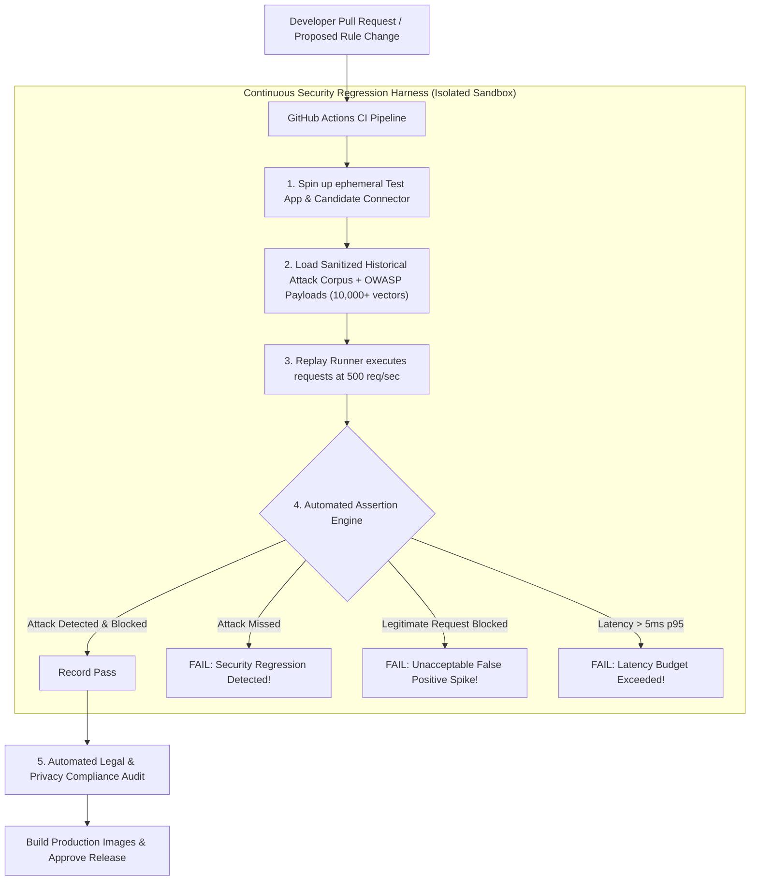

# Team Plan 08 — DevOps, Attack Replay & Continuous Security Regression Testing

> **Owner**: DevOps, QA & Adversarial Security Testing Team  
> **Target Milestones**: M2 (Docker Setup), M17 (Security Hardening & Chaos), WAAP-REPLAY (Attack Replay Harness)  
> **Key Dependents**: All Teams (Provides testing harness, CI/CD, and regression infrastructure)  
> **Legal Baseline**: Automated test suites verify zero offensive counter-attacks ("no hack-back") and 100% parameter masking to guarantee global legal compliance.

---

## 1. Scope & Core Responsibilities
The DevOps & Security Testing Team is responsible for:
1. Orchestrating the **Docker Compose Development & Staging Multi-Service Stack**.
2. Building the **Automated Attack Replay & Security Regression Testing Harness**: Replaying sanitized historical attacks and OWASP corpora in an isolated test environment to evaluate new detection rules.
3. Managing the **Automated GitHub Actions CI/CD Pipeline**.
4. Executing **Full OWASP Top 10 & API Security Top 10 Test Suites**.
5. Conducting **Chaos Engineering & Fail-Open Resilience Audits** (cloud outage, Redis loss, queue backpressure).
6. Executing **Global Legal & Privacy Compliance Audits** in CI.

---

## 2. Attack Replay & Regression Architecture



---

## 3. Technical Function Details & Architectural Alternatives

### 3.1 Continuous Attack Replay & Regression Runner
A dedicated test runner that evaluates proposed detection engines or policies against representative attack and benign corpora:

```python
class SecurityRegressionRunner:
    def __init__(self, test_app_url: str, attack_fixtures_path: str):
        self.url = test_app_url
        self.fixtures = self._load_fixtures(attack_fixtures_path)

    async def execute_regression_suite(self) -> RegressionReport:
        """
        Executes thousands of attack and legitimate payloads against the candidate engine.
        Ensures previously fixed vulnerabilities are never reintroduced (anti-regression).
        """
        results = {"passed": 0, "failed_regressions": [], "false_positives": []}

        async with httpx.AsyncClient(base_url=self.url) as client:
            for sample in self.fixtures:
                start_time = time.perf_counter()
                resp = await client.request(
                    method=sample["method"],
                    url=sample["path"],
                    params=sample.get("query"),
                    json=sample.get("body")
                )
                duration_ms = (time.perf_counter() - start_time) * 1000

                # Validate expected behavior
                if sample["is_malicious"]:
                    if resp.status_code != 403:
                        results["failed_regressions"].append({
                            "sample_id": sample["id"],
                            "name": sample["name"],
                            "expected": 403,
                            "actual": resp.status_code
                        })
                    else:
                        results["passed"] += 1
                else:
                    if resp.status_code == 403:
                        results["false_positives"].append({
                            "sample_id": sample["id"],
                            "name": sample["name"],
                            "reason": "Legitimate request was blocked"
                        })
                    else:
                        results["passed"] += 1

        return RegressionReport(
            total_executed=len(self.fixtures),
            passed_count=results["passed"],
            regression_failures=results["failed_regressions"],
            false_positives=results["false_positives"]
        )
```

#### Architectural Alternatives Analysis (Security Regression)
| Option | Approach | Safety | Repeatability | Verdict |
|---|---|---|---|---|
| **Option A (Chosen)** | **Isolated Ephemeral Container Replay Harness** | **100% Safe (Docker sandbox, zero production impact)** | **100% Deterministic (Version-controlled fixtures)** | **Selected**: Essential for establishing continuous trust in WAF/WAAP updates. |
| **Option B** | Testing in Staging Environment | Medium | Variable (Staging data often differs from production) | *Complementary*: Run after automated CI sandbox passes. |
| **Option C** | Live Canary Testing Only | High Risk | Poor | *Rejected*: Pushing untested rules to live production can cause customer-facing outages. |

---

### 3.2 Automated Legal & Compliance Test Suite
Every CI build runs automated checks to guarantee global legality:
1. **No-Hack-Back Verification (`test_legal_no_hack_back.py`)**:
   - Inspects all network socket calls in connectors and backend.
   - Asserts: Zero outbound TCP/UDP connections are initiated toward client IP addresses. Connectors communicate strictly with the upstream backend and the designated SentinelGrid ingestion endpoint.
2. **GDPR/DPDP Data Sanitization Verification (`test_legal_data_sanitization.py`)**:
   - Sends simulated requests containing fake passwords, credit cards (`4111 1111 1111 1111`), and SSNs (`123-45-6789`).
   - Asserts: Sanitized event payload emitted to ring buffer contains `[REDACTED_SENSITIVE]` and zero raw secret substrings.

---

## 4. Verification & Testing Gates

1. **Anti-Regression Gate**: Zero regressions allowed. 100% of attack fixtures in `shared/test-fixtures/` must be detected.
2. **False-Positive Gate**: False-positive rate on legitimate traffic sample suite must be $< 0.05\%$.
3. **Legal Compliance Gate**: Automated legal audit tests must pass 100% without exception.
4. **Latency Budget Gate**: Local inspection p95 latency must remain $\le 5.0\text{ms}$.
