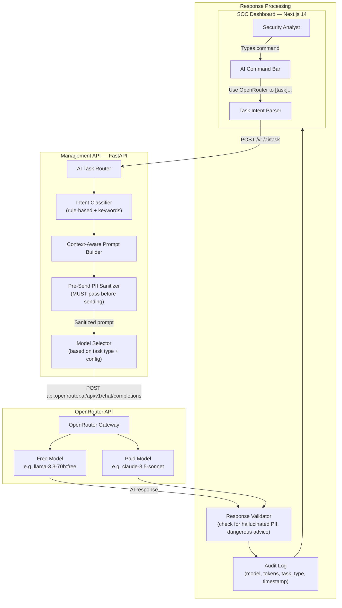
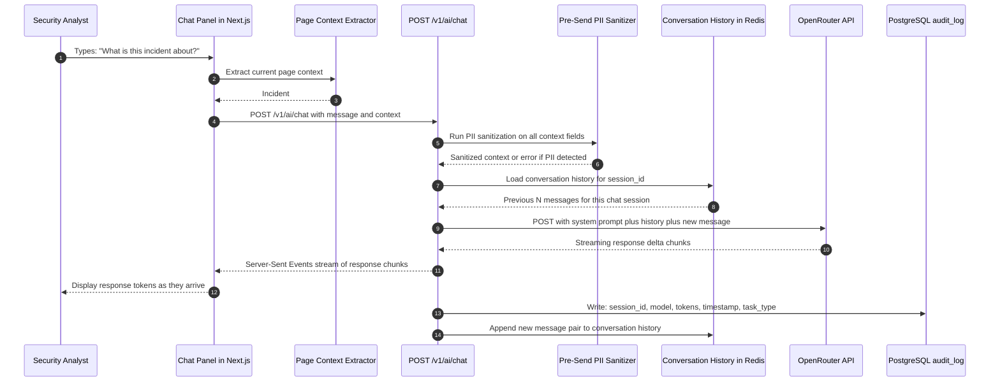
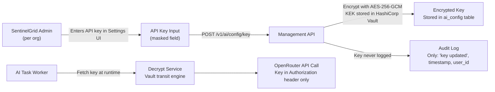
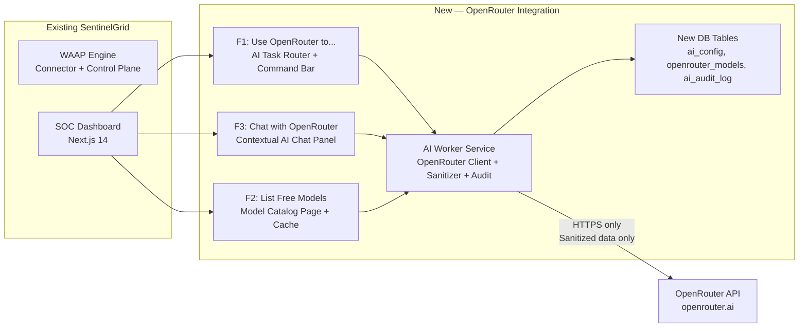

# SentinelGrid × OpenRouter — Integration Plan

> **Document Type**: Product & Architecture Plan (NO implementation yet)
> **Version**: 1.0 — For team review and approval
> **Author**: SentinelGrid Core Team — Lead Architect (SentinelGrid Open Architecture Core)
> **Date**: 2026-11-02
> **Storage**: `sentinelgrid/plans/09_OPENROUTER_INTEGRATION_PLAN.md`
> **Status**: 🟡 DRAFT — Awaiting team review

---

## 0. Executive Summary

This plan adds **OpenRouter** as SentinelGrid's AI model gateway. OpenRouter is a single API that gives access to 200+ AI models (including many **free-tier** models like `google/gemma-3-27b-it:free`, `meta-llama/llama-3.3-70b-instruct:free`, `deepseek/deepseek-r1:free`) through one unified OpenAI-compatible endpoint.

**We are adding 3 features:**

| # | Feature Name | What It Does | Where It Lives |
|---|---|---|---|
| **F1** | **"Use OpenRouter to..."** | AI task router — route any security task (summarize incident, explain attack, write rule) to the best model | SOC Dashboard + Backend Worker |
| **F2** | **"List OpenRouter Free Models"** | Live catalog of all OpenRouter models with filtering by free/paid, capability, latency, context length | SOC Dashboard settings page |
| **F3** | **"Chat with OpenRouter"** | Contextual AI assistant embedded in SOC dashboard — security analyst can chat with models about incidents, logs, rules | SOC Dashboard sidebar panel |

> [!IMPORTANT]
> **NO implementation today.** This document is the plan only. Team reviews → approves → then we build.

---

## 1. Why OpenRouter? (Decision Rationale)

### Problem Without OpenRouter

Without OpenRouter, if we want to use AI in SentinelGrid we must:
- Write separate integrations for OpenAI, Anthropic, Google, Mistral, etc.
- Manage multiple API keys and billing accounts
- Hard-code model choices into the codebase
- Pay per-token even for development and testing

### What OpenRouter Solves

| Problem | OpenRouter Solution |
|---|---|
| Multiple API integrations | **One API** — OpenAI-compatible endpoint for 200+ models |
| Cost during development | **Free models** — dozens of fully capable free-tier models |
| Vendor lock-in | **Model switching** — change models with one config line |
| Model discovery | **Live model catalog API** — always up-to-date list with pricing |
| Rate limit fallback | **Model fallback chains** — if one model is rate-limited, try next |
| Unified billing | **One account** — single OpenRouter dashboard for all usage |

### Free Models Available Right Now (as of Nov 2026)

> [!NOTE]
> This list comes from the OpenRouter public model catalog. Free models have `:free` suffix. Availability may change; the "List Free Models" feature (F2) will always show the live list.

| Model ID | Provider | Context | Best For |
|---|---|---|---|
| `google/gemma-3-27b-it:free` | Google | 8k | General reasoning, incident summaries |
| `meta-llama/llama-3.3-70b-instruct:free` | Meta | 128k | Long log analysis, incident reports |
| `deepseek/deepseek-r1:free` | DeepSeek | 64k | Complex security reasoning, rule writing |
| `deepseek/deepseek-chat-v3-0324:free` | DeepSeek | 64k | Fast chat, quick explanations |
| `mistralai/mistral-7b-instruct:free` | Mistral | 32k | Fast responses, summaries |
| `qwen/qwen3-8b:free` | Alibaba | 32k | Multilingual incident analysis |
| `microsoft/phi-3-mini-128k-instruct:free` | Microsoft | 128k | Lightweight, fast, low latency |
| `nousresearch/hermes-3-llama-3.1-405b:free` | NousResearch | 128k | Advanced security analysis |

**Paid models we may want (optional, for premium tier):**

| Model ID | Context | Best For | Approx Cost |
|---|---|---|---|
| `anthropic/claude-3.5-sonnet` | 200k | Best reasoning, complex analysis | \$3/M tokens in |
| `openai/gpt-4o` | 128k | Reliable, fast, structured output | \$2.5/M tokens in |
| `google/gemini-2.0-flash-exp` | 1M | Very long log analysis | Low cost |

---

## 2. Legal & Compliance Analysis

> [!IMPORTANT]
> This is security software. AI integration must be done legally and safely.

### 2.1 What Data Will Go to OpenRouter?

**Strict rule: No raw customer data ever goes to OpenRouter.**

| Data Type | Sent to OpenRouter? | Why |
|---|---|---|
| Incident summaries (anonymized) | ✅ Yes | Already stripped of PII by connector |
| Attack pattern descriptions | ✅ Yes | No customer data, only attack signatures |
| Rule drafts for AI review | ✅ Yes | Policy syntax, not customer traffic |
| Raw request bodies | ❌ **NEVER** | May contain PII, violates GDPR/DPDP |
| Customer IP addresses | ❌ **NEVER** | PII under GDPR |
| JWT tokens / passwords | ❌ **NEVER** | Security credentials |
| Usernames / emails | ❌ **NEVER** | Personal data |

### 2.2 Legal Framework

| Regulation | Requirement | Our Solution |
|---|---|---|
| **GDPR (EU)** | Personal data cannot be sent to third-party processors without DPA | Use only anonymized/aggregated data; provide opt-out for OpenRouter |
| **India DPDP Act 2023** | Sensitive personal data requires explicit consent | Mask all PII before any AI processing |
| **CCPA (California)** | No sale/sharing of personal info without opt-out | Data sent to OpenRouter is never personal info (masked) |
| **CFAA (US)** | No unauthorized computer access | OpenRouter used only for legitimate AI inference |
| **OpenRouter ToS** | Must follow model provider policies | Comply with each model's usage policy; no circumvention |

### 2.3 OpenRouter Privacy

- OpenRouter's privacy policy: https://openrouter.ai/privacy
- OpenRouter does **not** train on user inputs by default
- Customers can configure SentinelGrid to use **on-premises LLMs** (Ollama) as an alternative — no data leaves their network at all

### 2.4 Data Classification Before Sending to OpenRouter

Every AI request must pass through a **Pre-Send Sanitizer** (planned module) that:
1. Strips any string matching PII patterns (emails, IPs, credit cards, names)
2. Replaces with anonymized placeholders: `[IP_REDACTED]`, `[USER_REDACTED]`, `[ORG_ID: uuid]`
3. Logs what was sent (not the content, just metadata: model, tokens, timestamp) to `audit_log`
4. Blocks sending if sanitization confidence is below threshold

---

## 3. Feature F1 — "Use OpenRouter to..."

### 3.1 What This Feature Is

A **smart AI task router** that lets security analysts and backend workers send specific tasks to AI models via natural language commands.

**Examples of what analysts can type:**
- `"Use OpenRouter to summarize this incident"`
- `"Use OpenRouter to explain this SQL injection attack in simple terms"`
- `"Use OpenRouter to write a WAF rule that blocks requests with User-Agent: Headless"`
- `"Use OpenRouter to analyze this 7-day anomaly trend and suggest a response"`
- `"Use OpenRouter to generate a PCI-DSS compliance summary for this website"`
- `"Use OpenRouter to translate this security report to Hindi"`

### 3.2 How It Works (Planned Architecture)



### 3.3 Task Types & Model Routing Rules

| Task Type | Detected By | Preferred Model | Fallback Model | Rationale |
|---|---|---|---|---|
| `incident_summary` | Keywords: "summarize", "incident", "explain" | `llama-3.3-70b:free` | `deepseek-chat-v3:free` | Long context, good summarization |
| `attack_explanation` | Keywords: "explain", "attack", "what is", "why" | `deepseek-r1:free` | `gemma-3-27b:free` | Strong reasoning for technical explanations |
| `rule_generation` | Keywords: "write rule", "create rule", "block", "WAF rule" | `deepseek-r1:free` | `llama-3.3-70b:free` | Structured output, code generation |
| `anomaly_analysis` | Keywords: "anomaly", "trend", "pattern", "analyze" | `llama-3.3-70b:free` | `qwen3-8b:free` | Long context for log data |
| `compliance_report` | Keywords: "compliance", "PCI", "SOC 2", "HIPAA", "report" | `claude-3.5-sonnet` (paid) | `llama-3.3-70b:free` | Accuracy critical |
| `translation` | Keywords: "translate", "in [language]" | `qwen3-8b:free` | `mistral-7b:free` | Multilingual capability |
| `quick_question` | Short query, < 50 words | `mistral-7b:free` | `phi-3-mini:free` | Low latency for fast answers |
| `general` | Default fallback | Config default model | Second configured model | User preference |

### 3.4 Planned API Contract

```yaml
# POST /v1/ai/task
Request:
  method: POST
  path: /v1/ai/task
  auth: Bearer <jwt_token>
  body:
    command: string              # "Use OpenRouter to summarize this incident"
    context_type: string         # "incident" | "log" | "rule" | "general"
    context_id: string (uuid)    # Optional: incident_id, log_batch_id, etc.
    context_data: object         # SANITIZED data snippet (max 4000 tokens)
    preferred_model: string      # Optional: override model selection
    max_tokens: integer          # Optional: default 1024
    stream: boolean              # Optional: stream response via SSE

Response (non-streaming):
  status: 200
  body:
    task_id: uuid
    model_used: string           # Actual model that answered
    model_provider: string       # "openrouter"
    response_text: string        # AI response
    tokens_used: object          # {prompt: int, completion: int, total: int}
    cost_usd: float              # 0.0 for free models
    latency_ms: integer
    audit_log_id: uuid

Response (streaming — SSE):
  Content-Type: text/event-stream
  data: {"delta": "partial text...", "task_id": "uuid"}
  data: {"delta": "more text...", "task_id": "uuid"}
  data: {"done": true, "model_used": "...", "tokens_used": {...}}

Error Responses:
  400: {"error": "sanitization_failed", "reason": "PII detected in context_data"}
  402: {"error": "quota_exceeded", "reason": "OpenRouter credits exhausted"}
  429: {"error": "rate_limited", "reason": "Too many AI requests, try again in 30s"}
  503: {"error": "model_unavailable", "reason": "All configured models unavailable"}
```

### 3.5 Prompt Engineering Templates

Each task type will have a carefully engineered system prompt stored in the database:

```
# Template: incident_summary
System: You are a cybersecurity analyst assistant for SentinelGrid WAAP.
        You analyze security incidents and provide clear, actionable summaries.
        Rules:
        - Be concise and factual
        - Do NOT make up specific IP addresses, usernames, or credentials
        - Recommend defensive actions only (no offensive countermeasures)
        - If you see placeholder like [IP_REDACTED], note it as "a redacted source IP"
        Format: 1) What happened, 2) Severity, 3) Affected components, 4) Recommended action

User: Summarize this security incident:
      {sanitized_incident_data}
```

---

## 4. Feature F2 — "List OpenRouter Free Models"

### 4.1 What This Feature Is

A **live model catalog page** in the SentinelGrid SOC dashboard showing all models available on OpenRouter — with filtering, sorting, and one-click selection as the active model for the platform.

### 4.2 What the Page Shows

```
┌─────────────────────────────────────────────────────────────────┐
│  OpenRouter Model Catalog                    🔄 Refresh         │
│                                                                 │
│  Filters: [✅ Free Only] [All] [Chat] [Code] [Reasoning]       │
│  Sort: [Context Length ▼] [Latency] [Popularity]               │
│  Search: [___________________________]                          │
├─────────────────────────────────────────────────────────────────┤
│  🟢 FREE  │ meta-llama/llama-3.3-70b-instruct:free             │
│           │ Provider: Meta  │ Context: 128k  │ Latency: ~2s    │
│           │ Best for: Long analysis, reports                    │
│           │ [Set as Default] [Test with Sample Prompt]          │
├─────────────────────────────────────────────────────────────────┤
│  🟢 FREE  │ deepseek/deepseek-r1:free                          │
│           │ Provider: DeepSeek  │ Context: 64k  │ Latency: ~3s  │
│           │ Best for: Complex reasoning, rule writing           │
│           │ [Set as Default] [Test with Sample Prompt]          │
├─────────────────────────────────────────────────────────────────┤
│  🟡 PAID  │ anthropic/claude-3.5-sonnet                        │
│           │ Provider: Anthropic  │ Context: 200k  │ $3/M tokens │
│           │ Best for: Compliance reports, critical analysis     │
│           │ [Set as Default] [Test with Sample Prompt]          │
├─────────────────────────────────────────────────────────────────┤
│  Showing 12 free models, 180+ paid models                       │
└─────────────────────────────────────────────────────────────────┘
```

### 4.3 Architecture for Model Catalog

```mermaid
flowchart LR
    subgraph Backend["Backend — Management API"]
        CacheJob["Scheduled Job\nevery 6 hours"] -->|"GET openrouter.ai/api/v1/models"| OR_Models["OpenRouter\nModels API"]
        OR_Models -->|"JSON array of 200+ models"| Transformer["Model Data Transformer\nNormalizes fields, adds SentinelGrid tags"]
        Transformer -->|"Cache for 6 hours"| Redis["Redis Cache\nmodels:catalog:openrouter"]
        Redis -->|"Serve cached"| CatalogAPI["GET /v1/ai/models\n?filter=free&sort=context_length"]
    end

    subgraph Frontend["Frontend — Next.js 14"]
        CatalogAPI --> ModelListPage["Model Catalog Page\n/settings/ai-models"]
        ModelListPage --> FilterSort["Filter and Sort\nClient-side on cached data"]
        FilterSort --> ModelCards["Model Cards\nwith badges and actions"]
        ModelCards --> SetDefault["Set as Default\nPATCH /v1/ai/config"]
        ModelCards --> TestPrompt["Test with Sample Prompt\nPOST /v1/ai/task"]
    end
```



### 4.4 Model Data Schema (Database)

```sql
-- Table: openrouter_models (cached, refreshed every 6h)
CREATE TABLE openrouter_models (
    model_id         TEXT PRIMARY KEY,          -- "meta-llama/llama-3.3-70b-instruct:free"
    name             TEXT NOT NULL,             -- "Llama 3.3 70B Instruct (free)"
    provider         TEXT NOT NULL,             -- "Meta"
    is_free          BOOLEAN NOT NULL,          -- true
    context_length   INTEGER,                   -- 131072
    pricing_prompt   NUMERIC(12, 8),            -- 0.00000000 (free)
    pricing_compl    NUMERIC(12, 8),            -- 0.00000000 (free)
    capabilities     TEXT[],                    -- ARRAY['chat','reasoning','code']
    top_provider     JSONB,                     -- {"max_completion_tokens": 16384, ...}
    description      TEXT,
    avg_latency_ms   INTEGER,                   -- Estimated from OpenRouter stats
    sg_tags          TEXT[],                    -- SentinelGrid-added: ['incident_summary', 'rule_gen']
    fetched_at       TIMESTAMPTZ NOT NULL DEFAULT NOW(),
    is_active        BOOLEAN DEFAULT TRUE
);

-- Table: ai_config (per-organization AI configuration)
CREATE TABLE ai_config (
    config_id           UUID PRIMARY KEY DEFAULT gen_random_uuid(),
    org_id              UUID NOT NULL REFERENCES organizations(org_id),
    openrouter_api_key  TEXT,                   -- Encrypted with Vault
    default_model_id    TEXT REFERENCES openrouter_models(model_id),
    fallback_model_id   TEXT REFERENCES openrouter_models(model_id),
    model_routing_rules JSONB,                  -- Task-type to model mapping
    max_tokens_per_req  INTEGER DEFAULT 2048,
    monthly_budget_usd  NUMERIC(10,2),          -- Optional spending cap
    allow_paid_models   BOOLEAN DEFAULT FALSE,  -- Safety gate for free-only orgs
    created_at          TIMESTAMPTZ DEFAULT NOW(),
    updated_at          TIMESTAMPTZ DEFAULT NOW(),
    UNIQUE(org_id)
);
```

### 4.5 Planned API Contracts

```yaml
# GET /v1/ai/models — List models (cached)
Query params:
  filter: "free" | "paid" | "all"     (default: "all")
  capability: "chat" | "code" | "reasoning" | "vision"
  sort: "context_length" | "latency" | "name" | "pricing"
  order: "asc" | "desc"
  search: string                        # Substring search on model_id/name
  page: integer
  per_page: integer (max 100)

Response:
  {
    "total": 214,
    "free_count": 38,
    "paid_count": 176,
    "cached_at": "2026-11-02T03:00:00Z",
    "models": [
      {
        "model_id": "meta-llama/llama-3.3-70b-instruct:free",
        "name": "Llama 3.3 70B Instruct",
        "provider": "Meta",
        "is_free": true,
        "context_length": 131072,
        "pricing": {"prompt_per_1m": 0.0, "completion_per_1m": 0.0},
        "capabilities": ["chat", "reasoning"],
        "avg_latency_ms": 2100,
        "sg_recommended_for": ["incident_summary", "anomaly_analysis"],
        "description": "..."
      }
    ]
  }

# PATCH /v1/ai/config — Update AI configuration for org
Body:
  {
    "default_model_id": "meta-llama/llama-3.3-70b-instruct:free",
    "fallback_model_id": "mistralai/mistral-7b-instruct:free",
    "allow_paid_models": false,
    "monthly_budget_usd": 0,
    "model_routing_rules": {
      "incident_summary": "meta-llama/llama-3.3-70b-instruct:free",
      "rule_generation": "deepseek/deepseek-r1:free",
      "compliance_report": "meta-llama/llama-3.3-70b-instruct:free"
    }
  }
```

---

## 5. Feature F3 — "Chat with OpenRouter"

### 5.1 What This Feature Is

A **contextual AI chat panel** embedded in the right sidebar of the SOC dashboard. Security analysts can have a multi-turn conversation with an AI model that has access to the current page's context (incident details, event logs, active policies).

### 5.2 What the Chat Panel Looks Like

```
┌──────────────────────────────────────────┐
│  🤖 SentinelGrid AI Assistant            │
│  Model: llama-3.3-70b:free  ⚙️ Change    │
│  Context: Incident #4821 ✅              │
├──────────────────────────────────────────┤
│  [Chat history area]                     │
│                                          │
│  🤖 I can see Incident #4821 involves    │
│  a SQL injection attempt from a          │
│  redacted IP targeting /api/orders.      │
│  The risk score was 89. This pattern     │
│  matches a known scanner signature.      │
│  Would you like me to suggest a WAF      │
│  rule to block this pattern?             │
│                                          │
│  👤 Yes, write the rule for me           │
│                                          │
│  🤖 Here's the suggested WAF rule:       │
│  Rule: Block requests where query        │
│  param contains UNION SELECT pattern...  │
│  [Apply Rule] [Copy Rule] [Dismiss]      │
│                                          │
├──────────────────────────────────────────┤
│  [Type your question...           ] [Send]│
│  ⚠️ Data sent to AI is anonymized        │
└──────────────────────────────────────────┘
```

### 5.3 Chat Architecture



### 5.4 Context-Awareness Design

The chat panel automatically injects **sanitized context** based on which page the analyst is on:

| Page | Context Injected into Chat | What AI Can Reference |
|---|---|---|
| Incident detail page | Incident severity, attack type, event count, timeline | `"Incident #4821: SQL injection, severity HIGH, 847 events"` |
| API Discovery page | Shadow API list, endpoint count, risk breakdown | `"12 shadow APIs detected, 3 high-risk"` |
| Policy editor | Current policy rules, last simulation result | `"Current rule set, last sim: 2.6% FP rate"` |
| Anomaly alert page | Anomaly score, SHAP feature list | `"Anomaly score 0.87, top driver: req/min 4x above baseline"` |
| Dashboard home | Global threat stats for the org | `"Last 24h: 1,247 blocks, 89 incidents, 3 critical"` |
| Any page | Base: org name, website count, current user role | Always available |

### 5.5 Conversation History Management

```yaml
# Redis data structure for conversation history
Key: ai:chat:session:{session_id}
Type: List (LPUSH / LTRIM)
Max messages stored: 20 (to keep within context window)
TTL: 24 hours (auto-expire sessions)

Structure of each message entry:
  role: "user" | "assistant"
  content: string               # Sanitized text
  timestamp: ISO-8601
  tokens: integer

# New conversation starts when:
# - Analyst clicks "New Chat"
# - Session expires (24h)
# - Page context changes significantly (new incident page)
```

### 5.6 Planned API Contracts

```yaml
# POST /v1/ai/chat — Send chat message
Body:
  session_id: string            # UUID, null = start new session
  message: string               # User's message
  page_context: object          # {page_type, context_id, context_summary (sanitized)}
  model_override: string        # Optional: use different model for this message
  stream: boolean               # Default: true (SSE streaming)

Response (streaming SSE):
  data: {"type": "session_id", "session_id": "uuid"}    # First event
  data: {"type": "delta", "content": "partial text"}    # Token chunks
  data: {"type": "context_used", "fields": ["incident_id", "severity"]}
  data: {"type": "done", "model": "...", "tokens": {...}, "cost_usd": 0.0}

Response (non-streaming):
  {
    "session_id": "uuid",
    "message_id": "uuid",
    "response": "Full AI response text",
    "model_used": "meta-llama/llama-3.3-70b-instruct:free",
    "context_fields_used": ["incident_type", "severity", "event_count"],
    "tokens_used": {"prompt": 512, "completion": 256, "total": 768},
    "cost_usd": 0.0,
    "latency_ms": 1840
  }

# GET /v1/ai/chat/{session_id}/history
Response:
  {
    "session_id": "uuid",
    "messages": [
      {"role": "user", "content": "...", "timestamp": "..."},
      {"role": "assistant", "content": "...", "timestamp": "...", "model": "..."}
    ],
    "created_at": "...",
    "expires_at": "..."
  }

# DELETE /v1/ai/chat/{session_id}
# Clears chat history (GDPR right to erasure)
Response: 204 No Content
```

---

## 6. OpenRouter API Key Management Plan

### 6.1 Key Storage



### 6.2 Key Security Rules

| Rule | Detail |
|---|---|
| **Never logged** | OpenRouter API key never appears in any log, trace, or error message |
| **Encrypted at rest** | AES-256-GCM encryption; decryption key stored in Vault, not in DB |
| **Transit only in header** | Key only passed as `Authorization: Bearer <key>` in HTTPS requests to OpenRouter |
| **Per-organization** | Each org has its own OpenRouter key; no shared keys |
| **Optional** | SentinelGrid works without an OpenRouter key — AI features simply show "Configure AI to enable" |
| **Revocable** | Admin can clear the key at any time from Settings; all AI features immediately disabled |
| **Free tier supported** | Org can use OpenRouter's free models on a free OpenRouter account; AI features available at \$0 cost |

---

## 7. OpenRouter Alternatives Analysis

> [!NOTE]
> We chose OpenRouter, but the plan evaluates alternatives so the team is fully informed.

| Option | Description | Pros | Cons | Verdict |
|---|---|---|---|---|
| **OpenRouter** ✅ | Unified gateway, 200+ models, free tier | One API, free models, no vendor lock-in, live catalog | External dependency, latency vs self-hosted | **Selected** |
| **Ollama (local)** | Self-hosted open-source models | 100% private, no API cost, GDPR trivial | Requires GPU hardware, team must maintain models | **P2 alternative option** — offer as "on-premises AI" mode |
| **OpenAI API directly** | Direct GPT-4o/GPT-3.5 integration | Reliable, well-documented | No free tier, vendor lock-in, higher cost | Rejected for default; available via OpenRouter anyway |
| **Anthropic directly** | Direct Claude integration | Best reasoning quality | No free tier, expensive, separate integration | Rejected for default; available via OpenRouter |
| **HuggingFace Inference API** | Hosted open-source models | Free tier, many models | Slower, less reliable than OpenRouter, fewer models | Rejected — OpenRouter is better abstraction |
| **Google Gemini API** | Direct Gemini 2.0 integration | Fast, long context, free tier | Requires Google account, different API format | Available via OpenRouter; no need for separate integration |

**Architecture Decision Record**: OpenRouter is selected because it gives us access to all providers (OpenAI, Anthropic, Meta, Google, Mistral, DeepSeek) through one OpenAI-compatible API. We can switch models without changing code. Free models allow \$0 AI features for self-hosted customers.

---

## 8. Backend Service Plan: AI Worker

### 8.1 New Service: `sentinelgrid-ai-worker`

This is a **new Python service** (not yet part of the existing worker pool). It handles all OpenRouter calls.

```
sentinelgrid/
├── services/
│   ├── ai-worker/              ← NEW SERVICE
│   │   ├── main.py             # FastAPI app or Celery worker
│   │   ├── task_router.py      # Task intent classification
│   │   ├── prompt_builder.py   # Prompt templates per task type
│   │   ├── sanitizer.py        # PII pre-send sanitizer
│   │   ├── openrouter_client.py # OpenRouter HTTP client (async)
│   │   ├── response_validator.py # Post-receive response check
│   │   ├── model_catalog.py    # Fetch + cache model list
│   │   ├── conversation.py     # Redis-backed conversation history
│   │   └── audit.py            # Write AI audit events to PostgreSQL
```

### 8.2 OpenRouter Client Design

```python
# PLAN ONLY — shows the interface, not final implementation

class OpenRouterClient:
    """
    Async HTTP client for OpenRouter API.
    OpenRouter uses the same request format as OpenAI.
    Base URL: https://openrouter.ai/api/v1
    Auth: Authorization: Bearer {api_key}
    Extra headers:
        HTTP-Referer: https://sentinelgrid.io (identifies our app to OpenRouter)
        X-Title: SentinelGrid WAAP (display name in OpenRouter dashboard)
    """

    BASE_URL = "https://openrouter.ai/api/v1"

    async def chat_completion(
        self,
        model: str,                    # e.g. "meta-llama/llama-3.3-70b-instruct:free"
        messages: list[dict],          # OpenAI message format
        max_tokens: int = 1024,
        temperature: float = 0.3,      # Lower = more deterministic for security tasks
        stream: bool = False,
        timeout_seconds: int = 30,
    ) -> dict | AsyncGenerator:
        """
        Call OpenRouter chat completions API.
        Returns full response dict or async generator for streaming.
        Raises: OpenRouterRateLimitError, OpenRouterAuthError, OpenRouterTimeoutError
        """
        ...

    async def list_models(self) -> list[dict]:
        """
        Fetch live model catalog from GET /api/v1/models
        Returns list of model dicts with id, name, pricing, context_length, etc.
        """
        ...
```

### 8.3 Rate Limiting & Fallback Chain

```
Request arrives for task_type="incident_summary"
    │
    ▼
Try: meta-llama/llama-3.3-70b-instruct:free
    │ ← 429 Rate Limited
    ▼
Try: deepseek/deepseek-chat-v3-0324:free  (fallback 1)
    │ ← 503 Model Unavailable
    ▼
Try: mistralai/mistral-7b-instruct:free   (fallback 2)
    │ ← Success ✅
    ▼
Return response + note: "Answered by fallback model mistral-7b"
    │
    ▼
If ALL fallbacks fail:
    Return: {"error": "ai_unavailable", "retry_after_seconds": 60}
    Log: AI service unavailable event (does NOT affect core WAF — AI is non-critical path)
```

> [!IMPORTANT]
> **AI features are always non-critical-path.** If OpenRouter is down or rate-limited, the WAAP connector continues blocking attacks normally. AI assistance is a dashboard feature only — never required for enforcement.

---

## 9. Database Changes Required

### 9.1 New Tables

```sql
-- 1. openrouter_models — cached model catalog
CREATE TABLE openrouter_models (
    model_id         TEXT PRIMARY KEY,
    name             TEXT NOT NULL,
    provider         TEXT NOT NULL,
    is_free          BOOLEAN NOT NULL DEFAULT TRUE,
    context_length   INTEGER,
    pricing_prompt   NUMERIC(12,8) DEFAULT 0,
    pricing_compl    NUMERIC(12,8) DEFAULT 0,
    capabilities     TEXT[] DEFAULT '{}',
    description      TEXT,
    avg_latency_ms   INTEGER,
    sg_tags          TEXT[] DEFAULT '{}',
    fetched_at       TIMESTAMPTZ NOT NULL DEFAULT NOW(),
    is_active        BOOLEAN DEFAULT TRUE
);

-- 2. ai_config — per-organization AI settings
CREATE TABLE ai_config (
    config_id            UUID PRIMARY KEY DEFAULT gen_random_uuid(),
    org_id               UUID NOT NULL REFERENCES organizations(org_id) ON DELETE CASCADE,
    openrouter_key_enc   BYTEA,          -- AES-256-GCM encrypted; NULL = not configured
    default_model_id     TEXT REFERENCES openrouter_models(model_id),
    fallback_model_id    TEXT REFERENCES openrouter_models(model_id),
    model_routing_rules  JSONB DEFAULT '{}',
    max_tokens_per_req   INTEGER DEFAULT 2048,
    monthly_budget_usd   NUMERIC(10,2),
    allow_paid_models    BOOLEAN DEFAULT FALSE,
    created_at           TIMESTAMPTZ DEFAULT NOW(),
    updated_at           TIMESTAMPTZ DEFAULT NOW(),
    UNIQUE(org_id)
);

-- 3. ai_audit_log — every AI call recorded (no content, only metadata)
CREATE TABLE ai_audit_log (
    log_id           UUID PRIMARY KEY DEFAULT gen_random_uuid(),
    org_id           UUID NOT NULL REFERENCES organizations(org_id),
    website_id       UUID REFERENCES websites(website_id),
    user_id          UUID REFERENCES users(user_id),
    session_id       UUID,
    task_type        TEXT NOT NULL,    -- 'incident_summary', 'rule_generation', 'chat', etc.
    model_requested  TEXT,
    model_used       TEXT,
    provider         TEXT DEFAULT 'openrouter',
    tokens_prompt    INTEGER,
    tokens_compl     INTEGER,
    cost_usd         NUMERIC(10,8) DEFAULT 0,
    latency_ms       INTEGER,
    status           TEXT NOT NULL,    -- 'success', 'error', 'fallback_used', 'sanitization_blocked'
    error_code       TEXT,
    created_at       TIMESTAMPTZ DEFAULT NOW()
);

-- Index for usage/cost reporting per org
CREATE INDEX idx_ai_audit_org_date ON ai_audit_log(org_id, created_at DESC);
CREATE INDEX idx_ai_audit_session ON ai_audit_log(session_id) WHERE session_id IS NOT NULL;
```

### 9.2 Redis Keys (New)

| Key Pattern | Type | TTL | Purpose |
|---|---|---|---|
| `ai:models:catalog` | String (JSON) | 6 hours | Cached OpenRouter model list |
| `ai:chat:session:{uuid}` | List | 24 hours | Conversation history per session |
| `ai:ratelimit:org:{org_id}` | Counter | 1 minute | Per-org AI request rate limiter |
| `ai:ratelimit:user:{user_id}` | Counter | 1 minute | Per-user AI request rate limiter |

---

## 10. Frontend Plan (SOC Dashboard Changes)

### 10.1 New Pages & Components

| Component | Path | Type | Description |
|---|---|---|---|
| Model Catalog Page | `/settings/ai-models` | Full page | F2: Browse, filter, set default models |
| AI Task Command Bar | Global (header) | Component | F1: "Use OpenRouter to..." command input |
| Chat Panel | Global (right sidebar) | Drawer/Sidebar | F3: Persistent chat window |
| AI Config Card | `/settings/general` | Component | API key entry, budget settings |
| AI Usage Dashboard | `/settings/ai-usage` | Full page | Tokens used, cost, audit log |
| Chat Privacy Notice | Chat panel header | Banner | "Data is anonymized before sending to AI" |

### 10.2 UI States

```
AI Feature States (for UI components to handle):

NOT_CONFIGURED:   No OpenRouter key set → show "Configure AI" CTA
CONFIGURED_FREE:  Key set, free models only → show all features, "Free" badge
CONFIGURED_PAID:  Key set, paid models enabled → show all features, no restriction
UNAVAILABLE:      OpenRouter API down / all models rate-limited → show degraded state banner
PROCESSING:       Waiting for AI response → show skeleton/spinner
ERROR:            AI returned error → show error message + retry button
```

### 10.3 Accessibility & UX Rules

- All AI responses must include model name ("Answered by Llama 3.3 70B")
- All AI chat panels must show: "⚠️ AI can make mistakes. Verify critical decisions."
- AI-suggested WAF rules must go through Policy Simulation (F1 in master plan) before applying
- One-click "Apply Rule" from chat triggers policy simulation, not direct deployment

---

## 11. Security Rules for AI Integration

> [!CAUTION]
> These rules are non-negotiable. Any team member implementing AI features must follow all of them.

| Rule # | Rule | Enforcement |
|---|---|---|
| SR-1 | **No raw PII to OpenRouter** — All context data passes through Pre-Send Sanitizer before leaving SentinelGrid | Sanitizer is a mandatory middleware; AI Worker will reject requests that skip it |
| SR-2 | **AI decisions are advisory only** — No AI output can directly block traffic, modify policy, or delete data without human approval + policy simulation | Management API will reject policy updates flagged as `source: "ai_direct"` |
| SR-3 | **OpenRouter API key is encrypted at rest** — Key stored as AES-256-GCM encrypted blob; decryption only via Vault transit engine at request time | Key never stored in plaintext in DB, env vars, or logs |
| SR-4 | **Every AI call is audit-logged** — model, tokens, task_type, latency, cost logged to `ai_audit_log` (NOT the content) | AI Worker writes audit log before returning response; failure to write blocks the call |
| SR-5 | **Rate limiting on AI endpoints** — Max 20 AI requests per user per minute, 200 per org per minute | Redis counter check before every OpenRouter call |
| SR-6 | **Response validation** — AI responses are scanned for hallucinated PII, credentials, or dangerous offensive advice before showing to user | Response Validator module runs after every OpenRouter response |
| SR-7 | **User consent notice** — Users see "Data is anonymized before sending to AI" in chat panel before first use | Frontend must show notice; dismissed state stored in user preferences |
| SR-8 | **Opt-out available** — Org admin can completely disable all AI features; no AI features are mandatory | `ai_config.openrouter_key_enc = NULL` disables all features; UI falls back gracefully |

---

## 12. Milestones & Team Assignments

> [!NOTE]
> This work should begin AFTER Milestone M13 (SOC Dashboard MVP) from the master plan. AI features require the dashboard shell to be built first.

| Milestone | Week (after M13) | Task | Owner | Definition of Done |
|---|---|---|---|---|
| **OR-1** | +1 | Database schema: `openrouter_models`, `ai_config`, `ai_audit_log` tables + migrations | Team 01 (DB) | Tables created, RLS applied, Alembic migration passing |
| **OR-2** | +1 | Redis keys defined, `ai_config` CRUD API endpoints scaffolded | Team 04 (Platform) | API key save/update/delete endpoints working, Vault encryption integrated |
| **OR-3** | +2 | OpenRouter client (`openrouter_client.py`), model catalog fetch + Redis cache | New: AI Worker | Client tested against OpenRouter API, models cached in Redis |
| **OR-4** | +2 | Model catalog page (F2) — frontend list, filter, sort, set-as-default | Team 07 (Frontend) | Page renders live model list from `/v1/ai/models`, filter works |
| **OR-5** | +3 | Pre-send PII Sanitizer — strip emails, IPs, cards, names from context | New: AI Worker | Unit tests with 50 PII patterns all redacted, no false negatives |
| **OR-6** | +3 | Task router, prompt templates, "Use OpenRouter to..." command bar (F1) | Team 07 + AI Worker | Command bar in header, 7 task types routing to correct models |
| **OR-7** | +4 | Chat panel UI, SSE streaming, conversation history in Redis (F3) | Team 07 (Frontend) | Chat panel opens, streams responses, history persists 24h |
| **OR-8** | +4 | Response validator, AI audit log writing, rate limiter middleware | New: AI Worker | All SR-* rules enforced, audit log populated for every call |
| **OR-9** | +5 | Full E2E testing: free models work, fallback chain works, PII sanitizer blocks raw data | Team 08 (DevOps) | Automated E2E tests green, pen-test of AI endpoints passes |
| **OR-10** | +5 | Cost dashboard (`/settings/ai-usage`), monthly budget cap enforcement | Team 07 + Team 04 | Admins can see token usage, budget cap blocks new calls when exceeded |

---

## 13. Risks & Mitigations

| Risk | Likelihood | Impact | Mitigation |
|---|---|---|---|
| OpenRouter free model rate limits hit during peak | High | Medium | Fallback chain (3 models), cache responses for identical queries |
| Free models give low-quality security analysis | Medium | Medium | Quality evaluation during OR-9 testing; switch to paid model for critical tasks |
| PII accidentally sent to OpenRouter | Low | **Critical** | Pre-send Sanitizer (SR-1), automatic PII pattern testing in CI |
| OpenRouter API outage | Medium | Low | AI features degrade gracefully; core WAF unaffected (SR-2 principle) |
| Analyst blindly trusts AI rule suggestions | Medium | High | Mandatory policy simulation step before any AI-suggested rule applies (SR-2) |
| OpenRouter API key leaked | Low | High | Encrypted in Vault (SR-3), key rotation procedure documented |
| Model context window exceeded for large incidents | Medium | Low | Chunk and summarize large incidents before sending; stay under 4000 tokens |

---

## 14. Summary: What We Are Adding



**New components being added:**
1. `services/ai-worker/` — new Python service (5 files)
2. `GET /v1/ai/models` + `PATCH /v1/ai/config` + `POST /v1/ai/task` + `POST /v1/ai/chat` — 4 new API endpoints
3. 3 new DB tables + Redis keys
4. 3 new frontend pages/components in Next.js

**Nothing in the existing WAF, ingestion pipeline, or policy engine changes.**

---

## 15. Open Questions for Team Review

> The team should answer these before implementation begins.

1. **Should free-model-only be the default?** — Or should we allow paid models from day 1 for orgs that want better quality?
2. **Which free model should be the default out-of-the-box?** — `llama-3.3-70b:free` (best quality) or `mistral-7b:free` (lowest latency)?
3. **Should Ollama (on-premises) be built at the same time as OpenRouter?** — Or defer to P2?
4. **Chat history retention** — 24 hours correct? Or should it be user-configurable (e.g., 7 days)?
5. **Monthly budget cap** — Should we hard-block AI calls when budget exceeded, or just warn the admin?
6. **AI-suggested rules** — Should they go to a "pending review" queue, or directly to policy simulation?
7. **Which team member owns the AI Worker service?** — Suggest: Person 3 (ML/Backend), but needs to be confirmed.
